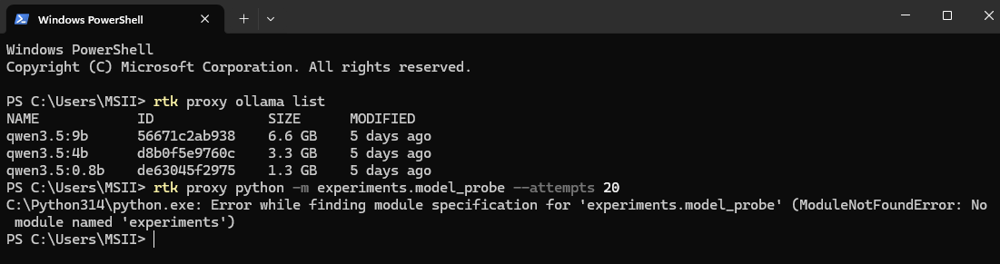
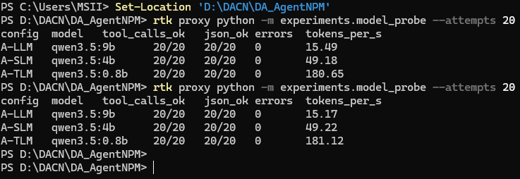

# Báo cáo tiến độ tuần 01 — AI Agent kiểm tra gói npm

**Thành viên:** Lê Đặng Thiên Phước · Phạm Minh Triết · Nguyễn Đình Thiên

**Giai đoạn:** Chốt nền tảng · **Ngày cập nhật:** 04/11/2026 · **Nghiệm thu:** TV2 Phạm Minh Triết, 04/11/2026

## 1. Nội dung buổi báo cáo tuần

Trong tuần 1, nhóm chốt nền tảng để các tuần sau có thể làm việc an toàn:

- Tạo kho mã nguồn. Cấu hình Git để không bao giờ đưa mẫu mã độc, file nén của gói và đầu ra chạy thử lên GitHub.
- Viết quy tắc an toàn chung cho cả nhóm (`AGENTS.md`): không chạy mã của gói npm trên máy thật, nội dung của gói luôn được xem là dữ liệu không tin cậy, quyết định cho phép hoặc chặn chỉ ở chế độ chạy thử.
- Tải ba mô hình chạy cục bộ qua Ollama để so sánh ba cỡ:

| Cấu hình | Mô hình | Dung lượng |
| --- | --- | --- |
| A-LLM | `qwen3.5:9b` | 6,6 GB |
| A-SLM | `qwen3.5:4b` | 3,3 GB |
| A-TLM | `qwen3.5:0.8b` | 1,3 GB |

- Viết bài thử nghiệm (probe): gọi mỗi mô hình 20 lần với công cụ giả. Mục đích là kiểm tra mô hình có biết gọi công cụ và trả JSON đúng định dạng không, trước khi cho nó đọc gói npm thật.

> *Góp ý của thầy trong buổi gặp tuần 1:* **[nhóm bổ sung theo ghi âm/ghi chép của buổi gặp]**. Báo cáo này không tự ghi nội dung trao đổi khi nhóm chưa xác nhận.

## 2. Demo bao nhiêu phần trăm (kèm ảnh)

Nhóm demo được **4/4 hạng mục của tuần 1 (100% phạm vi tuần 1)**. Con số này chỉ nói về phần nền tảng, chưa phải tiến độ toàn đồ án hay độ chính xác của AI.

| Hạng mục tuần 1 | Kết quả |
| --- | --- |
| Ba mô hình chạy được qua Ollama | Đạt: `ollama list` hiện đủ ba mô hình (Hình 1). |
| Khung kho mã và quy tắc Git | Đạt: mẫu độc, tarball và đầu ra chạy thử đều bị chặn khỏi Git. |
| Hợp đồng dữ liệu giữa các phần | Đạt: thống nhất định dạng kết quả của công cụ và định dạng kết luận. |
| Probe 20 lượt mỗi mô hình | Đạt (Hình 2). Chạy lại ngày 03/11 vẫn cho cùng kết quả. |

Kết quả probe chạy lại ngày 03/11/2026:

| Mô hình | Gọi công cụ đúng | JSON hợp lệ | Tốc độ |
| --- | --- | --- | --- |
| A-LLM | 20/20 | 20/20 | 14,95 token/giây |
| A-SLM | 20/20 | 20/20 | 49,14 token/giây |
| A-TLM | 20/20 | 20/20 | 177,31 token/giây |

Probe chỉ chứng minh mô hình **biết dùng công cụ**; nó không đo khả năng phát hiện mã độc.

**Hình 1.** Ba mô hình trong Ollama (ảnh chụp PowerShell ngày 28/10/2026).

**Hình 2.** Kết quả probe gọi công cụ (ảnh chụp ngày 28/10/2026).

## 3. Ảnh chụp lúc báo cáo

Nhóm **chưa có ảnh chụp thực tế buổi báo cáo tuần 1** để đính kèm. Hai ảnh ở mục 2 là ảnh kết quả làm việc, không phải ảnh buổi gặp. Nếu có ảnh, nhóm thêm vào `hinh-anh/` với tên `tuan-01-buoi-bao-cao.jpg`.

## 4. Đề xuất tuần 2 và cách thực hiện

- **Dữ liệu:** định nghĩa bảng nhãn 11 cột và quy tắc chia tập dev/test theo họ gói, để một họ không nằm ở cả hai tập.
- **Công cụ đọc gói an toàn:** tải gói bằng `npm pack --ignore-scripts`; giải nén có chặn đường dẫn nguy hiểm.
- **Định dạng kết luận:** dùng Pydantic để kiểm tra kết luận của mô hình.
- **Sandbox:** dựng môi trường Docker cách ly để thử với mẫu mô phỏng vô hại.

Ngoài ra, tuần 2 sẽ bắt đầu tìm ứng viên dữ liệu, nhưng chỉ đưa vào bảng nhãn những gói có bằng chứng `file:dòng`.

*Ghi chú đối chiếu sau (04/11/2026):* các hạng mục trên đã làm ở tuần 2–4; chi tiết ở [báo cáo tuần 2](BaoCaoTienDo_Tuan02.md) và [nhật ký tuần 1](../nhat-ky-tuan/tuan-01.md).
