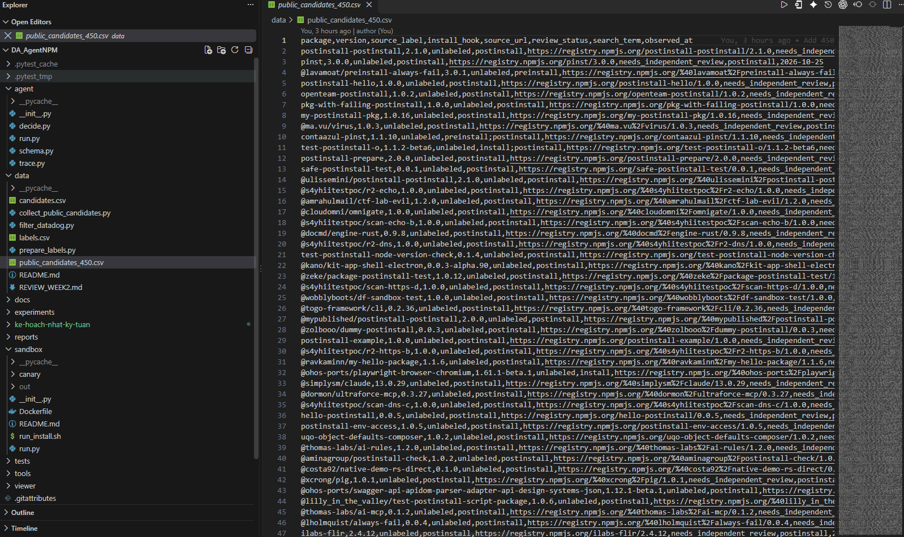

# Báo cáo tiến độ tuần 02 — AI Agent kiểm tra gói npm

**Thành viên:** Lê Đặng Thiên Phước · Phạm Minh Triết · Nguyễn Đình Thiên

**Giai đoạn:** Dữ liệu và hợp đồng công cụ · **Ngày báo cáo:** 25/10/2026 · **Cập nhật:** 04/11/2026 · **Nghiệm thu:** TV2 Phạm Minh Triết, 04/11/2026

## 1. Nội dung buổi báo cáo tuần

Trong tuần 2, nhóm tập trung chuẩn bị dữ liệu và xây dựng những phần đầu tiên để hệ thống có thể kiểm tra gói npm. Nhóm đã thử cách đọc thông tin của một gói mẫu trong môi trường an toàn và tổng hợp được danh sách **450 gói** kèm nguồn để tiếp tục xem xét.

Điểm nhóm còn kẹt là **chưa xác nhận gói nào lành hoặc độc** trong danh sách mới. Vì vậy, nhóm chưa thể dùng 450 gói này để đánh giá độ chính xác của hệ thống. Theo ghi nhận của nhóm, góp ý chính của thầy trong buổi báo cáo là cần tiếp tục tìm và hoàn thiện dữ liệu. Nhóm đã bổ sung số lượng ứng viên, còn bước quan trọng tiếp theo là kiểm tra và gán nhãn có bằng chứng.

## 2. Demo bao nhiêu phần trăm (kèm ảnh)

Nhóm có thể trình bày khoảng **75% nội dung dự kiến của tuần 2**: cho xem danh sách gói đã tìm được, cách hệ thống đọc một gói mẫu mà không chạy mã gói trên máy, và kết quả thử trong môi trường cách ly. Phần chưa thể demo như một kết quả hoàn chỉnh là đánh giá đúng/sai trên bộ dữ liệu đã được kiểm tra nhãn. Con số 75% chỉ tính trong phạm vi tuần 2, không phải tiến độ toàn đồ án.

*Hình 1: Màn hình VS Code khi nhóm mở `public_candidates_450.csv`. Các dòng đang hiển thị vẫn là `unlabeled`; đây là ảnh kết quả làm việc, không phải ảnh chụp lúc báo cáo.*

## 3. Ảnh chụp lúc báo cáo

Nhóm quên chụp ảnh trong buổi báo cáo nên **không có ảnh chụp thực tế** để đính kèm. Nhóm có file ghi âm buổi trao đổi và có thể cung cấp khi cần. Ảnh màn hình ở mục 2 chỉ minh họa kết quả làm việc, không được xem là ảnh chụp buổi gặp.

## 4. Đề xuất tuần 3 và 4, cách giải quyết và định hướng

**Tuần 3:** Nhóm sẽ chọn trước khoảng 20–30 gói trong danh sách để kiểm tra kỹ, thay vì chạy thử cả 450 gói. Phạm Minh Triết đối chiếu nguồn và nhãn; Lê Đặng Thiên Phước loại gói trùng, bổ sung gói đối chứng; Nguyễn Đình Thiên tiếp tục kiểm tra môi trường chạy cách ly. Gói nào thiếu bằng chứng sẽ giữ ở trạng thái chờ, không vội kết luận.

**Tuần 4:** Khi đã có một nhóm dữ liệu đáng tin, nhóm mới dùng chúng để đánh giá cách hệ thống phân tích và so sánh ba mô hình. Nhóm sẽ bổ sung công cụ hỗ trợ và ghi lại các trường hợp hệ thống nhận định sai để điều chỉnh. Việc thử nghiệm vẫn ưu tiên môi trường an toàn và chưa chạy hàng loạt trên 450 gói.

**Định hướng chung:** Ưu tiên **dữ liệu đúng và có thể kiểm tra lại** hơn là chỉ tăng số lượng. Mục tiêu tiếp theo là biến danh sách ứng viên thành bộ dữ liệu có nhãn rõ ràng, sau đó mới đo kết quả và mở rộng quy mô. Mã nguồn, dữ liệu và báo cáo tuần 02 đã được cập nhật trên GitHub.

## 5. Tiến độ sau buổi báo cáo (cập nhật 04/11/2026)

| Việc | Trạng thái |
| --- | --- |
| Đối chiếu metadata 450 ứng viên | Xong: 25 batch × 18 gói. 445 gói còn thông tin phát hành, 5 gói không còn. Danh sách vẫn chỉ là **ứng viên**, không tự trở thành nhãn. |
| Bảng nhãn có bằng chứng | 76 dòng: 20 lành, 2 nghi vấn, 54 độc hại. Mỗi dòng có nguồn và vị trí `file:dòng`. Chia dev/test theo họ gói, không họ nào nằm ở cả hai tập. |
| Phiếu kiểm tra chéo | Đã tạo 4 phiếu cho 4 lượt (20 + 18 + 18 + 20 = 76 dòng) trong `data/review_rounds/`. Công cụ kiểm tra phiếu từ chối các trường hợp: người duyệt chính là người gán nhãn, thiếu ngày, thiếu lý do loại dòng. |
| Bằng chứng cho người kiểm tra | Đã chuẩn bị đủ 4 lượt. Gói được đọc tĩnh trong container dùng một lần, mẫu độc không chạm máy thật. Cả 76/76 dòng không có lỗi tự động phát hiện: đúng tên và phiên bản, đúng hash, dòng trích dẫn có trong file. |
| Người kiểm tra chéo điền phiếu | **Đang chờ.** Đây là bước bắt buộc trước khi chốt **bộ nhãn v1** và tính Recall/F1. Hệ thống không tự điền thay người kiểm tra. |

**Giới hạn cần nói rõ với thầy.** Tập `test` hiện chủ yếu gồm một chiến dịch mã độc (`mut-4831`) và một họ gói lành (`esbuild`). Các phiên bản trong cùng một họ không độc lập với nhau, nên số mẫu "thật sự khác nhau" gần với số họ (3) hơn là số dòng (28). Nhóm sẽ bổ sung họ và chiến dịch mới **trước** khi chạy tập test, không đổi cách chia sau khi đã xem kết quả.
