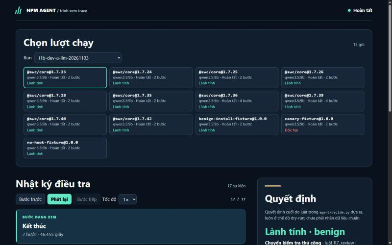
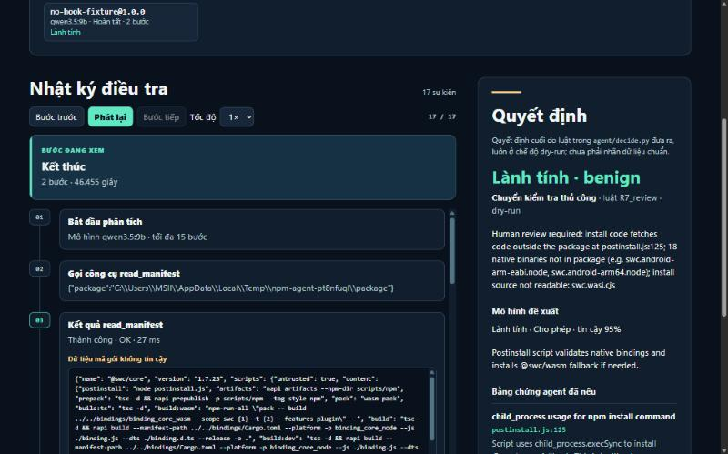
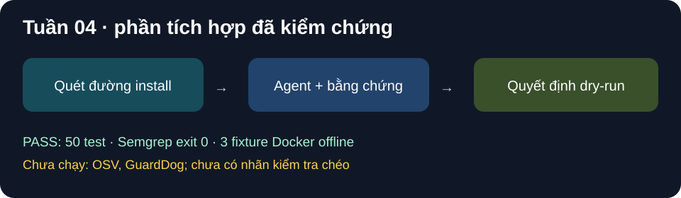

# Báo cáo tiến độ tuần 04 — AI Agent kiểm tra gói npm

**Thành viên:** Lê Đặng Thiên Phước (TV1) · Phạm Minh Triết (TV2, PO) · Nguyễn Đình Thiên (TV3)

**Giai đoạn:** Tích hợp công cụ tĩnh, chạy lô và baseline · **Ngày làm:** 03–04/11/2026 · **Cập nhật tình trạng:** 08/11/2026 · **Nghiệm thu:** TV2 Phạm Minh Triết, 04/11/2026

> Số liệu lấy từ lần chạy thật trên máy của nhóm (Ollama cục bộ, Python 3.14, Docker). Mỗi bảng ghi `run_id` để mở lại bằng trình xem trace (`py -3.14 -m viewer --reports reports`). Chi tiết lệnh và PASS/FAIL ở [nhật ký tuần 4](../nhat-ky-tuan/tuan-04.md).

## 1. Nội dung buổi báo cáo tuần

Tuần 4, nhóm đưa agent từ mẫu thử sang **gói npm thật** (chỉ gói lành; mẫu độc chỉ được đọc trong môi trường cách ly) và làm đủ các phần cần cho việc đánh giá:

1. **Công cụ bối cảnh** (`tools/intel.py`): tra cơ sở dữ liệu mã độc OSV (`MAL-…`) và thông tin phát hành trên npm Registry (phiên bản trước, script cài đặt mới xuất hiện, người duy trì, mã toàn vẹn); `diff_versions` so đường cài đặt của hai phiên bản.
   - Agent không tự gọi mạng: việc tra cứu chạy trước và lưu ra file.
   - OSV báo mã độc thì **không được tự động cho phép** (luật R5), nhưng tín hiệu này không bao giờ thay cho bằng chứng trong mã nguồn.
2. **Lớp hành động** (`tools/actions.py`, TV1-7): chỉ lập lệnh `npm approve-scripts`/`deny-scripts` ở chế độ chạy thử (dry-run); chạy thật bị chặn.
3. **Chạy lô** (`experiments/run_batch.py`, TV1-8): một gói lỗi không làm dừng lô; bị ngắt thì chạy tiếp từ chỗ dừng; mỗi lần chạy lưu `run_meta.json` (commit mã, phiên bản Python/Ollama, digest model, tham số, hash dữ liệu) để tái hiện.
4. **Baseline GuardDog** (TV3-4): GuardDog trên Windows báo "0 lỗi" giả vì bộ quét semgrep bên trong không chạy; nhóm đóng gói GuardDog 2.6.0 vào **container Linux tắt mạng**.
5. **Tính chỉ số** (`experiments/metrics.py`, TV3-5): confusion matrix, Precision, Recall, F1, tỷ lệ báo nhầm (FPR), tỷ lệ chuyển người xem, tỷ lệ kết luận hợp lệ. Lượt chạy lỗi vẫn nằm trong mẫu số.
6. **Cải thiện chất lượng I1–I4** (04/11): lý do quyết định cụ thể, model nhỏ ổn định hơn, đo tốc độ, tách mã cho dễ bảo trì.

> *Góp ý của thầy trong buổi gặp tuần 4:* **[nhóm bổ sung theo ghi chép buổi gặp]**. Báo cáo không tự ghi nội dung trao đổi khi nhóm chưa xác nhận.

## 2. Demo bao nhiêu phần trăm (kèm ảnh)

Nhóm demo được **5/6 phần dự kiến (≈ 83%)**. Phần còn thiếu là chỉ số trên mẫu độc, vì bộ nhãn chưa được người kiểm tra chéo (xem mục 4).

| Phần trình diễn | Kết quả |
| --- | --- |
| Agent chạy lô trên 10 bản `@swc/core` (gói lành thật, tập dev) và 3 gói thử, 3 model | **Đạt:** 39/39 lượt chạy xong, không lượt nào làm dừng lô; ngắt giữa chừng rồi chạy lại cùng `run_id` thì bỏ qua đúng 11 gói đã xong |
| Tra OSV và npm Registry | **Đạt:** 10/10 gói tra được, không có cảnh báo mã độc. Thử với gói độc đã biết `exnesss`: nhận đúng mã `MAL-2026-11518` |
| GuardDog baseline trong container | **Đạt:** 10/10 gói swc không bị báo nhầm. GuardDog **bỏ sót** gói thử đọc khóa SSH giả |
| Tính chỉ số | **Đạt** cho tập lành: FPR 0/10 với A-LLM và A-SLM |
| Lý do quyết định cụ thể (I1) | **Đạt:** 10/10 gói swc nêu đúng `postinstall.js:125`, 18 file `.node` thiếu và `swc.wasi.cjs` |
| Recall/F1 trên mẫu độc | **Chưa:** chờ bộ nhãn v1 được kiểm tra chéo |

**Kết quả trên 10 bản `@swc/core`** (`week4-dev-*-20261103`):

| Mô hình | Kết luận hợp lệ | Báo nhầm (FPR) | Quyết định | Giây/gói (trung vị) |
| --- | --- | --- | --- | --- |
| A-LLM (qwen3.5:9b) | 10/10 | 0/10 | cả 10 chuyển người xem | 50,7 |
| A-SLM (qwen3.5:4b) | 10/10 | 0/10 | cả 10 chuyển người xem | 17,2 |
| A-TLM (qwen3.5:0.8b) | 2/10 | 8/10 (8 lượt lỗi rơi về "nghi vấn", vẫn an toàn) | cả 10 chuyển người xem | 20,5 |
| GuardDog 2.6.0 | — | 0/10 | 10 gói không có cảnh báo | — |

**Vì sao không gói swc nào được tự động cho phép?** Script cài đặt của swc tự chạy `npm install` để tải thêm gói khác (`postinstall.js:125`) và cần 18 file nhị phân `.node` không có trong gói. Agent không thể xem hết những gì sẽ chạy, nên đúng nguyên tắc là chuyển người xem — và nay nêu rõ lý do.

**Kết quả cải thiện I2–I3 trên 13 gói dev** (`i3b-dev-*` so với `week4-dev-*`):

| Mô hình | Kết luận hợp lệ | Giây/gói trung vị | Hành động giữ nguyên |
| --- | --- | --- | --- |
| A-TLM | 3/13 → **13/13** | 20,5 → 8,4 (**−59%**) | 13/13 |
| A-SLM | 13/13 → 13/13 | 17,2 → 12,0 (**−30%**) | 12/13 |
| A-LLM | 13/13 → 13/13 | 50,7 → 82,2 (**chậm hơn**, xử lý ở tuần 5) | 13/13 |

**Hình 1.** Trình xem trace: lô 13 gói dev của A-LLM (`i1b-dev-a-llm-20261103`), mỗi ô là một gói với kết luận. Ảnh chụp màn hình thật, 08/11/2026.

**Hình 2.** Gói `@swc/core@1.7.23`: model đề xuất "Lành tính · cho phép · tin cậy 95%", nhưng **luật R7_review chuyển người xem** và nêu đủ lý do (tải mã ngoài gói ở `postinstall.js:125`, thiếu 18 file `.node`, không đọc được `swc.wasi.cjs`). Ảnh chụp màn hình thật.

**Hình 3.** Sơ đồ các phần đã tích hợp trong tuần 4 (hình tổng hợp, không phải ảnh chụp).

## 3. Ảnh chụp lúc báo cáo

Nhóm **chưa có ảnh chụp thực tế buổi báo cáo tuần 4**. Khi có, thêm `../hinh-anh/tuan-04-buoi-bao-cao.jpg` và cập nhật mục này.

## 4. Đã làm tốt hơn và còn vướng ở đâu

### Cải thiện có số đo (I1–I4, 04/11)

- **I1 — lý do quyết định cụ thể:** `extract_indicators` trả thêm danh sách lý do "chưa quét hết" (file `.node` thiếu, file nguồn không đọc được, chạm giới hạn); thêm chỉ báo `external_install` cho lệnh tải mã ngoài nằm trong mã nguồn. Lộ thêm một nguyên nhân thật trước đây bị che: `swc.wasi.cjs` không có trong gói.
- **I2 — model nhỏ ổn định hơn:** giới hạn độ dài ngay lúc sinh câu trả lời (mô tả ≤ 75 ký tự, tối đa 3 hành vi, số dòng sinh dạng số nguyên); định dạng kết luận không bị nới. A-TLM trên 3 gói thử × 3 lần: 2/9 → **9/9** hợp lệ.
- **I3 — tốc độ:** đạt với A-TLM (−59%) và A-SLM (−30%); A-LLM chậm hơn → đã tìm ra nguyên nhân và sửa ở tuần 5 (W5-8: Ollama chỉ đưa ~55% model lên GPU; thêm `num_gpu: 99` → 85,1 → 47,0 giây/gói).
- **I4 — dễ bảo trì:** tách hàm phân tích ~340 dòng thành các bước nhỏ (hàm dài nhất 51 dòng); thêm 5 test phát lại nguyên văn câu trả lời thật của model. Bộ kiểm thử: 99 → **115/115**.

### Còn vướng (stuck) — tình trạng ngày 08/11

| Vướng của tuần 4 | Tình trạng 08/11 | Hướng xử lý |
| --- | --- | --- |
| **Recall/F1 và so với GuardDog trên mẫu độc** | **Còn tắc.** Đã chuẩn bị 499 dòng nhãn (sau lọc trùng) kèm bằng chứng và ô kiểm tự động; 0 dòng đã được người kiểm tra | 3 người kiểm tra theo bảng phân công 15 lượt, hạn 17/11; đóng băng nhãn v1 ngày 19/11 |
| **GuardDog chỉ chạy được trên gói lành tải về máy** | **Đã gỡ:** `run_isolated --guarddog` chạy GuardDog trong container dùng một lần cho cả gói độc (tải và giải nén trong bộ nhớ container) | Đang quét 499 dòng; chấm điểm chính thức khi có nhãn v1 |
| A-LLM chậm (I3) | **Đã gỡ** ở tuần 5 (W5-8): 85,1 → 47,0 giây/gói, kết luận giữ nguyên 13/13 | — |
| Gộp lý do `.node` thiếu với "quét thiếu" chung | **Đã gỡ** (I1): lý do riêng, gộp thành một dòng | — |
| Lời gọi mạng của npm lẫn với của gói trong sandbox | **Đã gỡ** ở tuần 5 (W5-3): gắn tác nhân `npm`/`package` cho từng sự kiện | — |
| A-TLM (0.8b) yếu | Vẫn yếu khi bằng chứng bị kiểm chặt; mọi thất bại đều rơi về "chuyển người xem" (an toàn) | Dùng làm mốc so sánh trong báo cáo cuối, không triển khai |

## 5. Đề xuất tuần 5 (đã thực hiện) và việc tiếp theo

Đề xuất của tuần 4 cho tuần 5 và kết quả:

1. **Sandbox là việc chính:** kiểm tra giới hạn mạng, quyền, RAM, số tiến trình, thời gian; tách hành vi npm và gói; nối vào agent sau khi chứng minh cách ly → **đã làm** (xem [báo cáo tuần 5](BaoCaoTienDo_Tuan05.md)).
2. **Hoàn tất bộ nhãn v1** → **chưa xong**, chuyển thành việc chính của tuần 6–7 (kiểm tra chéo 499 dòng).
3. **Bổ sung dữ liệu cho tập test** (họ gói và chiến dịch mới) → **đã chuẩn bị:** 200 gói lành từ 450 ứng viên công khai và 240 mẫu độc thuộc 240 cụm khác nhau từ bộ Datadog, chờ kiểm tra chéo.
