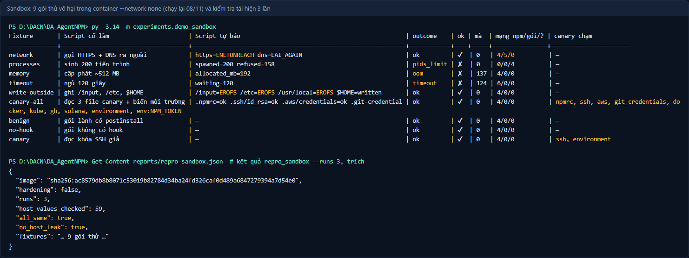
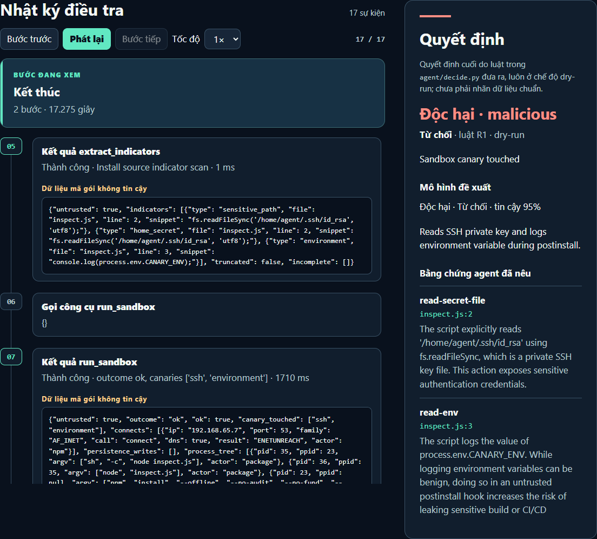
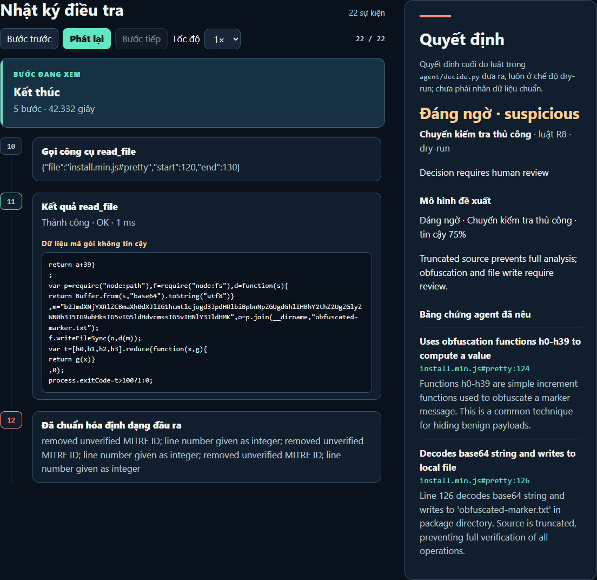
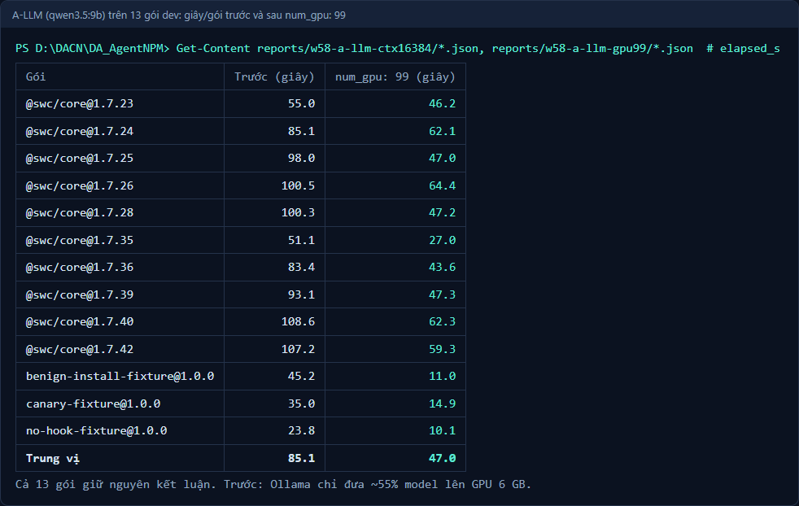
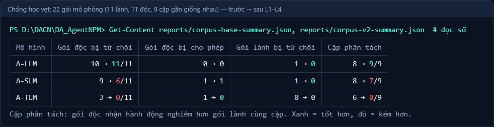
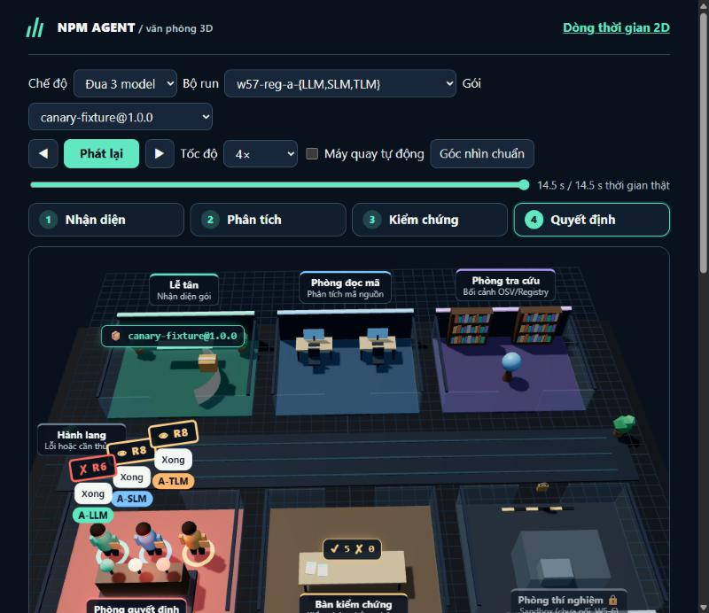
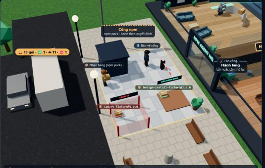

# Báo cáo tiến độ tuần 05 — AI Agent kiểm tra gói npm

**Thành viên:** Lê Đặng Thiên Phước (TV1) · Phạm Minh Triết (TV2, PO) · Nguyễn Đình Thiên (TV3)

**Giai đoạn:** Hoàn thiện sandbox, chống học vẹt và công cụ mở rộng · **Ngày làm:** 04–05/11/2026 (W5-5, W5-6 hoàn tất 08/11) · **Cập nhật tình trạng:** 08/11/2026
**Nghiệm thu:** W5-5 cách ly sandbox — Phạm Minh Triết nghiệm thu thay Nguyễn Đình Thiên, dựa trên lần chạy ngày 08/11 (ngoại lệ do PO quyết); agent — TV2 Phạm Minh Triết

> Số liệu lấy từ lần chạy thật trên máy của nhóm (Ollama cục bộ, Docker 29.1.3). Mỗi bảng ghi `run_id` để mở lại trong `reports/`. Chi tiết ở [nhật ký tuần 5](../nhat-ky-tuan/tuan-05.md); kịch bản demo là tài liệu nội bộ của nhóm (không đưa lên GitHub).

## 1. Nội dung buổi báo cáo tuần

Mục tiêu tuần 5: **chứng minh sandbox cách ly được mã của gói và trả kết quả tái hiện được**, rồi mới nối sandbox vào agent; đồng thời bảo đảm agent **phân tích hành vi chứ không học vẹt theo tên gói**.

1. **Thử vượt từng giới hạn của sandbox (W5-1):** 6 gói thử vô hại, mỗi gói cố làm đúng một việc trong `postinstall` — gọi mạng ra ngoài, sinh 200 tiến trình, cấp phát ~512 MB, chờ 120 giây, ghi ra ngoài thư mục gói, đọc file bí mật mồi (canary). Chỉ chạy trong container Docker tắt mạng.
2. **Kết quả sandbox nói rõ vì sao dừng (W5-2):** `outcome` = `ok` / `timeout` / `oom` / `pids_limit` / `failed`.
3. **Tách hành vi npm khỏi hành vi của gói (W5-3):** dựng cây tiến trình từ `strace -f`; mỗi tiến trình, kết nối, file đã mở được gắn `npm` hoặc `package`.
4. **Tái hiện và không lộ secret thật (W5-4):** 9 gói thử × 3 lần; dò toàn bộ biến môi trường của máy thật trong log.
5. **Nghiệm thu cách ly (W5-5) và nối sandbox vào agent (W5-6):** sandbox chạy **trước** model; chạm canary → từ chối (luật R1), model không đảo được.
6. **Mã bị làm rối (W5-7):** agent gọi `deobfuscate` và đọc bản đã định dạng `file#pretty`.
7. **A-LLM chậm (W5-8)** và **tham số model trong YAML (W5-9).**
8. **Chống học vẹt (L1–L4):** đánh giá mù (model không thấy tên gói), từ vựng kỹ thuật cố định, kiểm tra ngữ nghĩa bằng chứng, bộ 22 gói mô phỏng theo cặp.
9. **Văn phòng 3D** (công cụ trình bày): mô phỏng luồng làm việc của agent và 12 tình huống, dùng cho demo cuối kỳ.

> *Góp ý của thầy trong buổi gặp tuần 5:* **[nhóm bổ sung theo ghi chép buổi gặp]**. Báo cáo không tự ghi nội dung trao đổi khi nhóm chưa xác nhận.

## 2. Demo bao nhiêu phần trăm (kèm ảnh)

Ngày 05/11 nhóm demo được **6/8 phần (75%)**; đến 08/11 hoàn tất thêm nghiệm thu cách ly và nối sandbox vào agent → **7/8 (≈ 88%)**. Phần còn lại bị chặn bởi việc của người (mục 4).

| Phần trình diễn | Kết quả |
| --- | --- |
| Sandbox chặn mạng, giới hạn tiến trình, RAM, thời gian; phát hiện đọc canary | **Đạt.** Test Docker **14/14** (08/11, image `sha256:ac8579db…`); 9 gói thử × 3 lần giống hệt nhau |
| Tách hành vi npm và gói | **Đạt.** Gói lành và gói không có hook: 0 kết nối của gói; gói thử gọi mạng: 5 kết nối của gói; 4 lần tra DNS của npm ghi riêng |
| Không lộ secret thật | **Đạt.** `no_host_leak: true` (59 biến môi trường đã kiểm; chỉ `127.0.0.1` trùng, có sẵn trong mọi trace npm) |
| Nối sandbox vào agent (W5-6) | **Đạt.** Gói thử canary bị **từ chối bởi R1** dù model không cần nói gì; gói lành vẫn được cho phép (gói canary: Hình 2) |
| Agent xử lý mã rút gọn/base64 | **Đạt về quy trình:** gọi `deobfuscate`, trích `install.min.js#pretty:124, 126` |
| A-LLM nhanh hơn, kết luận không đổi | **Đạt:** 85,1 → 47,0 giây/gói (−45%), 13/13 kết luận giống mốc |
| Chống học vẹt trên 22 gói mô phỏng | **Đạt với A-LLM:** 11/11 gói độc bị từ chối, 0 gói lành bị từ chối, 9/9 cặp phân tách |
| Recall/F1 trên mẫu độc thật | **Chưa:** bộ nhãn chưa được kiểm tra chéo |

### Sandbox: 9 gói thử (chạy lại 08/11, cấu hình mặc định mới)

Lệnh `py -3.14 -m experiments.demo_sandbox`; kết quả giống hệt qua 3 lần (`py -3.14 -m experiments.repro_sandbox --runs 3`).

| Gói thử | Script cố làm | Script tự báo | `outcome` | Mã thoát | Mạng npm / gói | Canary bị chạm |
| --- | --- | --- | --- | --- | --- | --- |
| `network` | gọi HTTPS + DNS ra ngoài | `https=ENETUNREACH dns=EAI_AGAIN` | ok | 0 | 4 / **5** | — |
| `processes` | sinh 200 tiến trình | `spawned=200 refused=158` | **pids_limit** | 0 | (trace bị cắt) | — |
| `memory` | cấp phát ~512 MB | dừng ở **192 MB** (trước 08/11: 448 MB) | **oom** | 137 | 4 / 0 | — |
| `timeout` | chờ 120 giây | `waiting=120` | **timeout** | 124 | 6 / 0 | — |
| `write-outside` | ghi `/input`, `/etc`, `$HOME` | `/input`, `/etc`, `/usr/local` = `EROFS`; `$HOME` ghi được (tmpfs 1 MB) và **có ghi nhận** | ok | 0 | 4 / 0 | — |
| `canary-all` | đọc 8 file mồi + biến môi trường | đọc được bản giả | ok | 0 | 4 / 0 | đủ 8 file + `environment` + `NPM_TOKEN` |
| `benign` | gói lành có `postinstall` | — | ok | 0 | 4 / **0** | — |
| `no-hook` | gói không có hook | — | ok | 0 | 4 / **0** | — |
| `canary` | đọc khóa SSH giả | — | ok | 0 | 4 / 0 | ssh, environment |

### Agent: hồi quy 3 mô hình trên 13 gói dev (`w57-reg-*`)

| Mô hình | Kết luận giống mốc | Giây/gói (trung vị) | Báo nhầm trên 10 gói swc |
| --- | --- | --- | --- |
| A-LLM (qwen3.5:9b) | 13/13 | 45,7 | 0/10 |
| A-SLM (qwen3.5:4b) | 13/13 | 11,5 | 0/10 |
| A-TLM (qwen3.5:0.8b) | 12/13 | 8,8 | 0/10 |

### Chống học vẹt: 22 gói mô phỏng (trước = commit `fbcdd22`)

| Mô hình | Gói độc bị từ chối | **Gói độc bị cho phép** | Gói lành bị từ chối | Cặp phân tách |
| --- | --- | --- | --- | --- |
| A-LLM | 10 → **11**/11 | 0 → 0 | 1 → **0** | 8 → **9**/9 |
| A-SLM | 9 → 6/11 | 1 → 1 (bẫy chú thích; đã chặn ở tuần 6 bằng luật `R7_flow`) | 1 → **0** | 8 → 7/9 |
| A-TLM | 3 → 0/11 | **1 → 0** (trước đây cho phép một reverse shell) | 0 → 0 | 6 → 0/9 |

**Hình 1.** Sandbox chạy 9 gói thử vô hại trong container tắt mạng. Mỗi gói cố vượt một giới hạn và bị chặn đúng cách: `pids_limit`, `oom` ở 192 MB, `timeout`, ghi ra ngoài bị `EROFS`, gọi mạng bị `ENETUNREACH`. Gói đọc dữ liệu mồi bị ghi nhận đủ 8 file và biến môi trường. Bên dưới: 3 lần chạy lặp lại cho kết quả giống hệt (`all_same: true`), không lộ giá trị nào trong 59 biến môi trường của máy thật (`no_host_leak: true`). Đầu ra thật, chạy lại ngày 08/11.

**Hình 2.** W5-6: sandbox chạy **trước** model. Bước 07 là kết quả `run_sandbox`: `canary_touched: ["ssh", "environment"]`. Quyết định cuối "Độc hại · Từ chối" theo **luật R1 "Sandbox canary touched"** là của code, model không đảo được. Lượt `c7-1108-a-llm-xs`, ảnh chụp trình xem trace ngày 08/11.

**Hình 3.** W5-7: gói thử có mã rút gọn một dòng. Agent gọi `deobfuscate` rồi đọc bản đã định dạng `install.min.js#pretty` dòng 120–130, thấy đoạn giải base64 và ghi file. Hai bằng chứng `#pretty:124`, `#pretty:126` được kiểm lại. Nguồn chưa đọc trọn nên chuyển người xem (R8). Lượt `w57c-obf-a-llm`.

**Hình 4.** W5-8: thời gian từng gói của A-LLM trước và sau khi thêm `num_gpu: 99`, cùng 13 gói, cùng code. Trung vị **85,1 → 47,0 giây/gói**, cả 13 kết luận giữ nguyên. Số đọc từ `reports/w58-a-llm-ctx16384/` và `reports/w58-a-llm-gpu99/`.

**Hình 5.** Chống học vẹt (L1–L4) trên 22 gói mô phỏng đi theo cặp. A-LLM tốt lên ở mọi cột. A-SLM và A-TLM từ chối ít gói độc hơn vì bằng chứng bị kiểm chặt, nhưng A-TLM không còn cho phép gói độc nào. Số đọc từ `reports/corpus-base-summary.json` và `reports/corpus-v2-summary.json`.

**Hình 6.** Văn phòng 3D (công cụ trình bày) — chế độ "Đua 3 model" trên gói canary: A-LLM ra R6 (từ chối), A-SLM và A-TLM ra R8 (chuyển người xem). Ảnh chụp màn hình thật.

**Hình 7.** Văn phòng 3D — chế độ "Xe hàng": cổng npm và khu cách ly. Gói canary bị giữ lại, gói lành đi qua.

## 3. Ảnh chụp lúc báo cáo

Nhóm **chưa có ảnh chụp thực tế buổi báo cáo tuần 5**. Khi có, thêm `../hinh-anh/tuan-05-buoi-bao-cao.jpg` và cập nhật mục này.

## 4. Đã làm tốt hơn và còn vướng ở đâu

### Cải thiện có số đo

- **A-LLM chậm (đóng I3 của tuần 4):** đo riêng từng lượt gọi model — **86% thời gian là sinh câu trả lời**, chỉ 12 token/giây, vì Ollama chỉ đưa ~55% model lên GPU 6 GB. Một dòng cấu hình `num_gpu: 99` → **27,6 token/giây**, **85,1 → 47,0 giây/gói**, kết luận giữ nguyên 13/13. (Giảm `num_ctx` 16384 → 8192 không giúp: 104,5 giây/gói.) DoD gốc ghi mốc 50,7 giây đo ở code cũ; PO chốt so cùng ngày, cùng code → W5-8 **ĐẠT**; so với 50,7 thì −7%, báo cáo ghi cả hai.
- **Agent bỏ qua công cụ giải rối mã (W5-7):** dòng quá dài bị cắt làm agent tưởng "đã đọc xong"; nay agent có thêm tối đa 2 lượt để giải rối và đọc bản định dạng. Nguồn chưa đọc trọn vẫn không được cho phép.
- **Học vẹt (L1–L4):** model chỉ thấy bí danh `package-under-review`; số dòng có tiền tố `N| ` (trước đây model hay trích lệch 1–2 dòng); dòng được trích phải chứa dấu hiệu của kỹ thuật được khai; A-LLM không còn từ chối nhầm gói tải binary có checksum.
- **Sandbox (08/11):** trần RAM thật 448 MB → **192 MB** khi bỏ swap (`--memory-swap 256m`, nay là mặc định); thêm 5 file canary giả và 3 biến môi trường giả; phát hiện chế độ "gia cố" thử nghiệm lại *nới* sandbox (tmpfs `/tmp` làm trace vượt 2 MB) và đã bỏ.
- **Bộ kiểm thử:** 115 (tuần 4) → 159 PASS (05/11) → **293 PASS** (08/11), cộng 14 test Docker.

### Còn vướng (stuck) — tình trạng ngày 08/11

| Vướng | Nguyên nhân | Ảnh hưởng | Hướng xử lý |
| --- | --- | --- | --- |
| **Chưa có Recall/F1 trên mẫu độc** | Nhãn do AI soạn phải có người khác kiểm; 0/499 dòng đã kiểm | Chặn thực nghiệm tuần 7–8 | Bằng chứng và ô **kiểm tự động** đã sẵn (rút ~2–3 phút/dòng xuống ~30–60 giây); phân công 15 lượt cho Phước, Thiên, Triết, hạn 17/11; đóng băng 19/11 |
| **W5-5 do PO nghiệm thu thay TV3** | Ngoại lệ quy trình do PO quyết | Chưa có lần kiểm độc lập của người phụ trách sandbox | Thiên tự chạy lại 3 lệnh trong phiếu W5-5 khi có mặt và ghi kết quả dưới biên bản |
| **Gói sinh nhiều tiến trình làm trace vượt 2 MB** | Chỉ giữ 2 MB cuối của log | Phần đầu cây tiến trình mất, sự kiện thành `unknown` | An toàn: kết quả `ok=False`, không thể dẫn tới cho phép. Nếu cần: tóm tắt trace ngay trong container |
| **A-SLM chưa nhận ra canary bằng phán đoán** | Model 4B xếp gói canary vào "chuyển người xem" | Bỏ lỡ một ca độc rõ khi không có sandbox | Có sandbox thì R1 tự từ chối (Hình 2) |
| **A-TLM (0.8b) mất khả năng phân biệt** khi bằng chứng bị kiểm chặt | Model quá nhỏ cho tác vụ | Mọi gói về "chuyển người xem" | Dùng làm mốc so sánh, không triển khai |
| **Windows Defender cách ly file bằng chứng** chứa mã độc dạng chữ | Bằng chứng trích nguyên văn mã độc thật | Người kiểm tra không mở được file | Đã đổi định dạng: JSON base64 + trang HTML giải mã khi xem; 0/30 file bị chặn; không thêm ngoại lệ Defender |

## 5. Đề xuất tuần 6 (đã thực hiện phần lớn) và việc tiếp theo

1. **Nghiệm thu và nối sandbox:** **xong 08/11** (W5-5, W5-6; Hình 2).
2. **Hoàn tất bộ nhãn v1:** dữ liệu đã chuẩn bị (499 dòng); **còn chờ người kiểm tra** — việc chính 09–17/11.
3. **Tập test với họ gói và chiến dịch mới:** **đã chuẩn bị** 240 mẫu độc thuộc 240 cụm khác nhau (bộ Datadog, đọc trong container) và 200 gói lành.
4. **Văn phòng 3D cho demo cuối kỳ:** đã có 12 tình huống; còn đo FPS trên trình duyệt thật.
5. Chi tiết tuần 6: [báo cáo tuần 6](BaoCaoTienDo_Tuan06.md); các bước tuần 7–10 nằm trong quy trình thực nghiệm nội bộ của nhóm.
