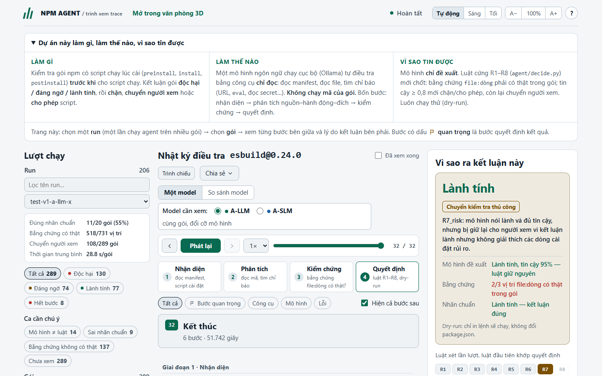
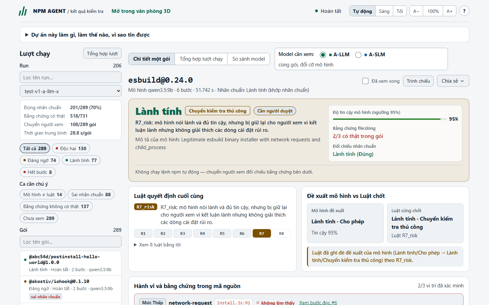
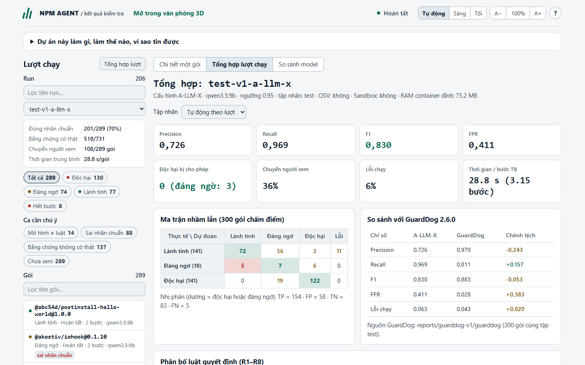
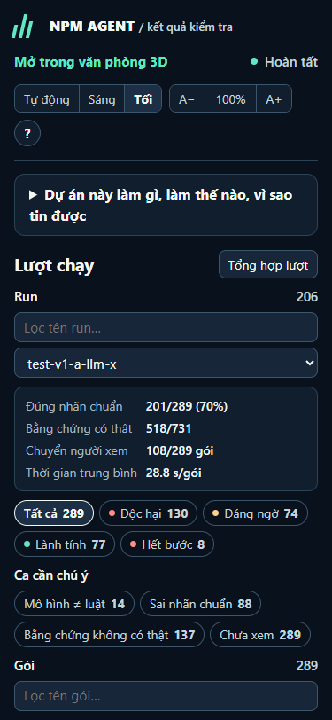
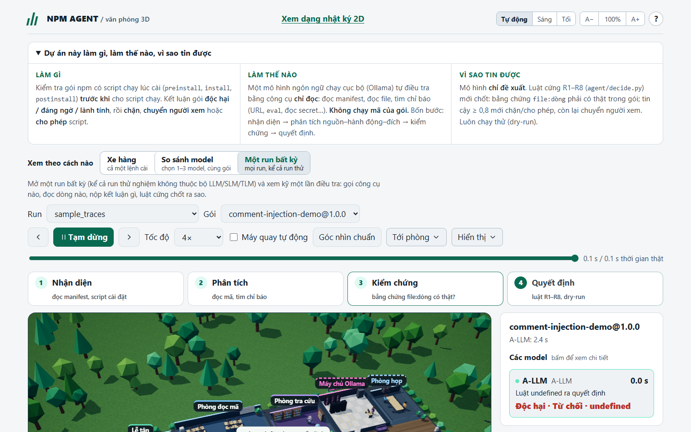
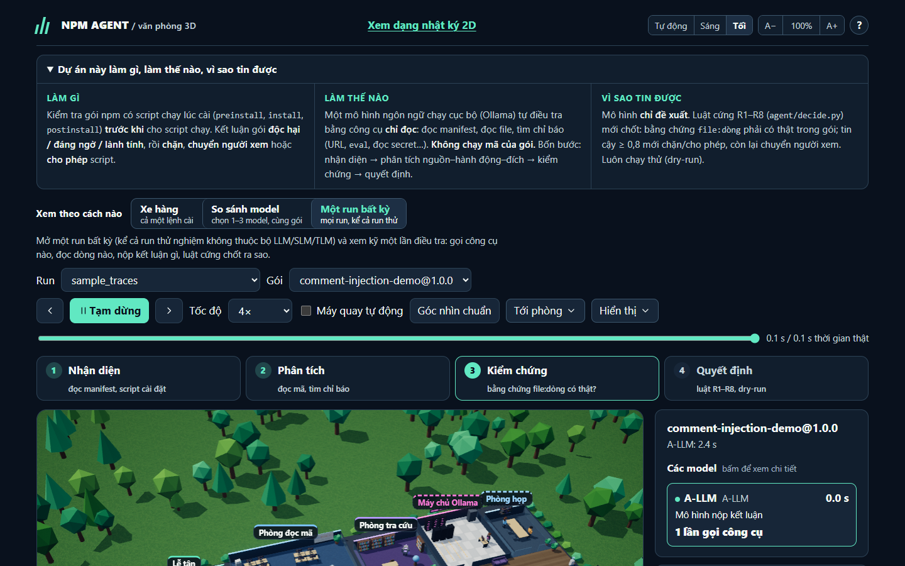

# Báo cáo tiến độ tuần 07 — Agent kiểm tra gói npm

**Thành viên:** Lê Đặng Thiên Phước · Phạm Minh Triết · Nguyễn Đình Thiên

**Giai đoạn:** Khắc phục góp ý sau tuần 6 và chuẩn bị mở rộng bộ dữ liệu · **Thời gian:** 23–29/11/2026 · **Ngày cập nhật:** 28/11/2026 · **Nghiệm thu:** TV2 Phạm Minh Triết (PO)

> Mọi số trong báo cáo lấy từ lần chạy thật, lưu trong `reports/`, `data/` và [nhật ký tuần 7](../nhat-ky-tuan/tuan-07.md).

## 1. Nội dung buổi báo cáo tuần

### 1.1. Tóm tắt: đã làm gì, làm thế nào, kết quả

| Việc | Làm thế nào | Kết quả |
| --- | --- | --- |
| Thiết kế lại giao diện 2D (góp ý 1) | Làm trang kết quả một gói (trả lời trong 10 giây) và trang tổng hợp lượt chạy dùng lại `experiments.metrics` (`score`, `load_results`) qua `GET /api/runs/<run>/summary` và `/api/package-extra` | Mở được mọi lượt `test-v1-*`; trang một gói 393 ms, trang tổng hợp 230 ms trên 300 gói (mục 4.1) |
| Sửa lỗi trình xem và văn phòng 3D | Sửa kiểm tra `run_id = "run"` trong `viewer/server.py` (`_same_run`); sửa nhãn `"undefined"` ở `viewer/static/office/` khi trace cũ thiếu `rule` | Trace cũ `test-v1-*` mở bình thường; 3D hết lỗi `"undefined"` (Hình 3–4) |
| An toàn và tiếp cận trình xem (WCAG 2.2) | Kiểm tự động bằng trình duyệt với trace bẫy XSS, chế độ sáng/tối và màn hình 375 px | 0 phần tử HTML thực thi XSS; 0 nút < 24 px; 0 lỗi tương phản < 4,5; không tràn ngang ở 375 px |
| Nháp bộ dữ liệu `labels-v2` (góp ý 2, pha 1) | Kiểm lại commit Datadog (`72c723be…`), đọc 1.300 ZIP năm 2025–2026 trong container (`datadog_container.py`), thu thập hai lượt gói lành phổ biến (`collect_public_candidates.py` + `triage_candidates.py`, `>= 20.000` và `>= 3.000` lượt tải/tháng), đối chiếu OSV theo `name@version`, giữ 30 mẫu đáng ngờ v1, chia cụm `train/dev/test` và gắn `time_split` (mốc `2026-03-02`) | Đã dựng `data/labels-v2-draft.csv`: **1.411** gói (600 độc / 781 lành / 30 đáng ngờ; `train` 702 / `dev` 281 / `test` 428; 0 rò rỉ cụm; tập `test` sau mốc: 50) (mục 4.2) |
| Khảo sát khả thi QLoRA `Qwen3.5-4B` (góp ý 2) | Đo VRAM trống, RAM, dung lượng đĩa, phiên bản Python/WSL2 và phân bố token trên 289 trace `test-v1-a-llm-x`; viết sẵn script trích mẫu huấn luyện từ tập `train` (`experiments/extract_sft.py`) | Kết luận khả thi có điều kiện ở ngữ cảnh `2.048–3.072` (tối đa `4.096` qua WSL2/Unsloth); script trích mẫu qua 4/4 test đơn vị, chặn tuyệt đối `dev`/`test` (mục 4.3) |
| Kiểm thử toàn repo | `py -3.14 -m pytest -q` và `node --test tests/js/*.test.mjs` | **370 passed, 18 skipped** (Docker giữ skip khi chưa bật cờ); JS **34/34 passed** |

### 1.2. Đối chiếu hai góp ý trọng tâm của thầy sau tuần 6

| Góp ý của thầy | Việc đã thực hiện trong tuần 7 | Phần còn chờ bước kế tiếp |
| --- | --- | --- |
| **(1) Cải thiện frontend trực quan, chuẩn xác, chuyên nghiệp** | Đã hoàn tất thiết kế lại 2D (trang một gói + trang tổng hợp), sửa lỗi `run_id` và `"undefined"`, kiểm WCAG 2.2 sáng/tối/375 px, XSS và tốc độ 300 gói | Trang so sánh nhiều cấu hình và trang danh sách ca sai chuyên sâu theo lịch tuần 8 |
| **(2) Nâng cấp bộ dữ liệu `labels-v2` (có mẫu 2025–2026, chia train/dev/test) và cải thiện mô hình nhỏ (SLM)** | Đã thu thập và tạo nháp `labels-v2` (600 mẫu độc 2025–2026 từ Datadog, trong đó 547/600 khớp `MAL-` trên OSV, chia cụm không rò rỉ `test` v1 vào `train` v2); hoàn thành khảo sát khả thi QLoRA 4B trên RTX 3050 6 GB và viết sẵn script trích mẫu SFT | Đợi PO duyệt đóng băng `labels-v2`, duyệt môi trường cài thư viện huấn luyện để chạy thử 10 bước đo thật rồi mới huấn luyện `A-SLM-FT` |

## 2. Mức độ hoàn thành kế hoạch tuần 7

| Hạng mục tuần 7 (theo kế hoạch) | Trạng thái | Kết quả / Ghi chú |
| --- | --- | --- |
| Thiết kế lại frontend 2D (trang một gói, trang tổng hợp, sửa `run_id`, `"undefined"`) | **Hoàn thành** | Commit `a394079`; mở được `test-v1-*`, có ảnh trước/sau và kết quả kiểm thử |
| `labels-v2`: thu thập ứng viên (Datadog mới nhất, gói lành phổ biến), kiểm tĩnh trong container, chia `train/dev/test` | **Hoàn thành bản nháp** | Đã có `data/labels-v2-draft.csv` (**1.411** dòng: 600 độc / 781 lành / 30 đáng ngờ) và `README-v2-draft.md`; chờ PO mở Gate đóng băng |
| Thử khả thi QLoRA 4B trên GPU 6 GB | **Hoàn thành bước khảo sát đo máy** | Có `docs/ke-hoach/KHA_THI_QLORA_4B.md` và script trích mẫu `experiments/extract_sft.py`; chưa cài thư viện huấn luyện (chờ Gate môi trường) |
| Chạy `-XS` trên `dev` v1, sửa sandbox nhóm A/F | **Chưa chạy** | Đã ghi rõ nguyên nhân nhóm A/F từ tuần 6; chờ mở Gate riêng cho `sandbox/` và xác nhận chạy lô GPU |
| 3 phiếu kiểm chéo mù v1 | **Chờ thành viên điền phiếu** | Đã có sẵn phiếu `data/review_rounds/blind-v1/phieu-*.csv` |

## 3. Ảnh chụp giao diện trước và sau thiết kế lại

**Hình 1–2.** Trang trình xem trước thiết kế lại (chỉ thấy nhật ký thô từng bước) và trang kết quả một gói sau thiết kế lại (tóm tắt kết luận, luật quyết định R1–R8 bằng lời, hành vi theo bộ ba *Nguồn → Hành động → Đích* kèm dòng mã trích dẫn, tín hiệu OSV/sandbox).

**Hình 3–4.** Trang tổng hợp một lượt chạy `test-v1-a-llm-x` (300 gói: ma trận nhầm lẫn, P/R/F1/FPR, đối chiếu GuardDog, phân bố luật, lọc ca sai) và kiểm tra giao diện sáng ở màn hình di động `375 px`.

**Hình 5–6.** Văn phòng 3D trước và sau khi sửa lỗi hiển thị chữ `"undefined"` cạnh nhãn quyết định trên trace cũ thiếu trường `rule`.

## 4. Kết quả chi tiết

### 4.1. Trình xem 2D, API tổng hợp và kiểm thử giao diện

- **Cơ chế tổng hợp số liệu:** `GET /api/runs/<run>/summary` đọc trực tiếp kết quả bằng `experiments.metrics.load_results` và `score`, tự xác định `split` khớp với `data/labels-v1.csv`, đối chiếu kết quả GuardDog (`reports/guarddog-dev-v1`, `guarddog-test-v1`), thống kê luật `R1–R8` và trả danh sách ca sai kèm phân loại (`false_positive`, `review_benign`, `false_negative`, `error`).
- **Thông tin bổ trợ theo gói:** `GET /api/package-extra` đọc tín hiệu OSV, Registry và sandbox đã ghi trong `reports/` (không gọi mạng ra ngoài).
- **An toàn giữ nguyên:** máy chủ chỉ nghe `127.0.0.1`, chỉ chấp nhận `GET`/`HEAD`, hiển thị toàn bộ nội dung gói qua `textContent`, giải mã `*_b64` trong bộ nhớ (`decode_fields`), không có nút chạy mã hay kích hoạt agent từ trình duyệt.

| Hạng mục kiểm tra | Điều kiện đo | Kết quả đo được |
| --- | --- | --- |
| API liệt kê danh sách gói (`_packages`) | Lượt 300 gói `test-v1-a-llm-x` | **0,168 giây** |
| Thời gian tải trang một gói | Trình duyệt cục bộ (`127.0.0.1:8765`) | **393 ms** |
| Thời gian tải trang tổng hợp lượt chạy | Lượt 300 gói `test-v1-a-llm-x` | **230 ms** |
| Kiểm tra bẫy XSS | Trace mẫu `comment-injection-demo@1.0.0` có `` | Hiện nguyên dạng chữ (`0 `, `0 dialog`) |
| Kiểm tra WCAG 2.2 | Chế độ tối, chế độ sáng (`tuan-07-viewer-sau-sang.png`) và `375 px` | **0** nút < 24 px, **0** lỗi tương phản < 4,5, `scrollWidth == clientWidth == 375` |

### 4.2. Nháp bộ dữ liệu `labels-v2` (pha 1 — chưa đóng băng)

Kho Datadog (`DataDog/malicious-software-packages-dataset`, commit `main` giữ nguyên `72c723be547033c558244520524b117c8d71663b`) được rà soát **1.300** tệp ZIP năm 2025–2026 bên trong container chỉ đọc (`python:3.12-slim`, không giải nén ra máy thật). Đối chiếu OSV được thực hiện bằng tên và phiên bản (`name@version`) vào `data/osv-v2-cache.json`. Gói lành phổ biến (từ **3.009** đến **1.827.646.475** lượt tải/tháng) được lọc manifest qua hai lượt (`v2` `>= 20.000`/tháng: 386 gói; `v2b` `>= 3.000`/tháng: 167 gói), sau đó kiểm `sha512` và phân loại tĩnh trong container dùng một lần (`v2`: 158 nhóm A, 157 nhóm B, 71 nhóm C; `v2b`: 57 nhóm A, 82 nhóm B, 28 nhóm C — chỉ nhận `A`/`B`).

| Chiều thống kê (`data/labels-v2-draft.csv`) | Số lượng | Ghi chú kiểm chứng |
| --- | ---: | --- |
| **Tổng số dòng** | **1.411** | Nguồn: `data/README-v2-draft.md` |
| Nhãn `malicious` (Datadog 2025–2026) | **600** | 2025: **340** · 2026: **260** · Đối chiếu OSV mã `MAL-`: **547/600** |
| Nhãn `benign` (chỉ nhóm A/B, OSV không có `MAL-`) | **781** | `npm-popular` (`v2` + `v2b`): **406** · `npm-search` (chưa dùng ở v1): **375** |
| Nhãn `suspicious` (giữ nguyên từ `labels-v1`) | **30** | Giữ nguyên theo kế hoạch |
| Chia tập theo cụm (`train` / `dev` / `test`) | **702 / 281 / 428** | **0** cụm nằm ở hai tập; **0** tên/cụm `test` v1 rơi vào `train` v2; **0** trùng khóa v1 |
| Cờ `time_split` (mốc `2026-03-02`) | `after`: **175** · `before`: **425** · `unknown`: **811** | Tập `test` theo thời gian (`split == test` và `time_split == after`): **50** gói |

### 4.3. Khảo sát khả thi QLoRA `Qwen3.5-4B` và chuẩn bị script trích mẫu

Số đo phần cứng thật trên máy thử nghiệm và độ dài hội thoại đo trực tiếp từ **289** trace của `test-v1-a-llm-x`:

| Hạng mục đo | Giá trị thực tế | Nhận định kỹ thuật |
| --- | --- | --- |
| GPU / VRAM | `RTX 3050 6GB Laptop GPU` (`6.001 / 6.144 MiB` trống) | Thực tế còn ~`5,2–5,5 GB` khả dụng dưới Windows |
| RAM / Đĩa trống | RAM `16,0 GB` · Ổ `D:` trống `109,5 GB` | Đủ merge LoRA trên CPU; toàn bộ cache/checkpoint đặt ở ổ `D:` |
| Môi trường phần mềm | Python `3.14`, `3.13`; đã bật `WSL2`; Ollama sẵn `qwen3.5:4b` (`Q4_K_M`, `3,3 GB`) | Wheel `bitsandbytes`/Unsloth ổn định hơn trên `Python 3.11–3.12` hoặc `WSL2 Ubuntu` |
| Độ dài token thực tế (289 trace) | `prompt_tokens/bước`: trung vị **1.973**, p95 **3.367**; `prompt_tokens` cả lượt: trung vị **5.398**, p95 **21.267**, max **67.865** | Khả thi ở mức ngữ cảnh **2.048–3.072** (tối đa **4.096** qua Unsloth/WSL2); có phương án dự phòng `0.8B` nếu vượt trần |
| Script trích mẫu huấn luyện | `experiments/extract_sft.py` + `tests/test_extract_sft.py` | Chỉ nhận `split == "train"`, `final_label == nhãn thật`, mọi bằng chứng `exists == true`; bỏ kiểm chứng nội bộ `Evidence check` và làm mù tên gói (`BLIND_ALIAS`); **4/4** test đơn vị `PASS` |

## 5. Vướng mắc

| Vướng mắc | Mức độ | Hướng xử lý |
| --- | --- | --- |
| Tập mẫu lành phổ biến `>= 20.000`/tháng chỉ có ~2,4% gói mang install script (`386/16.153`) | Đã giải quyết phần nháp | Chạy thêm lượt `v2b` (`>= 3.000`/tháng, thêm `167` gói, nhận `139` nhóm A/B) nâng tập lành nháp lên **781** (tổng **1.411** dòng) |
| 1 tệp metadata lô Datadog (`candidates-v2-batch-005.jsonl`) bị Windows Defender khóa đọc trên máy chủ (`Errno 22`) | Nhẹ | Không tắt hay thêm ngoại lệ Defender; `load_datadog_v2` bỏ qua có cảnh báo tệp bị khóa, 12 lô còn lại vẫn đủ **727** mẫu sạch → **600** mẫu độc sau lọc cụm |
| Chưa có môi trường Python `3.11–3.12` / thư viện QLoRA để đo 10 bước thật | **Đáng kể** | Chờ PO duyệt Gate cài venv tách biệt (ưu tiên WSL2/Docker CUDA hoặc Python 3.12 trên ổ `D:`) |
| Chưa chạy lại sandbox nhóm A/F (33 gói thiếu) và cấu hình `-XS` trên `dev` v1 | **Đáng kể** | Chờ mở Gate riêng cho `sandbox/`, sửa trên repo rồi thao tác chạy lại trong máy ảo VMware |
| Kiểm chéo nhãn v1 (60 gói) chưa có phiếu điền từ 3 thành viên | **Đáng kể** | Các thành viên tự điền `data/review_rounds/blind-v1/phieu-*.csv`, sau đó chấm bằng `blind_review.py` |

## 6. Đề xuất tuần 8 và cách thực hiện

| Việc ưu tiên | Điều kiện thực hiện | Kết quả kỳ vọng |
| --- | --- | --- |
| Hoàn thiện bản nháp và đóng băng `data/labels-v2.csv` + `labels-v2-review.csv` | PO duyệt Gate đóng băng `labels-v2` | ~1.430–1.500 gói (`train` / `dev` / `test`), đủ nhãn và `time_split` |
| Sửa `sandbox/` nhóm A/F và chạy lại `sbx-dev-v1b` / `sbx-test-v1b` trong VM | PO mở Gate `sandbox/` + thao tác trên VM Ubuntu | Tăng độ phủ sandbox > 86,6%, có mã lỗi rõ cho nhóm F |
| Chạy `A-LLM-XS` trên `dev` v1, chọn ngưỡng (Gate), chạy `test` v1 | PO xác nhận chạy lô GPU | Bảng đối chiếu có / không sandbox (P/R/F1/FPR, số gói đổi quyết định) |
| Mở Gate cài môi trường QLoRA 4B (đo 10 bước), chạy `A-LLM-X` trên `train` v2 và huấn luyện `A-SLM-FT` | PO duyệt cài môi trường và chạy lô GPU dài | Checkpoint/tag `A-SLM-FT` trong Ollama, chọn ngưỡng trên `dev` v2 |
| Giao diện: thêm trang so sánh cấu hình và trang ca sai trên trình xem 2D | Trình xem 2D sẵn sàng | Đọc trực tiếp các lượt chạy thật trong `reports/` |
