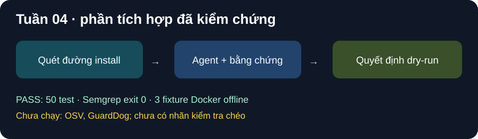

# Tuần 04 — Tích hợp công cụ tĩnh và baseline

## Kế hoạch

- [x] Nối công cụ đọc/quét tĩnh vào agent sau khi hợp đồng JSON ổn định.
- [x] Bổ sung công cụ bối cảnh như OSV, metadata và so phiên bản theo phạm vi đã chốt; không dùng nhãn bối cảnh làm bằng chứng duy nhất.
- [x] Chạy GuardDog làm baseline trên dữ liệu đã chuẩn bị (TV3-4) — trên tập dev nhỏ được PO cho phép; tập đầy đủ chờ nhãn v1.

## Mốc nghiệm thu

Agent hoàn thành ca phân tích tĩnh trên tập dev nhỏ; lưu kết quả GuardDog cùng phiên bản và lệnh chạy.

## Nhật ký

- Ngày / người thực hiện / người kiểm tra: 2026-10-25 / Codex / chờ TV2 review `agent/run.py`.
- **PASS:** Agent tự chạy `extract_indicators` trước lượt model, xác định đường install và dependency cục bộ tối đa hai cấp; trường hợp quét thiếu không tự approve. Prompt yêu cầu nguồn–hành động–đích và từ chối mã MITRE không có bằng chứng.
- **Kiểm chứng:** pytest toàn repo 50 PASS ngoài sandbox hệ thống; Semgrep `--config auto --error` exit 0. Ba model có một lượt verdict hợp lệ trên fixture lành, không chứng minh accuracy hay độ ổn định.
- **NOT_RUN / BLOCKED:** OSV, metadata, `diff_versions` và GuardDog chưa triển khai/chạy. Không có dữ liệu nhãn kiểm tra chéo để đo baseline. Chưa đạt mốc nghiệm thu đầy đủ của tuần 4.
- **Bước tiếp:** TV2 review thay đổi `agent/run.py`; hoàn tất nhãn tuần 2, sau đó thêm công cụ bối cảnh tối thiểu và GuardDog baseline trên tập đã duyệt.

## Ảnh kết quả

*Hình SVG tổng hợp kết quả test; không phải ảnh chụp màn hình hay phép đo trên gói thật.*

## Cập nhật 2026-11-03 — hoàn thành tuần 4 và các task còn nợ (Claude)

- **Ngày / người thực hiện / người kiểm tra:** 2026-11-03 / Claude theo Gate B0 “công việc tuần 4” / chờ TV2 review agent và quyết định, TV3 review baseline và metrics.
- **Đã làm (99 test PASS, Semgrep `--config auto --error` exit 0, `git diff --check` PASS):**
  - `tools/intel.py`:
    - tra OSV (cờ `MAL-`) và npm Registry (phiên bản trước, hook mới, maintainer, integrity), chỉ qua HTTPS tới hai host cố định;
    - `diff_versions` so tĩnh đường install của hai phiên bản.

    Agent chỉ đọc file context; OSV MAL chặn approve qua R5 nhưng không bao giờ là bằng chứng.
  - `tools/actions.py` (TV1-7): `apply_decision` chỉ lập lệnh `npm approve-scripts`/`deny-scripts` ở dry-run; `dry_run=False` bị từ chối.
  - `experiments/run_batch.py` (TV1-8): có resume, `run_meta.json` (commit, Python, phiên bản Ollama, digest model, tham số chat, hash dataset); một gói lỗi không làm dừng lô; dòng không phải `benign` bị chặn trên host.
  - `experiments/baseline_guarddog.py` + `experiments/guarddog/Dockerfile` (TV3-4).
  - `experiments/metrics.py` (TV3-5).
- **GuardDog:** bản pip trên Windows không dùng được. Bản mới nhất không cài được (`nono-py` không build). Bản 2.6.0 cài được nhưng semgrep thoát với mã 2 và GuardDog bỏ qua đường dẫn chứa `tests`, nên "0 issue" là kết quả giả. Vì vậy chuyển sang image `agent-npm-guarddog:2.6.0`, quét `--network none`, mount chỉ đọc. Kiểm chứng trên gói probe tổng hợp: bắt được `npm-exec-base64` ở `index.js:2`.
- **PASS — mốc nghiệm thu "agent hoàn thành ca phân tích tĩnh trên tập dev nhỏ":** tập gồm 10 bản `@swc/core` thuộc `dev` (`npm pack --ignore-scripts`, không chạy hook) cùng 3 fixture, chạy 3 model qua `run_batch`. Context OSV/Registry 10/10 OK, không có MAL, không có hook mới.

| Hệ thống (run) | 10 swc lành: dự đoán | FPR | Verdict hợp lệ | Bước TB | Giây/gói TB | 3 fixture |
| --- | --- | --- | --- | --- | --- | --- |
| A-LLM (`week4-dev-a-llm-20261103`) | 10 benign, cả 10 `review` (R7_review) | 0/10 | 10/10 | 2.8 | 71.5 | approve / deny / review |
| A-SLM (`week4-dev-a-slm-20261103`) | 10 benign, cả 10 `review` (R7_review) | 0/10 | 10/10 | 3.5 | 23.1 | approve / deny / review (R8) |
| A-TLM (`week4-dev-a-tlm-20261103`) | 2 benign, 8 fallback `suspicious` (R2) | 8/10 | 2/10 | 6.3 | 27.9 | approve / R2 / R2 |
| GuardDog 2.6.0 (`week4-dev-20261103/guarddog`) | 10 benign (0 issue) | 0/10 | — | — | — | 0 issue cả ba (bỏ sót canary) |

- **Đọc kết quả cho đúng:**
  - swc luôn ra `review` vì `postinstall.js:125` tự chạy `npm install` để tải gói khác khi cài, và `binding.js` require file `.node` nằm ngoài tarball. Agent không thể xem hết đường install, nên không được tự approve.
  - Tập chỉ có gói lành nên **không có Recall**. FPR 0/10 trên một họ gói không phải ước lượng tổng quát.
  - A-TLM chưa ổn định (verdict hợp lệ 2/10), nhưng mọi thất bại đều rơi về `review` an toàn.
- **Còn lại, chuyển có kiểm soát sang tuần 5–8 (không phải nợ kỹ thuật tuần 4):**
  - đo Recall/F1 và so với GuardDog trên mẫu độc: cần nhãn v1 đã kiểm tra chéo và chạy trong VM;
  - phân biệt `.node` của gói phụ với "quét thiếu" chung;
  - tách lời gọi mạng của npm khỏi lời gọi của gói trong sandbox.

## Nghiệm thu ngày 2026-11-04

- **TV2 Phạm Minh Triết** xác nhận trong chat đã review code agent và **ký nghiệm thu tuần 04**. Claude ghi lại theo lời PO, không ký thay.

## Cải thiện chất lượng I1–I4 ngày 2026-11-04 (Claude)

*Ghi ở tuần 4 vì đồ án đang ở tuần 4; phạm vi theo kế hoạch cải thiện.*

### I1 — lý do quyết định cụ thể

- **Ngày / người thực hiện / người kiểm tra:** 2026-11-04 / Claude, cải thiện I1 theo kế hoạch cải thiện và Gate B0 ngày 03/11 / chờ TV2 review.
- **Đã làm (I1 — lý do quyết định cụ thể; không đổi luật approve/deny, không đổi schema):**
  - `extract_indicators` trả thêm `incomplete`: các file `.node` không có trong gói (gộp thành một dòng), file nguồn không đọc được, chạm giới hạn độ sâu require, 30 chỉ báo hoặc 100 file.
  - Chỉ báo mới `external_install` cho lệnh tải mã ngoài nằm trong mã nguồn, ví dụ ``execSync(`npm install …`)``.
  - `R7_review` liệt kê nguyên nhân, kể cả dòng hook trong `package.json` gọi mã ngoài gói.
- **Kiểm chứng:** pytest 99 → **104 PASS**; Semgrep `--config auto --error` exit 0; `git diff --check` PASS.
- **Số đo trước/sau trên 13 gói dev (10 `@swc/core` + 3 fixture):**

| Chỉ số | Trước (`week4-dev-*`) | Sau (`i1b-dev-*`) |
| --- | --- | --- |
| swc ra `review` có lý do nêu `postinstall.js:125` và file `.node` thiếu | 0/10 (chỉ ghi "Install path not fully reviewed") | A-LLM 10/10, A-SLM 10/10 |
| Giữ nguyên nhãn, hành động, luật cuối | — | A-LLM 13/13; A-SLM 12/13 |
| Bước TB / giây trung vị mỗi gói | A-LLM 2.8 / 49.9; A-SLM 3.5 / 15.6 | A-LLM 2.3 / 46.3; A-SLM 3.5 / 28.5 |

- **Ghi chú trung thực:**
  - Ca lệch duy nhất là A-SLM trên fixture no-hook: từ `suspicious/review` (R8) sang `benign/review` (R7_review). Hành động vẫn là `review`. Nhãn đổi vì danh sách chỉ báo gửi cho model nay có thêm trường `incomplete`, nên model đề xuất khác; luật quyết định không đổi.
  - Lý do mới làm lộ thêm một nguyên nhân thật trước đây bị che: `swc.wasi.cjs` không có trong tarball.
  - Thời gian A-SLM tăng chủ yếu do máy đang chạy song song việc khác; chưa kết luận về tốc độ (việc của I3).
  - Lô A-LLM bị ngắt hai lần khi phiên làm việc khởi động lại; chạy lại cùng `run_id` đã bỏ qua 11 gói xong và chỉ chạy 2 gói còn lại, xác nhận cơ chế resume của `run_batch`.
- **Bước tiếp:** I5 (tách lời gọi mạng của npm trong sandbox) hoặc I4 (tách hàm + test phát lại) theo trình tự của kế hoạch; cả hai cần PO duyệt.

### I2, I3, I4

- **I4 — tách hàm và test phát lại: PASS.**
  - `analyze()` (khoảng 340 dòng) được tách thành lớp `_Session` với các bước `prepare`, `ask`, `run_tools`, `parse`, `verify`, `finish`, `repair`. Hàm dài nhất trong `agent/run.py` còn 51 dòng; có test chặn hàm trên 80 dòng.
  - `tests/test_replay.py` phát lại nguyên văn 5 bản ghi phản hồi thật của Ollama (3 thành công, 2 thất bại cũ của A-TLM) và ra đúng luật cuối như lượt chạy live.
  - Bộ test: **115/115 PASS**; Semgrep exit 0.
- **I2 — ổn định model nhỏ: PASS.**
  - Schema gửi cho Ollama được thêm giới hạn để decoding có ràng buộc tự dừng: `description` ≤ 75 ký tự; tối đa 3 behavior; `evidence.lines` sinh dưới dạng số nguyên, vì grammar của Ollama không áp `pattern` và trước đó model ghi cả đoạn mã vào ô này.
  - `Verdict` vẫn kiểm tra đủ mọi quy tắc cũ.
  - Lời nhắc sửa liệt kê đúng các file đã đọc.

| Mẫu thử 3 × 3 lần | Mốc (`i2base`) | Sau (`i3b`) |
| --- | --- | --- |
| A-TLM hợp lệ | 2/9 | **9/9** (6,0 giây TB) |
| A-SLM hợp lệ | 9/9 | 9/9 (9,1 giây TB) |
| A-LLM hợp lệ | 9/9 | 9/9 (27,9 giây TB) |

  - Ghi chú: trên fixture canary (đọc khóa SSH, in biến môi trường, không gửi đi đâu), A-SLM và A-TLM nay ra `suspicious/review` thay vì `malicious/deny`. Theo AGENTS §3 (không có đích gửi ra ngoài), nhãn này vẫn hợp lý và hành động cuối vẫn an toàn.
- **I3 — tốc độ: CHƯA ĐẠT với A-LLM (đã đo xong lần 2).**
  - Trace `run_end` giờ có `prompt_tokens`, `output_tokens`, `tokens_per_s`; danh sách chỉ báo trong prompt được rút gọn thành dòng `file:dòng loại: snippet`.
  - Lần đo 1 trên 13 gói dev (`i4-dev-*`), trung vị giây/gói: A-TLM 20,5 → 9,8; A-SLM 17,2 → 13,1; **A-LLM 50,7 → 83,5 (chậm hơn)**. Nguyên nhân: đầu ra tới khoảng 880 token ở tốc độ khoảng 12 token/giây.
  - Đã siết giới hạn đầu ra (tối đa 3 behavior, analysis/impact ≤ 200 ký tự); fixture vẫn 27/27 hợp lệ (`i3b-*`).
  - Lần đo 2 trên 13 gói dev (`i3b-dev-*`), so với mốc tuần 4 (`week4-dev-*`):

| Model | Kết luận hợp lệ | Giây/gói trung vị | Hành động giữ nguyên | swc có lý do `postinstall.js:125` |
| --- | --- | --- | --- | --- |
| A-TLM | 3/13 → **13/13** | 20,5 → 8,4 (**−59%**) | 13/13 | 10/10 |
| A-SLM | 13/13 → 13/13 | 17,2 → 12,0 (**−30%**) | 12/13 | 10/10 |
| A-LLM | 13/13 → 13/13 | 50,7 → 82,2 (**+62%**) | 13/13 | 10/10 |

  - **Kết luận I3:** đạt với A-TLM và A-SLM, **không đạt với A-LLM** (mục tiêu −25%). Siết độ dài đầu ra không làm A-LLM nhanh hơn trên gói thật, nên giả thuyết "chậm do câu trả lời dài" chưa đủ. Bước tiếp: đo riêng từng lượt (token vào/ra, thời gian nạp prompt so với thời gian sinh) và tải GPU khi chạy, rồi mới sửa tiếp. Ca A-SLM đổi hành động là fixture canary: `deny` → `review`, như đã ghi ở I2.
- **Bằng chứng phiếu kiểm tra chéo:** `data/scripts/review_evidence.py` đọc tĩnh trong container dùng một lần cho cả 4 lượt; **76/76 dòng không có vấn đề tự động**. File bằng chứng ở `data/review_rounds/evidence/` (Git ignore). Các cột `decision`/`reviewer`/`reviewed_at` chờ người kiểm tra chéo điền.
