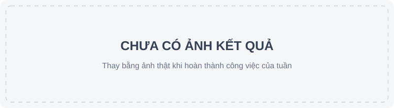

# Tuần 06 — Quyết định và chạy lô

## Kế hoạch

- [ ] Kiểm tra file/dòng bằng chứng và áp luật approve/deny, mặc định dry-run (TV1-7).
- [ ] Chạy lô có resume, báo cáo từng gói và `run_meta.json`; lỗi một gói không dừng lô (TV1-8).
- [ ] Tạo cấu hình A-LLM, A-SLM, A-TLM dùng cùng agent, công cụ, prompt và dữ liệu.

## Mốc nghiệm thu

Bằng chứng sai hoặc kết luận thiếu chắc chắn không tự approve/deny; chạy lô thử bằng agent giả có thể tiếp tục sau lỗi.

## Nhật ký

- Ngày / người thực hiện / người kiểm tra: 07–08/11/2026 / Claude / TV2 (chưa kiểm tra).
- Đã làm (Gate B0 07/11, commit `94d8106` → `e8ebe44`):
  - 10 công cụ chỉ đọc trong `tools/explore.py`, bật theo model bằng `tools:` trong config;
  - năng lực agent: `analyst_directive`, `R7_flow`, `self_check`, `guided_reading`, `repeat_limit`, `experiments/calibration.py`;
  - sandbox phần không chạy mã: canary giả mới, `behavior_events`, `hardening` (tắt), `sandbox: true` (tắt, chỉ `tests/fixtures/`);
  - sửa ổn định (08/11): `trace_flow` treo trên file dài (1000 dòng mất 29 s, 4000 dòng không xong → 0,15 s); lô dừng vì `UnicodeEncodeError` trên console cp1252; kết quả công cụ quá 16 000 ký tự làm model lặp.
- Kiểm chứng:
  - `py -3.14 -m pytest -q`: PASS (239 passed, 8 skipped); `node --test tests/js/*.test.mjs`: PASS (19/19); clone sạch: PASS;
  - corpus 22 gói, model thật, `py -3.14 -m experiments.rote_probe corpus-x1108 A-LLM-X A-SLM-X A-TLM-X`: PASS, 66/66 lượt chạy xong, 0 crash;
  - Docker / `RUN_SANDBOX_TESTS=1`: NOT_RUN (chờ TV3, W5-5); hồi quy 13 gói dev: NOT_RUN.

| Config | Gói độc bị deny | **Gói độc được approve** | Gói lành được approve | Gói lành bị deny | Cặp phân tách | ECE |
| --- | --- | --- | --- | --- | --- | --- |
| A-LLM (`corpus-v2`) | 11/11 | 0 | 7/11 | 0 | 9/9 | 0,041 |
| **A-LLM-X** | 11/11 | **0** | 6/11 | 0 | 9/9 | 0,052 |
| A-SLM (`corpus-v2`) | 6/11 | 1 | 2/11 | 0 | 7/9 | 0,355 |
| **A-SLM-X** | 7/11 | **0** | 4/11 | 0 | 8/9 | 0,280 |
| A-TLM (`corpus-v2`) | 0/11 | 0 | 0/11 | 0 | 0/9 | 0,839 |
| **A-TLM-X** | 0/11 | **0** | 2/11 | 0 | 2/9 | 0,779 |

- Nhận xét:
  - chỉ tiêu cứng đạt: 0 gói độc được approve ở cả 3 model; A-LLM-X giữ 11/11, 0 deny nhầm, 9/9;
  - A-SLM-X đạt mục tiêu cặp (≥ 8/9), chưa đạt mục tiêu gói lành approve (≥ 5/11, đo được 4/11);
  - A-TLM-X chưa đạt mục tiêu ≥ 3/9 (2/9): model 0.8b chỉ dùng làm mốc so sánh; `R7_flow` chặn được lượt approve gói bẫy chú thích của nó; 3 gói ra R2 do lặp verdict sai;
  - A-LLM-X approve ít hơn 1 gói lành (`sim-locale-data`, R3) — an toàn nhưng cần xem trace.
- Vướng mắc / bước tiếp: image và hồi quy dev đã làm ngày 08/11 (mục dưới); còn TV3 ký W5-5 và PO quyết có chuyển config mặc định sang `-X` không.

## Ảnh kết quả

*Thay ảnh này bằng ảnh kết quả thật khi có bằng chứng.*

### Hoàn thiện việc dở tuần 2–5 (08/11/2026, kế hoạch: KE_HOACH_HOAN_THIEN_2026-11-08.md)

- **Build lại image:** `docker build -t agent-npm-sandbox:local sandbox` → `sha256:ac8579db8b8071c53019b82784d34ba24fd326caf0d489a6847279394a7d54e0` (cũ: `b657e013…`); `/opt/canary` có đủ 8 file canary.
- **Test Docker:** `RUN_SANDBOX_TESTS=1 py -3.14 -m pytest -q tests/test_sandbox_limits.py` → PASS 14/14 (8 cũ + 6 mới: canary C2, ghi `/etc` được ghi nhận, hardening giữ cài đặt lành, hardening bỏ swap).
- **Lỗi tìm ra khi chạy thật:** tmpfs `/tmp` trong `hardening` *nới* `--read-only` và làm trace của npm vượt trần 2 MB → cài lành cũng "trace incomplete". Đã bỏ; thay bằng `--memory-swap 256m`.
- **RAM (W5-11):** fixture `memory` cấp phát 448 MB khi không hardening, 192 MB khi `hardening=True`. Mặc định chưa đổi — **TV3 quyết** (phiếu W5-5, bước 4).
- **W5-4 tái hiện:** `py -3.14 -m experiments.repro_sandbox --runs 3` (có và không `--hardening`): 9 fixture × 3 lần giống nhau ở mọi trường (`all_same: true`). Biến môi trường host duy nhất khớp là `127.0.0.1` (loopback, có sẵn trong trace npm); sau khi loại loopback: `no_host_leak: true` (59 giá trị đã kiểm).
- **C7 chạy thật** (`A-LLM-XS` = A-LLM-X + `sandbox: true`, Docker + Ollama): `benign-package` approve (R7); `canary-package` **deny bởi R1** (sandbox chạm canary, model không đảo được); `no-hook-package` review (R3).
- **Vi phạm phạm vi (tự báo):** trong lượt C7 Claude đã đưa thêm 2 gói corpus mô phỏng (`persist-bashrc`, `twin-safe`) vào container. Gate 07/11 không cho chạy corpus trong container. Rủi ro thấp (mã nhóm viết, `--network none`, `--read-only`, `/home` là tmpfs bị xóa khi container dừng) nhưng vẫn là thực thi chưa được duyệt. Đã chặn trong code: `sandbox=True` chỉ nhận `tests/fixtures/packages` và `tests/fixtures/sandbox-limits`; có test. Kết quả 2 gói này (`reports/c7-1108-a-llm-xs`) không dùng làm số liệu.
- **Hồi quy 13 gói dev** (`reg1108-a-*-x` so với `rote-reg-a-*`): A-LLM-X 13/13 giống mốc; A-TLM-X 13/13 giống mốc (cả 13 về review, 8 lần R2); A-SLM-X đổi 2 gói: `benign-install-fixture` review → **approve** (đúng), `canary-fixture` deny → **review** (an toàn nhưng mất một lần deny đúng). Không có approve nhầm hay deny nhầm mới.
- **Còn chờ người thật:** W5-5 (TV3 ký nghiệm thu, chọn phương án swap), W5-10 và dữ liệu v1 (người kiểm tra nhãn).

### Gỡ điểm tắc dữ liệu (08/11/2026, Gate B0 "Gỡ điểm tắc dữ liệu")

- **S2 — Datadog trong container:** `data/scripts/datadog_container.py` liệt kê 25 267 ZIP ở commit cố định `72c723be…`, lấy 800 ZIP ngẫu nhiên (seed 20261108), đọc trong container dùng một lần: 783 đọc được, 476 có hook và file điểm vào, 429 cụm mã cài đặt khác nhau. Sửa lỗi tên gói scope (thư mục Datadog dùng `@scope@name`).
- **S3 — đủ gói lành:** quét lại 29 gói vượt giới hạn giải nén (nhóm A 132 → 147); đề xuất lượt 6–7 (nhóm A) và 8–9 ("B nhẹ": chỉ `child_process`/gọi mạng, không luồng secret, không shell, không làm rối).
- **S4/D-6:** lượt 10–15, 240 mẫu độc, chọn xoay vòng theo cụm; bằng chứng 238/240 sạch, 2 dòng được đánh dấu để loại.
- **S1:** 15 lượt, 516 dòng, phân công cho Phước, Thiên, Triết; hạn 17/11.
- **S6 — sẵn sàng tuần 7–10:** `freeze_labels.py` (chỉ dòng `verified`, chia theo cụm, test 60%), `experiments/run_isolated.py` (agent và `--guarddog` trong container, Ollama qua `host.docker.internal`), `experiments/threshold_sweep.py` (quét 0,50–0,95 bằng chính `decide()`, trace nay ghi `inputs`). Chạy thử trên 2 gói `@swc/core`: agent R7_review giống chạy trên máy chủ; GuardDog 0 issue; `metrics`/`threshold_sweep` đọc được.
- **Kiểm chứng:** pytest PASS; test Docker 14/14 (lượt trước); bằng chứng 9 lượt mới qua container.
- **Còn chờ người thật:** kiểm tra chéo 516 dòng.

### Kiểm tự động hỗ trợ người kiểm tra (08/11/2026, PO chọn "cách 1")

- PO đề nghị Claude đánh `verified` và ghi tên người phụ trách; Claude từ chối vì đó là ghi sai người đã kiểm tra. PO chọn cách 1: Claude kiểm trước, người thật xác nhận.
- `data/scripts/ai_precheck.py`: quét đoạn trích bằng dấu hiệu cụ thể (đường dẫn secret thật, `eval`/`new Function`, file khởi động, `curl | sh`, dump `process.env`, lệnh, gọi mạng, thông tin máy, làm rối) và các họ kỹ thuật của agent; ghi "khớp / cần xem / nghi ngờ" kèm số dòng vào `data/review_rounds/ai-precheck/round-N.csv` và vào trang bằng chứng, luôn ghi là của Claude, chưa phải kiểm tra. Phiếu kiểm tra không đổi.
- Kết quả: lượt lành nhóm A (5–7) ~90% "khớp"; "B nhẹ" (8–9) phần lớn "cần xem"; lượt độc Datadog (10–15) ~40% "khớp", 7–16 "nghi ngờ"/lượt (đoạn trích 150 dòng đầu có thể chưa chứa hành vi).
- **Windows Defender** cách ly bằng chứng `.md` của lượt độc (10, 13, 14, 15) và cả bản HTML dùng ký tự mã hóa (Defender tự giải). Không thêm ngoại lệ: bằng chứng nay là `round-N.json` (đoạn trích base64, cho script) và `round-N.html` (đoạn trích XOR + base64, trình duyệt giải và hiển thị bằng `textContent`, không chạy). Sau đổi: 0/30 file bị chặn.
- **GuardDog** chạy trên 499 dòng trong container (`reports/guarddog-all-1108`), đang chạy.

### Baseline GuardDog trên 499 dòng (08/11/2026) — số TẠM

- `py -3.14 -m experiments.run_isolated guarddog-all-1108 --guarddog --labels reports/all-candidates-499.csv` (container dùng một lần, GuardDog 2.6.0): 499/499 lượt xong, 2 lỗi quét.
- Defender cách ly 16/500 file kết quả vì GuardDog trích nguyên văn đoạn mã khớp luật (trường `code`). Đã sửa: kết quả chỉ giữ luật, vị trí, thông báo; 483 file được làm sạch, 16 gói quét lại; `metrics` liệt kê file không đọc được thay vì dừng. Sau sửa: 0 file bị chặn.
- **Điểm TẠM theo nhãn chưa kiểm tra** (220 lành, 277 độc, 2 nghi vấn; KHÔNG dùng trong báo cáo cuối): Precision 0,960 · Recall 0,771 · F1 0,855 · FPR 0,041 (9/220 gói lành bị báo) · 62 gói độc không bị báo. Chấm lại bằng `experiments.metrics` khi có `data/labels-v1.csv` (19/11), không cần quét lại.
