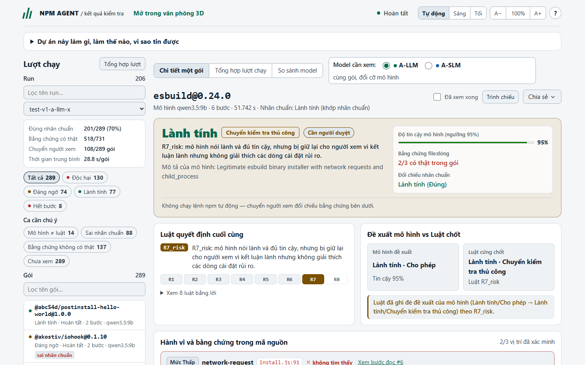
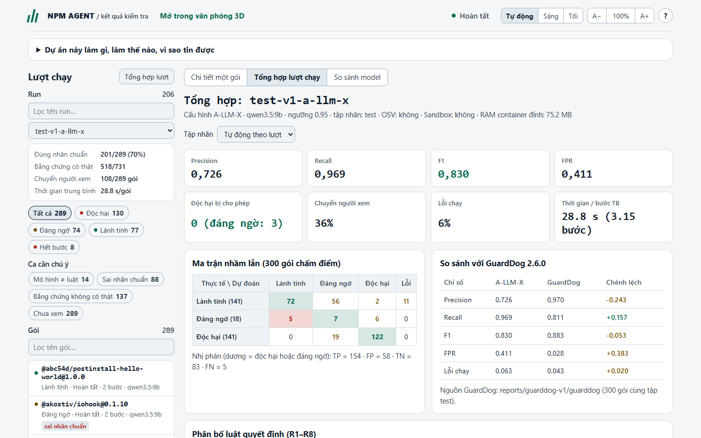
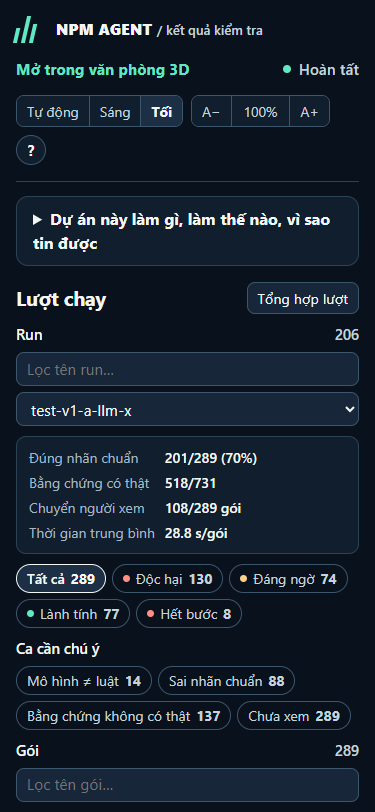

# Tuần 07 — Hiệu chỉnh trên tập phát triển

## Kế hoạch

- [ ] Tính confusion matrix, Precision, Recall, F1, FPR và tỉ lệ suspicious (TV3-5).
- [ ] Quét ngưỡng 0,50–0,95 riêng cho từng model trên tập phát triển.
- [ ] Kiểm tra độ tin cậy, chọn ngưỡng và đóng băng cấu hình trước khi mở tập kiểm tra.
- [ ] **Báo cáo 2 cấu hình tách biệt** (PO chốt 05/11/2026):
  - **Chỉ agent:** tắt hoàn toàn tín hiệu OSV/Registry. Mô phỏng khoảng trống zero-day, khi danh sách đen chưa biết gói; đây là con số chính của đồ án.
  - **Agent + OSV:** hiệu quả cả hệ thống.
  - Thêm chỉ số: trong các gói OSV đã biết là độc, agent tự bắt được bao nhiêu khi **không** được biết trước.
  - Lý do: phần lớn mẫu độc lấy từ Datadog/OSV. Nếu để OSV chặn sớm, Recall sẽ là thành tích của danh sách đen chứ không phải của agent (rò rỉ nhãn, AGENTS §3).
- [ ] Nguyên tắc sản phẩm **"chặn trước, phân tích sau"**: OSV báo độc thì chặn giao gói ngay, nhưng agent vẫn phân tích bản cách ly để làm phiếu báo cáo có bằng chứng và đối chiếu với OSV. Agent không được thấy kết quả OSV khi phân tích.

## Mốc nghiệm thu

Có bảng ngưỡng, lý do chọn ngưỡng và script tái hiện; không dùng tập kiểm tra để điều chỉnh.

## Nhật ký

- **28/11/2026 — Hoàn thành T1 (Frontend 2D + sửa `run_id` và `"undefined"`):**
  - Hoàn thiện sửa `run_id = "run"` trong `viewer/server.py` (`_same_run`), thêm test nhận `run_id = "run"` và từ chối `run_id` khác; tăng tốc `_packages` trên lượt 300 gói (`test-v1-a-llm-x`: 0,168 s API, tải trang một gói 393 ms, tải trang tổng hợp 230 ms).
  - Thêm `GET /api/runs/<run>/summary` dùng lại `experiments.metrics.load_results` và `score` (tự nhận split, đối chiếu GuardDog, phân bố luật R1–R8, danh sách ca sai) và `GET /api/package-extra` (OSV, Registry, sandbox từ `reports/`). Mặc định đọc `data/labels-v1.csv`.
  - Sửa chữ `"undefined"` cạnh nhãn quyết định trong `viewer/static/office/main.mjs` và `explain.mjs` khi trace cũ thiếu trường `rule`.
  - Thiết kế lại giao diện 2D (`viewer/static/index.html`, `app.js`, `summary.mjs`, `style.css`): trang một gói 10 giây (thẻ kết luận, luật quyết định, hành vi theo bộ ba Nguồn → Hành động → Đích kèm tô dòng mã `read_file`, sandbox/OSV nếu có, đề xuất mô hình vs luật, nhật ký bước thu gọn) và trang tổng hợp lượt chạy (ma trận nhầm lẫn, P/R/F1/FPR, so GuardDog, phân bố luật, lọc ca sai). Giữ nguyên an toàn: `127.0.0.1`, GET/HEAD, `textContent`, giải mã base64 trong bộ nhớ, không có nút chạy agent.
- **Kiểm chứng (28/11/2026):**
  - `py -3.14 -m pytest -q`: **359 passed, 18 skipped, 0 failed** (18 test Docker giữ skip khi chưa đặt `RUN_SANDBOX_TESTS=1`).
  - `node --test tests/js/*.test.mjs`: **34 passed, 0 failed**.
  - Kiểm tra trình duyệt (`playwright-cli`): XSS trên `comment-injection-demo@1.0.0` hiện `` dạng chữ (0 ``, 0 dialog); WCAG 2.2 chế độ sáng/tối/375px có 0 nút nhỏ hơn 24 px, 0 lỗi tương phản < 4,5, `scrollWidth == clientWidth == 375`; văn phòng 3D không còn chữ `"undefined"`.
- **Vướng mắc / bước tiếp:** chờ PO nghiệm thu T1 và chốt thứ tự làm tiếp T2–T5 (ưu tiên dễ trước).

## Ảnh kết quả

