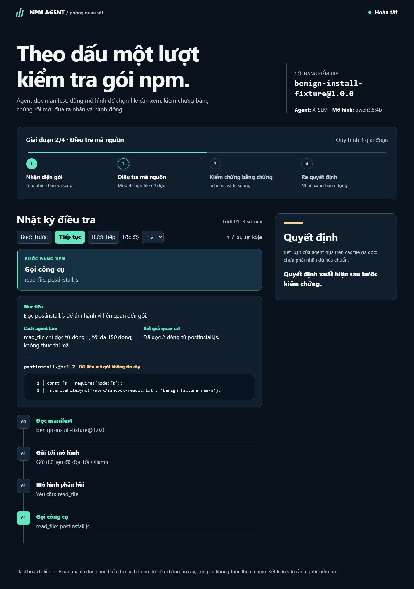
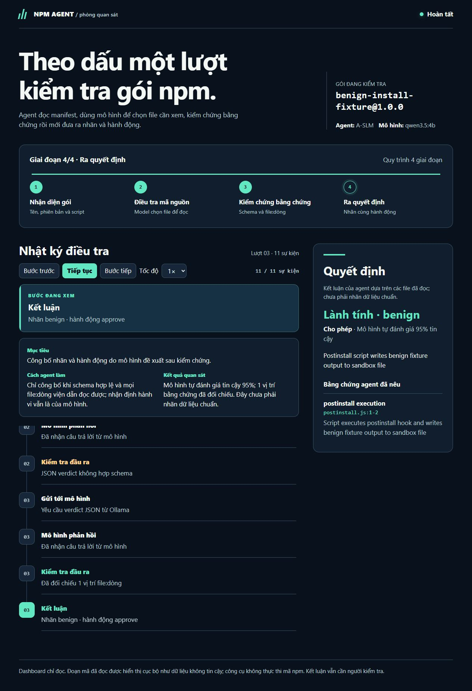
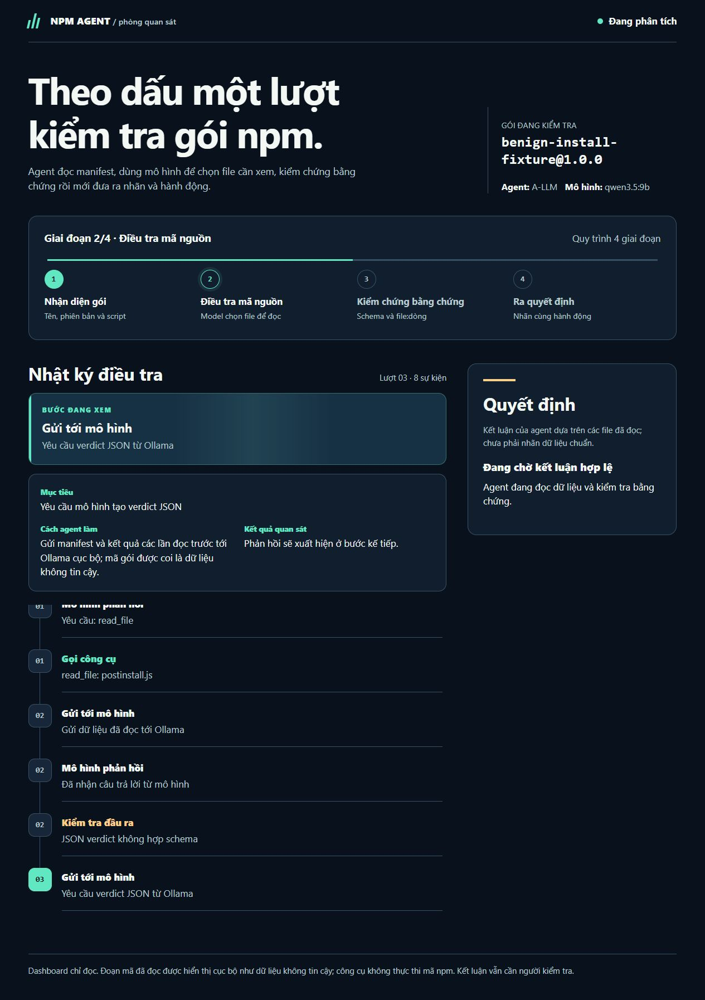
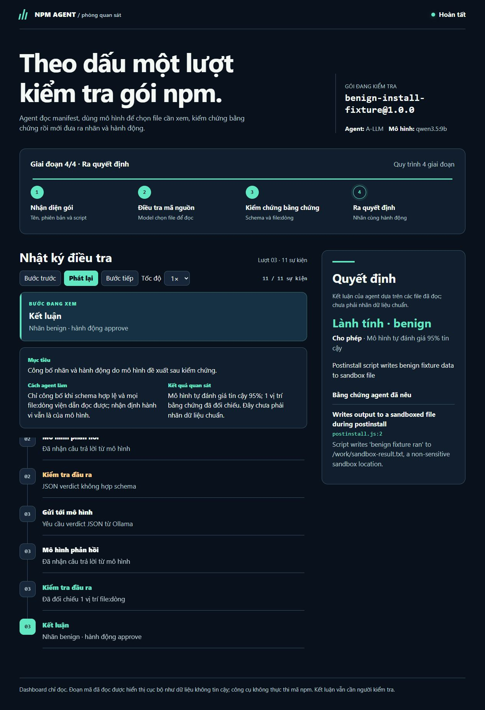

# Báo cáo tiến độ tuần 03 — AI Agent kiểm tra gói npm

**Thành viên:** Lê Đặng Thiên Phước · Phạm Minh Triết · Nguyễn Đình Thiên

**Giai đoạn:** Công cụ đọc, agent và sandbox cơ bản · **Ngày báo cáo:** 01/11/2026 · **Cập nhật:** 04/11/2026 · **Nghiệm thu:** TV2 Phạm Minh Triết, 04/11/2026

> Mục 1–6 giữ nguyên nội dung đã trình bày ngày 01/11. Những vướng mắc ở mục 4 đã được xử lý; kết quả mới ở **mục 7**.

Thưa thầy, trong tuần 3 nhóm đã cho các agent chạy được ở mức thử nghiệm. Khi kiểm tra một gói, nhóm có thể cho thầy xem agent đọc những file nào, nhận ra dấu hiệu gì và dựa vào đâu để đưa ra đề xuất. Nhóm mới chứng minh được quy trình hoạt động; độ chính xác của AI vẫn cần được đánh giá trên dữ liệu đã kiểm tra chéo.

## 1. Nội dung nhóm trình bày với thầy

Nhóm trình bày cách agent xem thông tin gói, tìm phần mã có thể chạy lúc cài đặt, rồi đọc các đoạn mã liên quan trước khi đề xuất cho phép, chặn hoặc chuyển cho người xem lại. Giao diện ghi lại quá trình đó theo từng bước để thầy thấy được lý do của kết luận. Agent hiện chỉ **đề xuất**; chương trình chưa tự thay đổi dự án hay chạy mã cài đặt của gói trên máy thật.

Nhóm cũng cho chạy thử môi trường cách ly bằng Docker với mẫu mô phỏng vô hại. Phần này đã ghi lại dấu vết hoạt động, nhưng hiện vẫn chạy riêng, chưa nối trực tiếp vào quá trình kết luận của agent.

Sau buổi gặp, nhóm ghi nhận góp ý của thầy là **cần tìm và hoàn thiện dữ liệu**. Nhóm đã tổng hợp 450 gói để xem xét và lập bảng 76 nhãn có nguồn tham khảo, dấu hiệu và vị trí mã. Tuy nhiên, người kiểm tra chéo chưa xác nhận lại từng nhãn trên mã gốc. Vì vậy nhóm chưa dùng bảng này để công bố độ chính xác.

## 2. Nhóm demo được đến đâu?

Trong sáu phần nhóm dự kiến trình diễn, hiện có **năm phần đã chạy được (khoảng 83% nội dung demo)**. Con số này cho biết mức độ sẵn sàng của buổi trình diễn, không thể hiểu là AI dự đoán đúng 83%.

| Phần trình diễn | Kết quả hiện tại |
| --- | --- |
| Agent đọc thông tin và những đoạn mã liên quan của gói | Đã xem được từng file, từng dòng và dấu hiệu tìm thấy. |
| Hai mô hình A-LLM và A-SLM phân tích mẫu thử | Đã chạy trên mẫu mô phỏng vô hại và đưa ra kết luận. |
| Môi trường cách ly Docker | Đã ghi được dấu vết của mẫu thử; phần này hiện chạy riêng. |
| Giao diện theo dõi | Đã xem trực tiếp và phát lại các bước agent đã thực hiện. |
| Thử trên một gói npm lành | A-LLM kiểm tra `esbuild@0.24.0` trong 6 bước, đề xuất cho phép sau khi đối chiếu 3 bằng chứng. Chương trình chỉ mô phỏng quyết định. |
| Đo độ chính xác trên dữ liệu chuẩn | Chưa làm được vì bảng nhãn cần được kiểm tra chéo. |

Các ảnh dưới đây là màn hình nhóm chụp khi chạy **mẫu mô phỏng vô hại trước buổi gặp**. Đây không phải ảnh chụp lúc báo cáo với thầy hoặc ảnh của lượt kiểm tra `esbuild`.

**Hình 1.** Agent mở và đọc các dòng mã của mẫu thử.

**Hình 2.** Agent đối chiếu những dòng mã đã đọc trước khi kết luận.

**Hình 3.** Giao diện cho thấy A-LLM đang thực hiện từng bước.

**Hình 4.** Giao diện hiển thị kết luận của lượt chạy thử.

Với gói `esbuild@0.24.0`, nhóm đã lưu lại toàn bộ sáu bước trên máy demo. Khi trình bày, nhóm có thể mở lượt chạy này để thầy xem ba dòng mã trong `install.js` mà agent dùng làm bằng chứng và quyết định cuối. Nhóm chỉ tải gói để đọc, không chạy lệnh cài đặt của gói.

## 3. Nhóm sẽ trình bày demo như thế nào?

1. Mở giao diện theo dõi và chọn lượt kiểm tra gói `esbuild` đã lưu.
2. Phát lại từng bước để thầy thấy agent đọc phần nào của gói, nhận kết quả gì và chọn ba dòng mã nào làm bằng chứng.
3. Mở thêm mẫu mô phỏng hành vi đáng ngờ để cho thấy agent đề xuất chặn khi có bằng chứng. Mẫu này vô hại và chỉ phục vụ trình diễn.
4. Nếu thầy muốn xem cách làm, nhóm sẽ mở mã nguồn trong VS Code và giải thích phần đọc gói, phần agent phân tích và phần kiểm tra kết luận.

Nhóm chọn phát lại lượt chạy đã lưu để buổi demo liền mạch. Giao diện cũng có chế độ theo dõi trực tiếp nếu thầy muốn xem agent làm việc theo thời gian thực.

## 4. Nhóm đã xử lý được gì, còn vướng gì?

Ban đầu A-LLM bị lặp khi kiểm tra `esbuild` và không kết thúc trong giới hạn 15 bước. Nhóm đã điều chỉnh lượng thông tin mô hình có thể ghi nhớ trong một lượt, sau đó agent hoàn tất cùng gói này trong 6 bước. A-LLM và A-SLM cũng đã chạy trên mẫu mô phỏng hành vi đáng ngờ và đề xuất chặn. Bộ kiểm thử phần mềm khi đó đạt **72/72 bài** (ngày 04/11: 115/115, xem mục 7).

Nhóm vẫn thấy A-LLM đưa ra **ba kết quả sai định dạng trước kết quả hợp lệ cuối cùng** trong lượt `esbuild`. Do đó nhóm chỉ báo cáo rằng agent đã chạy được, chưa khẳng định nó ổn định hay dự đoán chính xác.

Mô hình nhỏ nhất, A-TLM, còn gặp khó trên hai mẫu thử: sau 15 bước vẫn chưa trả kết quả đúng định dạng. Hệ thống chuyển ca đó sang **cần người xem lại**. Nhóm chưa dùng A-TLM làm kết quả chính khi trình bày.

Về dữ liệu, nhóm đã có bảng 76 nhãn gồm 20 gói lành, 2 gói nghi vấn và 54 gói độc hại. Bảng đã được kiểm tra định dạng và cách chia tập, nhưng **chưa có người kiểm tra chéo từng nhãn trên mã gốc**. Đây là lý do nhóm chưa thể báo cáo các chỉ số đánh giá AI.

Trong 450 gói nhóm tìm được, thông tin của **445 gói còn tra cứu được**, 5 gói không còn. Nhóm mới tổng hợp thông tin ban đầu; chưa đọc và gán nhãn cho toàn bộ 450 gói.

## 5. GitHub và ảnh chụp buổi báo cáo

Nhóm đã đưa báo cáo, code và dữ liệu hiện có lên [GitHub của dự án](https://github.com/trtpham/DA_AgentNPM). Dấu vết của lượt kiểm tra `esbuild` được lưu trên máy demo để nhóm mở trực tiếp khi trình bày.

## 6. Dự định của nhóm trong tuần 4

1. Nhóm ưu tiên kiểm tra lại dữ liệu theo từng đợt 15–20 gói: đối chiếu tên, phiên bản, nguồn, đoạn mã liên quan và người kiểm tra. Gói nào chưa xác minh được sẽ để ở trạng thái chờ, chưa dùng để tính điểm AI.
2. Nhóm tiếp tục làm cho A-LLM và A-SLM chạy đều hơn, ghi lại những lần trả kết quả sai định dạng và thời gian xử lý. A-TLM sẽ được sửa và thử riêng trên mẫu vô hại; nếu chưa đạt, nhóm vẫn để ca đó cho người xem lại.
3. Khi có một tập nhãn đã được kiểm tra chéo, nhóm sẽ đánh giá các mô hình trên cùng tập đó và trình bày cả những ca làm sai. Nhóm sẽ chụp ảnh thật trong buổi báo cáo tiếp theo. Việc nối môi trường cách ly vào agent sẽ thực hiện sau khi phần dữ liệu và cách đánh giá đã rõ.

Tóm lại, nhóm đã có thể **cho thầy xem agent làm việc ở mức bản thử nghiệm**. Việc quan trọng nhất tiếp theo là chốt dữ liệu đáng tin cậy và kiểm tra agent chạy ổn định đến đâu, trước khi báo cáo độ chính xác.

## 7. Cập nhật sau buổi báo cáo (03–04/11/2026)

**Nguyên nhân A-TLM không kết thúc.** Nhóm đọc lại dấu vết từng bước. Mô hình nhỏ không hỏng ngẫu nhiên mà **lặp đúng một câu trả lời sai** suốt 13 lượt:
- `description` quá 15 từ;
- ghi cả đoạn mã vào ô số dòng;
- thiếu phiên bản gói.

Lý do: mỗi lượt mô hình nhận lại cùng một nội dung nên cũng sinh lại cùng một câu trả lời.

**Cách xử lý (không nới lỏng định dạng kết luận):**
- Phần mềm tự điền tên và phiên bản gói.
- Khi lỗi lặp lại, lượt sau đổi seed để mô hình thử cách khác; lặp 4 lần thì dừng sớm và chuyển cho người xem lại.
- Giới hạn độ dài ngay lúc mô hình sinh câu trả lời.
- Ô số dòng chỉ nhận số. Mọi dòng mô hình dẫn ra vẫn được đọc lại để kiểm chứng.

Kết quả trên 3 mẫu thử × 3 lần chạy:

| Mô hình | Trước (01/11) | Sau (04/11) | Số bước TB | Thời gian TB |
| --- | --- | --- | --- | --- |
| A-LLM | chạy được | **9/9** kết luận hợp lệ | 2,0 | 27 giây |
| A-SLM | chạy được | **9/9** | 2,3 | 9 giây |
| A-TLM | hết 15 bước, chưa có kết luận | **9/9** | 3,0 | 6 giây |

Kết quả cuối đúng như mong đợi:
- mẫu lành → cho phép (chạy thử);
- mẫu chạm dữ liệu mồi → chặn;
- mẫu không có script cài đặt → chuyển người xem lại.

**Phần khác đã hoàn thành:**
- Giao diện xem lại và theo dõi trực tiếp đã xong, bằng tiếng Việt. Nhóm đã thử trên trình duyệt, kể cả chuỗi tấn công XSS cài trong mẫu.
- Sandbox Docker chạy lại thành công trên 3 mẫu: mẫu đọc dữ liệu mồi bị ghi nhận đúng.
- Ngày 04/11, bộ kiểm thử đạt **115/115 bài**.

**Vẫn giữ giới hạn.** Đây là kết quả trên mẫu mô phỏng vô hại, không phải độ chính xác trên gói npm thật. Kết quả trên gói npm thật nằm ở [báo cáo tuần 4](BaoCaoTienDo_Tuan04.md).
