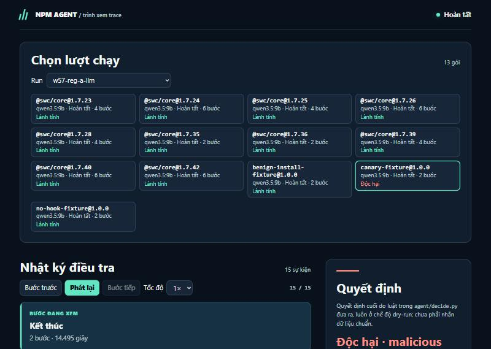
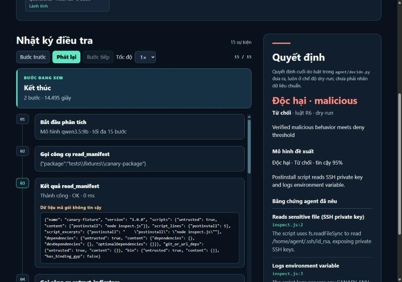
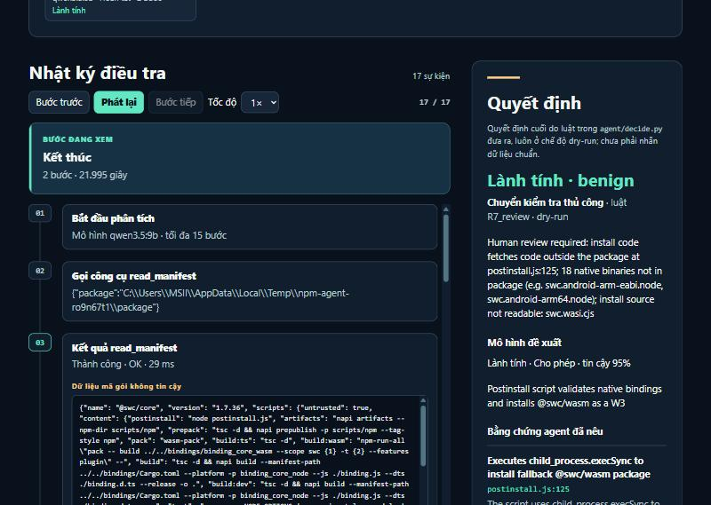
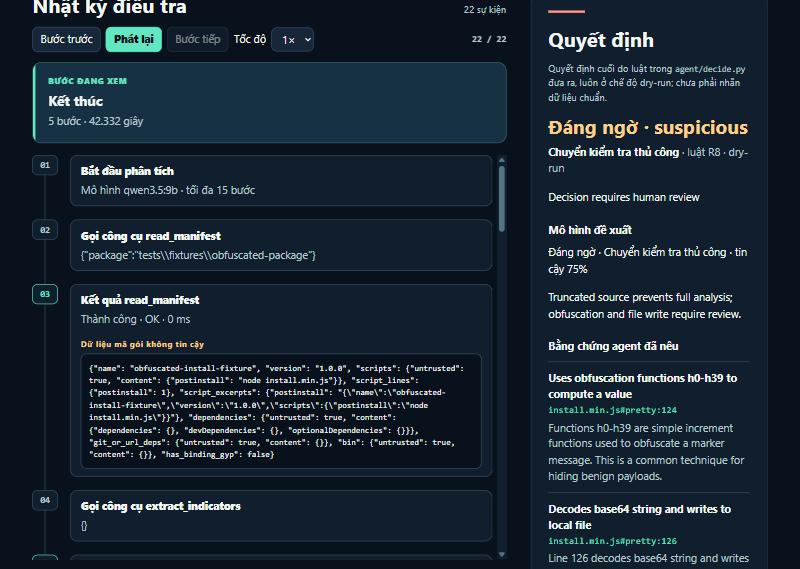

# Báo cáo tiến độ tuần 05 — AI Agent kiểm tra gói npm

**Thành viên:** Lê Đặng Thiên Phước · Phạm Minh Triết · Nguyễn Đình Thiên

**Giai đoạn:** Hoàn thiện sandbox và công cụ mở rộng · **Ngày cập nhật:** 08/11/2026 (bản đầu 05/11) · **Nghiệm thu:** chờ TV3 Nguyễn Đình Thiên (cách ly sandbox, W5-5), TV2 Phạm Minh Triết (agent)

> Số liệu trong báo cáo đều lấy từ lần chạy thật ngày 04–08/11/2026 trên máy của nhóm. Phần cập nhật 07–08/11 nằm ở mục 4.3. Mỗi bảng ghi `run_id` để mở lại trong `reports/`. Chi tiết từng việc ở [nhật ký tuần 5](tuan-05.md); kịch bản demo ở [hướng dẫn demo](HUONG_DAN_DEMO_TUAN05.md).

## 1. Nội dung buổi báo cáo tuần

Mục tiêu tuần 5 là **chứng minh sandbox cách ly được mã của gói và trả kết quả tái hiện được**, trước khi nối sandbox vào agent. Nhóm cũng xử lý hai việc còn treo từ tuần 4: A-LLM chạy chậm và tham số model chưa nằm trong file cấu hình.

1. **Thử vượt từng giới hạn của sandbox (W5-1):** 6 gói thử vô hại, mỗi gói cố làm đúng một việc trong `postinstall`:
   - gọi mạng ra ngoài;
   - sinh 200 tiến trình;
   - cấp phát khoảng 512 MB;
   - chờ 120 giây;
   - ghi ra ngoài thư mục gói;
   - đọc file bí mật mồi (canary).

   Các gói thử chỉ chạy trong container Docker tắt mạng, không bao giờ chạy trên máy thật.
2. **Kết quả sandbox nói rõ vì sao dừng (W5-2):** trường `outcome` = `ok` / `timeout` / `oom` / `pids_limit` / `failed`, thay cho thông điệp chung "sandbox execution failed".
3. **Tách hành vi của npm khỏi hành vi của gói (W5-3):**
   - Dựng cây tiến trình từ `strace -f`; mỗi tiến trình, kết nối mạng và file đã mở được gắn **`npm`** hoặc **`package`**.
   - Trước đây, 4 lần tra DNS của chính npm bị lẫn vào hành vi của gói, nên gói lành vẫn trông như "có gọi mạng".
4. **Tái hiện và không lộ secret thật (W5-4):** chạy 9 gói thử × 3 lần và so sánh kết quả; dò toàn bộ biến môi trường của máy thật trong log.
5. **Mã bị làm rối (W5-7):** thêm gói thử có mã rút gọn một dòng và chuỗi base64. Gói này làm lộ một lỗi thật của agent; nhóm đã sửa (mục 4).
6. **A-LLM chậm (W5-8)** và **tham số model nằm trong YAML (W5-9).**

> *Góp ý của thầy trong buổi gặp tuần 5:* **[nhóm bổ sung theo ghi chép buổi gặp]**. Báo cáo không tự ghi nội dung trao đổi khi nhóm chưa xác nhận.

## 2. Demo bao nhiêu phần trăm (kèm ảnh)

Ngày 05/11 nhóm demo được **6/8 phần dự kiến (75%)**. Đến 08/11 làm thêm được phần nối sandbox (chạy được, còn chờ TV3 ký để bật mặc định), thành **7/8 (88%)**. Phần còn lại bị chặn bởi việc của người, không phải lỗi kỹ thuật (xem mục 4).

| Phần trình diễn | Kết quả |
| --- | --- |
| Sandbox chặn mạng, giới hạn tiến trình, RAM, thời gian; phát hiện đọc canary | **Đạt.** 9 gói thử × 3 lần cho kết quả giống hệt nhau. Test tự động trong Docker 8/8. |
| Tách hành vi npm và gói | **Đạt.** Gói lành và gói không có hook: 0 kết nối của gói. Gói thử gọi mạng: 5 kết nối của gói. 4 lần tra DNS của npm được ghi riêng. |
| Không lộ secret thật | **Đạt.** Không biến môi trường nào của máy thật xuất hiện trong log (chỉ trùng `127.0.0.1`, có sẵn trong mọi container). |
| Agent xử lý mã rút gọn/base64 | **Đạt về quy trình:** gọi `deobfuscate`, trích bằng chứng `install.min.js#pretty:124, 126`. Kết luận vẫn là "chuyển người xem" vì model chưa đọc hết bản đã định dạng. |
| A-LLM nhanh hơn, kết luận không đổi | **Đạt:** 85,1 → 47,0 giây/gói (−45%), 13/13 kết luận giống mốc. |
| Đổi tham số model chỉ bằng file cấu hình | **Đạt.** |
| Nối sandbox vào agent (W5-6) | **Đạt có điều kiện (08/11):** `sandbox: true` trong config, mặc định tắt, chỉ chạy gói thử vô hại. Chạy thật: gói canary bị **từ chối bởi luật R1** (model không đảo được), gói lành vẫn được cho phép. Chờ TV3 ký W5-5 mới bật. |
| Recall/F1 trên mẫu độc | **Chưa làm:** bộ nhãn v1 chưa có người kiểm tra chéo (W5-10). |

### Sandbox: kết quả trên 9 gói thử

Lệnh `py -3.14 -m experiments.demo_sandbox`, chạy ngày 05/11/2026. Image `agent-npm-sandbox:local` (`sha256:b657e013…`), Docker 29.1.3. Kết quả giống hệt nhau qua 3 lần chạy.

| Gói thử | Script cố làm | Script tự báo | `outcome` | Mã thoát | Mạng npm / gói | Canary bị chạm |
| --- | --- | --- | --- | --- | --- | --- |
| `network` | gọi HTTPS + DNS ra ngoài | `https=ENETUNREACH dns=EAI_AGAIN` | ok | 0 | 4 / **5** | — |
| `processes` | sinh 200 tiến trình | `spawned=200 refused=158` | **pids_limit** | 0 | (trace bị cắt) | — |
| `memory` | cấp phát ~512 MB | dừng ở 448 MB | **oom** | 137 | 4 / 0 | — |
| `timeout` | chờ 120 giây | `waiting=120` | **timeout** | 124 | 6 / 0 | — |
| `write-outside` | ghi `/input`, `/etc`, `$HOME` | `/input`, `/etc`, `/usr/local` = `EROFS`; `$HOME` ghi được (tmpfs 1 MB trong container) và **có ghi nhận** | ok | 0 | 4 / 0 | — |
| `canary-all` | đọc 3 file bí mật mồi + biến môi trường | đọc được bản giả | ok | 0 | 4 / 0 | npmrc, ssh, aws, environment |
| `benign` | gói lành có `postinstall` | — | ok | 0 | 4 / **0** | — |
| `no-hook` | gói không có hook | — | ok | 0 | 4 / **0** | — |
| `canary` | đọc khóa SSH giả | — | ok | 0 | 4 / 0 | ssh, environment |

### Agent: hồi quy 3 mô hình trên 13 gói dev

Tập dev gồm 10 phiên bản `@swc/core` (gói lành thật) và 3 gói thử. Các run: `w57-reg-a-llm`, `w57-reg-a-slm`, `w57-reg-a-tlm`.

| Mô hình | Kết luận giống mốc | Giây/gói (trung vị) | Báo nhầm trên 10 gói swc |
| --- | --- | --- | --- |
| A-LLM (qwen3.5:9b) | 13/13 | 45,7 | 0/10 |
| A-SLM (qwen3.5:4b) | 13/13 | 11,5 | 0/10 |
| A-TLM (qwen3.5:0.8b) | 12/13 | 8,8 | 0/10 |

Ca lệch của A-TLM là gói không có hook. Model 0.8b lặp lại cùng một kết luận sai nên hệ thống rơi về "chuyển người xem" (luật R2). Lỗi y hệt đã có ở lô tuần 4, không do thay đổi tuần này, và kết quả vẫn an toàn.

**Hình 1.** Trình xem trace: lô 13 gói của A-LLM. Gói thử canary được kết luận Độc hại. Ảnh chụp màn hình thật, 05/11/2026.

**Hình 2.** Gói thử canary: kết luận Độc hại → **Từ chối** (luật R6). Bằng chứng `inspect.js:2` đọc `/home/agent/.ssh/id_rsa`; lệnh `npm deny-scripts` chỉ lập ở chế độ chạy thử.

**Hình 3.** `@swc/core@1.7.36` (gói lành thật). Model đề xuất "Cho phép, tin cậy 95%", nhưng **luật cứng R7_review chuyển sang người xem**: script tải mã ngoài gói ở `postinstall.js:125`, thiếu 18 file `.node`, không đọc được `swc.wasi.cjs`.

**Hình 4.** Gói thử mã rút gọn: agent gọi `deobfuscate` và trích `install.min.js#pretty:124` và `#pretty:126`.

## 3. Ảnh chụp lúc báo cáo

Nhóm **chưa có ảnh chụp thực tế buổi báo cáo tuần 5**. Khi có, thêm vào `hinh-anh/` với tên `tuan-05-buoi-bao-cao.jpg` và cập nhật mục này.

## 4. Đã làm tốt hơn và còn vướng ở đâu

### Cải thiện có số đo

- **A-LLM chậm (đóng I3 tuần 4):**
  - Đo riêng từng lượt gọi model: **86% thời gian là sinh câu trả lời**, chỉ 12 token/giây.
  - Nguyên nhân: Ollama chỉ đưa khoảng 55% model lên GPU 6 GB, phần còn lại chạy bằng CPU. Giảm `num_ctx` từ 16384 xuống 8192 không giúp (104,5 giây/gói).
  - Sửa bằng một dòng cấu hình `num_gpu: 99`: tốc độ sinh tăng lên **27,6 token/giây**, thời gian **85,1 → 47,0 giây/gói**, kết luận giữ nguyên 13/13.
  - DoD gốc ghi mốc cố định 50,7 giây, đo trước các thay đổi I1–I4 và không tái hiện được (cùng code đo lại ra 82–83 giây). Ngày 05/11, PO chốt so với lần đo cùng ngày, cùng code: **giảm 45% → W5-8 ĐẠT**. Nếu so với 50,7 giây thì chỉ giảm 7%; báo cáo ghi cả hai để minh bạch.
- **Agent bỏ qua công cụ giải rối mã:**
  - Gói thử mã rút gọn cho thấy: khi một dòng quá dài bị cắt, agent coi như "đã đọc xong" và chuyển ngay sang kết luận, không còn cơ hội gọi `deobfuscate`.
  - Sau khi sửa, agent được thêm tối đa 2 lượt để giải rối và đọc bản đã định dạng; kết quả đọc file có gợi ý rõ phải làm gì.
  - Luật an toàn giữ nguyên: nguồn chưa đọc trọn thì không được cho phép.
- **Bộ kiểm thử:** 115 (tuần 4) → **139 PASS**, cộng 8 test sandbox chỉ chạy khi có Docker (8/8 PASS ngày 05/11).

### Còn vướng (stuck) và vì sao

| Vướng | Nguyên nhân | Ảnh hưởng | Hướng xử lý |
| --- | --- | --- | --- |
| **Sandbox đã nối nhưng chưa bật** (W5-6) | Theo quy trình, TV3 phải tự chạy lại và ký nghiệm thu cách ly; Claude và PO không ký thay | Mặc định agent vẫn chỉ phân tích tĩnh | Đã chạy lại theo phiếu W5-5 ngày 08/11 và chuẩn bị bằng chứng; TV3 xem, chọn phương án swap, ký |
| **Chưa có Recall/F1 trên mẫu độc** | 4 phiếu kiểm tra chéo nhãn (76 dòng) chưa có người điền. Một người không được vừa gán vừa duyệt nhãn | Chưa so được 3 mô hình với GuardDog trên mẫu độc; **chặn mốc thực nghiệm tuần 7–8** | Phân công người kiểm tra chéo ngay đầu tuần 6; bằng chứng đã chuẩn bị sẵn |
| **Trần RAM thực tế là 512 MB, không phải 256 MB** | `--memory 256m` không kèm `--memory-swap`, nên Docker cho dùng thêm 256 MB swap. Lần chạy 05/11 thấy script cấp phát được 448 MB rồi mới bị kill | Vẫn bị chặn, nhưng trần rộng gấp đôi thiết kế | **Đã chuẩn bị 08/11:** `--memory-swap 256m` nằm trong `hardening=True`, đo được 192 MB. Chờ TV3 chọn bật làm mặc định |
| **Gói sinh nhiều tiến trình làm trace vượt 2 MB** | Chỉ giữ 2 MB cuối của log | Phần đầu cây tiến trình mất, sự kiện thành `unknown` | An toàn (`ok=False`, không thể dẫn tới cho phép). Tuần 6 tóm tắt trace ngay trong container |
| **A-SLM chưa nhận ra canary** | Model 4B xếp gói thử canary vào "chuyển người xem" thay vì từ chối | Không nguy hiểm (không cho phép), nhưng bỏ lỡ một ca độc rõ ràng | Đã có bù bằng sandbox (`canary_touched` → luật R1), kiểm chứng 08/11; có hiệu lực khi bật sandbox |
| **Không gói swc thật nào được tự động cho phép** | Script cài của swc tải mã ngoài gói và cần file nhị phân không có trong gói | Thiết kế an toàn chủ động: không thấy hết thì chuyển người xem | Giữ nguyên; giải thích trong báo cáo cuối kỳ |

### 4.3 Cập nhật 07–08/11/2026

- **Công cụ phân tích mới** (Gate B0 07/11): 10 công cụ chỉ đọc (`list_files`, `search_code`, `trace_requires`, `trace_flow`, `inspect_scripts`, `decode_literal`, `resolve_value`, `list_endpoints`, `inspect_binary`, `file_stats`), bật theo từng model bằng config `A-*-X`. Config cũ giữ nguyên.
- **Luật mới, chỉ chặt hơn:** `R7_flow` (benign trên luồng secret/env → mạng, hoặc có chữ hướng tới người phân tích) và `R7_sandbox` (sandbox thấy gói ghi file khởi động) đổi "cho phép" thành "chuyển người xem".
- **Đo trên 22 gói mô phỏng, model thật:**

| Config | Gói độc bị từ chối | Gói độc bị cho phép | Gói lành được cho phép | Gói lành bị từ chối | Cặp phân tách |
| --- | --- | --- | --- | --- | --- |
| A-LLM → A-LLM-X | 11/11 → 11/11 | 0 → 0 | 7/11 → 6/11 | 0 → 0 | 9/9 → 9/9 |
| A-SLM → A-SLM-X | 6/11 → 7/11 | **1 → 0** | 2/11 → 4/11 | 0 → 0 | 7/9 → 8/9 |
| A-TLM → A-TLM-X | 0/11 → 0/11 | 0 → 0 | 0/11 → 2/11 | 0 → 0 | 0/9 → 2/9 |

- **Sandbox:** build lại image (`sha256:ac8579db…`) với 5 file canary giả mới và 3 biến môi trường giả; test Docker **14/14 PASS**; tái hiện 9 gói thử × 3 lần giống nhau, không lộ biến môi trường của máy thật.
- **Lỗi tìm ra và đã sửa:** `trace_flow` treo trên file dài; chạy lô dừng vì ký tự Unicode trên console Windows; tmpfs `/tmp` trong chế độ gia cố làm sandbox *lỏng* hơn (đã bỏ).
- **Bộ kiểm thử:** 139 → **241 PASS**, cộng 14 test sandbox chỉ chạy khi có Docker.
- Chi tiết: [nhật ký tuần 6](tuan-06.md).

## 5. Đề xuất tuần 6 và cách thực hiện

1. **Nghiệm thu sandbox (cập nhật 08/11):**
   - Phần kỹ thuật W5-6 đã xong và đã chạy thử; còn TV3 Nguyễn Đình Thiên tự chạy lại theo phiếu W5-5, chọn phương án swap và ký.
   - Sau khi ký: bật `sandbox` mặc định cho gói thử, chạy lại ma trận 3 mô hình.
2. **Hoàn tất bộ nhãn v1:** người kiểm tra chéo (không phải người đã gán nhãn, không phải Claude/Codex) điền 4 phiếu W5-10. Sau đó mới tính Recall/F1 và so với GuardDog, chạy trong môi trường cách ly.
3. **Tập test:** chọn thêm họ gói và chiến dịch mới từ 450 ứng viên và OSV, chuẩn bị bằng chứng trong container dùng một lần.
4. **Văn phòng 3D (đã duyệt 04/11):** bắt đầu khi tuần 5 ổn định, phục vụ demo cuối kỳ ([kế hoạch](KE_HOACH_VAN_PHONG_3D.md)).
