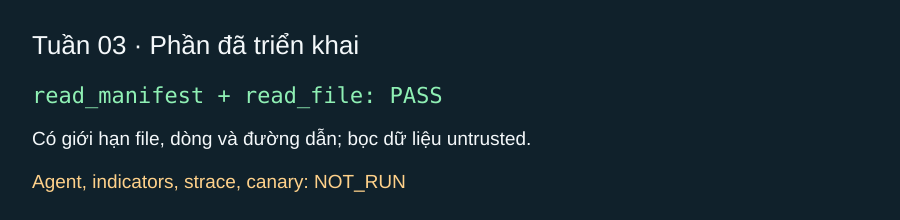

# Tuần 03 — Công cụ đọc, agent và sandbox cơ bản

[Báo cáo chi tiết và kịch bản demo ngày 24/10/2026](BaoCaoTienDo_Tuan03.md)

## Kế hoạch

- [x] Hoàn thành `read_manifest`, `read_file`, `extract_indicators` và test giới hạn file/dòng (TV1-4 đến TV1-6).
- [x] Bọc Ollama bằng cấu hình, giới hạn thời gian, retry; chạy vòng lặp agent tối đa 15 bước (TV2-2, TV2-4).
- [x] Viết prompt phân tích hành vi theo nguồn–hành động–đích (TV2-5).
- [x] Ghi dấu vết sandbox và dùng canary giả; chưa nối sandbox vào agent (TV3-1 đến TV3-3).

## Mốc nghiệm thu

Agent trả verdict hợp lệ với công cụ giả; sandbox ghi dấu vết trên gói mô phỏng, không có secret thật.

## Nhật ký

- Ngày / người thực hiện / người kiểm tra: 2026-10-23 / Codex / chưa có người kiểm tra chéo.
- Đã làm: phần đầu TV1-4 và TV1-5 (`read_manifest`, `read_file`) với bọc nội dung không tin cậy, giới hạn 256 KiB/file và 150 dòng/lần đọc, chặn đọc ngoài thư mục gói.
- Kiểm chứng: `rtk python -m pytest -q --tb=line --basetemp=.pytest_tmp` — PASS (8 test), gồm đọc manifest và kiểm tra giới hạn đường dẫn/dòng.
- NOT_RUN: vòng lặp agent, gọi Ollama, `extract_indicators`, dấu vết `strace` và canary; các mục này chưa triển khai.
- Vướng mắc / bước tiếp: hoàn thiện các mục còn lại của tuần 3, sau đó thử trong VM/container có Docker Linux daemon.

## Thử agent với A-TLM và A-SLM (2026-10-23)

Đầu vào: `tests/fixtures/packages/benign-package` (`postinstall.js` chỉ ghi marker cục bộ). Vòng lặp agent dùng `read_manifest`/`read_file`, Ollama cục bộ, tối đa 15 bước; không chạy install script.

| Biến thể | Kết quả | Bằng chứng |
| --- | --- | --- |
| A-TLM (`qwen3.5:0.8b`) | FAIL: gọi công cụ được nhưng không tạo verdict hợp schema trong 15 bước | `evidence.lines` sai định dạng; không chấp nhận verdict |
| A-SLM (`qwen3.5:4b`) | PASS: `benign`, `approve`, 3 bước | `postinstall.js:1-2`; JSON cục bộ ở `reports/A-SLM-benign-fixture.json` |

Kiểm tra mã: `rtk python -m pytest -q` → 10 PASS; `rtk semgrep scan --error --quiet` → exit 0. Chưa phân tích mã của ba ứng viên advisory, nên chưa có đánh giá độ chính xác trên dữ liệu thật.

## Ảnh kết quả



*Ảnh SVG tổng hợp test của hai công cụ đọc; chưa có ảnh agent hoặc sandbox chạy thật.*

## Công cụ trực quan hóa agent (2026-10-23)

- Thêm `tools/visualize_agent.py`: chạy A-TLM/A-SLM trên gói đã giải nén, mở dashboard localhost trước khi gọi Ollama, cập nhật từng lượt model, lệnh đọc file và kiểm tra verdict trong lúc chạy. Bản cuối được lưu ở `reports/agent-flow.html`.
- Thử trên fixture vô hại với A-SLM: API dashboard trả `running=True` cùng trace trước khi model hoàn tất; sau đó `running=False`, verdict `benign`, không có lỗi. Trang cuối không chứa mã nguồn fixture hoặc prompt hệ thống.
- Kiểm tra offline: `rtk python -m pytest -q --basetemp=.pytest_tmp` → 11 PASS; `rtk semgrep scan --error --quiet` → exit 0; `rtk git diff --check` → exit 0. Nhánh lỗi với đường dẫn gói không tồn tại trả `running=False`, thông báo lỗi và trang theo dõi.
- Chưa có ảnh chụp giao diện tự động: trình duyệt tích hợp chặn URL `file:` theo chính sách bảo mật trước đó. Dashboard HTTP chỉ được kiểm tra qua API và nội dung HTML; cần mở URL localhost trên máy để xem trực quan khi demo.

## Chạy A-TLM và A-LLM qua dashboard (2026-10-23)

Đầu vào: `tests/fixtures/packages/benign-package`; không thực thi `postinstall.js`. Hai lượt chạy tuần tự trên Ollama cục bộ; dashboard trả tiến độ trong lúc chạy và lưu HTML cuối vào `reports/` (bị Git ignore).

| Biến thể | Kết quả | Báo cáo cục bộ |
| --- | --- | --- |
| A-TLM (`qwen3.5:0.8b`) | FAIL: 15 bước, verdict tiếp tục không hợp schema; không chấp nhận kết luận | `reports/A-TLM-agent-flow.html` |
| A-LLM (`qwen3.5:9b`) | PASS: 3 bước, `benign`, `approve`, confidence `0.95`, bằng chứng `postinstall.js:2` | `reports/A-LLM-agent-flow.html` |

Kết quả này chỉ chứng minh luồng agent trên một fixture vô hại; chưa đo độ chính xác trên bộ dữ liệu nhãn thật.

## Cập nhật tích hợp 2026-10-25

- **PASS — đọc/quét:** `script_targets` chuyển vào `tools/static.py`; `extract_indicators` chỉ theo đường cài đặt và tối đa hai cấp `require` tương đối. Agent quét tĩnh trước vòng lặp; nếu quét không đủ thì quyết định an toàn là `review`.
- **PASS — mô hình trên fixture lành:** A-LLM 4 bước, A-SLM 5 bước, A-TLM 4 bước, đều tạo verdict hợp lệ ở lượt chạy cuối. A-TLM từng FAIL nhiều lần như bảng lịch sử phía trên; một lượt PASS không đủ kết luận ổn định. `approve` ở đây chỉ là dry-run.
- **PASS — sandbox:** Image `agent-npm-sandbox:local` chạy ba fixture vô hại trong Docker offline. Fixture lành và không có hook không chạm canary; fixture canary ghi nhận truy cập `ssh` và biến môi trường giả. Log `strace` đầy đủ trong ba lượt này. Không dùng mẫu độc thật.
- **PASS — hồi quy:** 50 test pytest PASS khi chạy ngoài sandbox hệ thống; Semgrep `--config auto --error` exit 0; `git diff --check` exit 0.
- **Còn thiếu:** Chưa nối sandbox vào vòng lặp agent; chưa có benchmark nhiều lượt trên gói thật hoặc nhãn được kiểm tra chéo. Reviewer TV2 cần xem lại `agent/run.py` trước khi chốt code.
- **Kiểm tra lại khi dịch vụ sẵn sàng:** Docker daemon 29.1.3 truy cập được; `ollama list` có cả ba model. Chạy `agent.run` trên `benign-package`: A-TLM PASS 4 bước, A-SLM PASS 5 bước, A-LLM PASS 4 bước; cả ba trả `benign`/`approve` dry-run. Chạy `sandbox.run` với cùng fixture trong Docker trả exit 0. Đây là smoke test một fixture lành, không phải accuracy hay kiểm thử mẫu độc thật.

## Rà soát theo vai trò ngày 2026-10-29

- **TV1 — PASS:** `read_manifest`, `read_file`, `extract_indicators` và giới hạn đường dẫn/file/dòng có test. Luồng quét tĩnh chỉ theo script cài đặt và `require` tương đối tối đa hai cấp.
- **TV2 — PASS phần code và fixture:** cấu hình model, timeout/retry, prompt, vòng lặp tối đa 15 bước và schema verdict có test; lượt chạy fixture lành ngày 25/10 đã trả verdict hợp lệ cho ba model. Probe công cụ giả ngày 29/10 đạt 20/20 tool call và JSON cho từng model; đây không phải phép đo độ chính xác phân tích gói. Reviewer TV2 vẫn cần duyệt `agent/run.py`; độ ổn định A-TLM trên nhiều gói chưa được chứng minh.
- **TV3 — PASS trên fixture:** sandbox Docker offline ghi tiến trình/file/kết nối và canary giả; ba fixture vô hại chạy thành công ngày 28/10. Nối sandbox vào agent thuộc giai đoạn sau, chưa nghiệm thu với mã độc thật.
- **Kiểm tra lại:** 33/33 test trọng tâm TV1/TV2/TV3 và 64/64 test toàn repo PASS ngày 29/10. Không chạy AI scan các gói trong lần rà soát này. Bộ nhãn hiện có hai gói `benign` đã được Codex duyệt theo ủy quyền TV2; chưa có nhãn độc hại để tính accuracy, recall hoặc F1 có ý nghĩa.

## Gỡ kẹt tuần 3 — 2026-10-30

- Ollama: sửa retry một lần khi HTTP 429 hoặc 5xx; HTTP 400 báo lỗi ngay. Agent vẫn chỉ quyết định dry-run.
- Kiểm tra offline: 23/23 test agent và sandbox PASS; Semgrep agent/run.py có 0 finding, 0 lỗi.
- Docker offline: benign-package, canary-package và no-hook-package đều exit 0, có trace; canary-package phát hiện ssh và environment giả.
- Probe công cụ giả, không đọc gói: A-LLM, A-SLM, A-TLM mỗi model đạt 1/1 tool call và 1/1 JSON, 0 lỗi.
- Tại thời điểm 2026-10-30 chưa chạy AI scan gói npm thật theo yêu cầu khi đó. Chưa có bằng chứng ổn định trên nhiều gói; TV2 vẫn cần duyệt agent/run.py. Sandbox vẫn tách khỏi agent theo hợp đồng mục 6.4.

### Bổ sung kiểm chứng trên 3 fixture vô hại (2026-10-30)

Sau khi TV2 cho phép, đã chạy agent Ollama trên đúng `tests/fixtures/packages/benign-package`, `canary-package`, `no-hook-package`; không quét 450 ứng viên hay gói npm thật. Trace được ghi dưới `reports/week3-fixtures-20261030-*` và được Git bỏ qua.

| Model | Gói biên dịch lành | Gói canary | Gói chỉ có manifest |
| --- | --- | --- | --- |
| A-LLM (`qwen3.5:9b`) | JSON hợp lệ, `benign/approve`, 4 bước | JSON hợp lệ, `malicious/deny`, 4 bước | JSON hợp lệ, `benign/review`, 3 bước sau sửa vòng lặp |
| A-SLM (`qwen3.5:4b`) | JSON hợp lệ, `benign/approve`, 5 bước | JSON hợp lệ, `malicious/deny`, 4 bước | JSON hợp lệ, `suspicious/review`, 5 bước sau sửa vòng lặp |
| A-TLM (`qwen3.5:0.8b`) | JSON hợp lệ, `benign/approve`, 4 bước | JSON không hợp lệ, chạm 15 bước; fallback `suspicious/review` | JSON không hợp lệ, chạm 15 bước; fallback `suspicious/review` |

Đã sửa hai lỗi vòng lặp: sau khi đọc đủ nguồn, lượt sau yêu cầu verdict theo schema JSON; gói chỉ có manifest được yêu cầu đọc `package.json` và vẫn phải `review`. Thử tăng giới hạn token, nhắc lại độ dài mô tả và giới hạn mô tả 100 ký tự trong JSON schema cho A-TLM đều không cải thiện nên đã bỏ các thay đổi thử nghiệm. Phản hồi thô của A-TLM trên fixture manifest có JSON cú pháp đúng nhưng mô tả 22 từ, vượt hợp đồng 5–15 từ; các lần sau lặp lại hoặc bị cắt giữa JSON. Không được diễn giải fallback `suspicious/review` là mô hình đã nhận diện đúng gói canary.

Kiểm tra tại thời điểm đó: `tests/test_agent.py` và `tests/test_sandbox.py` **24/24 PASS**; `rtk semgrep scan --config auto --error agent/run.py` **PASS (exit 0)**. Còn kẹt: A-TLM chưa ổn định với schema hiện hành; TV2 cần review `agent/run.py`; chưa đo độ đúng trên tập gói thật hoặc Docker live tích hợp với agent. Hướng xử lý: giữ fallback `review`, đo thêm trên fixture được duyệt, cân nhắc rút gọn đầu vào hoặc dùng model lớn hơn cho kết luận; không tự phê duyệt khi JSON sai.

### Quét thử một gói npm lành (2026-11-01)

Theo yêu cầu mới của TV2, đã tải tĩnh `esbuild@0.24.0` (ứng viên lành có sẵn trong `data/labels.csv`) bằng `npm pack --ignore-scripts`, rồi chạy A-LLM (`qwen3.5:9b`) trên bản giải nén. Không chạy script cài đặt. Trace cục bộ: `reports/esbuild-0.24.0-live/` (44 sự kiện, Git bỏ qua).

Agent đọc manifest, trích dấu hiệu và nhiều đoạn `install.js`. Bộ xác minh từ chối các nhận định có mã MITRE không được chứng minh và bằng chứng ở dòng chưa được đọc. Sau 15 bước, **không có verdict được xác minh hợp lệ**; agent trả fallback `suspicious/review`, `dry_run=true`. Đây là trạng thái cần người xem lại, không phải kết luận `esbuild` độc hại hay phép đo false positive. Kẹt mới cần xử lý: mô hình phải đọc đúng các dòng nó trích dẫn và hoàn tất verdict trên gói thật trong giới hạn bước.

### Khắc phục quét gói thật và chốt kỹ thuật (2026-11-01)

Đã xác nhận Ollama chỉ cấp ngữ cảnh 4096 token khi các lần quét `esbuild` thất bại. Agent nay yêu cầu ngữ cảnh 16384 token, dành tối đa 4096 token cho verdict và bỏ các verdict sai cũ khỏi lịch sử sau khi model đã nhận phản hồi lỗi. Các kết quả đọc mã, ngưỡng bằng chứng và chế độ dry-run được giữ nguyên.

Quét lại đúng `esbuild@0.24.0`: A-LLM kết thúc sau **6 bước**, 24 sự kiện, verdict **hợp lệ** `benign/approve`, `dry_run=true`. Ba bằng chứng `install.js:87-93`, `install.js:234`, `install.js:238` đều được xác minh tồn tại. Trace cục bộ ở `reports/esbuild-0.24.0-16k/`. Đây là một lượt kiểm chứng trên gói lành đã chọn, chưa phải phép đo độ đúng trên nhiều gói.

Kiểm tra lại fixture sau sửa: A-LLM kết luận canary `malicious/deny` sau 3 bước; A-SLM kết luận canary `malicious/deny` sau 8 bước và gói chỉ có manifest `suspicious/review` sau 6 bước. Cả ba lượt có verdict hợp lệ; tất cả hành động vẫn là dry-run.

Kiểm tra lại A-TLM (`qwen3.5:0.8b`) trên fixture `no-hook-package` và `canary-package`: cả hai vẫn chạm **15 bước**, verdict không hợp lệ và fallback `suspicious/review`. Fallback giữ an toàn nhưng không chứng minh model đã nhận diện canary. Vì vậy **mốc kỹ thuật tuần 3 đã đạt** (agent có verdict hợp lệ trên fixture, sandbox có trace, A-LLM quét xong một gói thật), còn **độ ổn định A-TLM chưa đạt** và không được giới thiệu là đã giải quyết.

Kiểm tra sau sửa và cập nhật dữ liệu tuần 2: **72/72 pytest PASS** toàn repo; `rtk semgrep scan --config auto --error agent/run.py` **PASS (exit 0)**. Chạy lại fixture canary trong Docker sandbox cho exit 0; trace cục bộ có tín hiệu `.ssh`, `.npmrc` và kết nối giả. TV2 vẫn cần review thay đổi trong `agent/run.py` trước khi chốt nghiệm thu nhóm; chưa quét hàng loạt hoặc chạy script cài đặt trên máy thật.

## Cập nhật 2026-11-03 — Claude tiếp nhận, vá vòng lặp agent và đo lại

- **Ngày / người thực hiện / người kiểm tra:** 2026-11-03 / Claude (theo Gate B0 ngày 03/11) / chờ TV2 Phạm Minh Triết review code.
- **Nguyên nhân A-TLM chạm 15 bước (đọc từ trace `reports/week3-final-tlm-*`):** model lặp đúng một verdict sai qua 13 lượt. Ngữ cảnh mỗi lượt giống hệt nhau nên ở nhiệt độ 0 nó sinh lại cùng câu trả lời: thiếu `@version` trong `package`, `description` sai số từ, JSON bị cắt khi hết `num_predict`.
- **Đã sửa (`agent/run.py`, `agent/decide.py`, `tools/static.py`; test 72 → 99):**
  1. Code tự điền định danh gói.
  2. Lỗi lặp lại thì lượt sau dùng `temperature 0.4` với `seed` cố định; lỗi giống nhau 4 lần thì dừng với `repeated_invalid` và trả R2.
  3. Phân biệt `truncated_output` (đầu ra bị cắt).
  4. Bóc khối ```` ```json ````.
  5. Chuẩn hóa `evidence.lines` dạng `"2: code"` thành `"2"`, bỏ mã MITRE chưa kiểm chứng khỏi `technique`, ghi sự kiện `normalized_output`. Mọi dòng trích dẫn vẫn được đọc lại và kiểm chứng.
  6. Luật mới `R7_risk`: verdict `benign` phải dẫn đúng từng dòng chỉ báo rủi ro trên đường install mới được approve.
  7. Hook gọi mã ngoài gói (`node-gyp`, `npx`, `curl`, `npm install`…) bị coi là phân tích chưa đủ.
  8. `node x` được phân giải thành `x.js`/`x/index.js`.
  9. Dòng script được lấy theo cấu trúc JSON cấp gốc.
- **PASS — ma trận 3 fixture × 3 model × 3 lần, code cuối (`reports/b5v3-20261103-*`):**

| Model | Verdict hợp lệ | Bước | Kết quả cuối (dry-run) |
| --- | --- | --- | --- |
| A-LLM `qwen3.5:9b` | 9/9 | 2 | benign → approve (R7); canary → malicious/deny (R6); no-hook → benign/review (R7_review) |
| A-SLM `qwen3.5:4b` | 9/9 | 2–4 | benign → approve; canary → deny; no-hook → suspicious/review (R8) |
| A-TLM `qwen3.5:0.8b` | **1/9** | 3–8 | 8 lượt fallback `suspicious/review` (R2) sau 6–8 bước, không còn tốn đủ 15 bước |

- **Còn yếu (FAIL có kiểm soát):** A-TLM vẫn viết `description` quá 15 từ dù được nhắc số từ, và dẫn bằng chứng ở file không tồn tại (`manifest.json`). Schema không được nới để tăng tỷ lệ PASS. Lượt đo trung gian (`b5v2-*`, trước khi chuẩn hóa định dạng) chỉ cho A-SLM 6/9 vì model lặp mã MITRE. Đây là kết quả trên 3 fixture, không phải độ chính xác trên npm.
- **PASS — sandbox tái hiện ngày 03/11:** build lại `agent-npm-sandbox:local`; ba fixture đều `ok`, `returncode=0`, `strace` không bị cắt; canary ghi nhận `ssh` và `environment`. Cả ba fixture có 4 lời gọi `connect()` là npm tự tra nscd/DNS và bị chặn bởi `--network none`. Tách lời gọi của npm khỏi lời gọi của gói là việc tuần 5.
- **Viewer VIZ-1 G3–G4:** xong replay/live tiếng Việt trong `viewer/static/`. Kiểm tra trên trình duyệt: replay 8/8 sự kiện, live nối sự kiện của run đang chạy, chuỗi XSS hiện dạng chữ, không cuộn ngang ở 375px. Chờ PO nghiệm thu demo.

## Nghiệm thu ngày 2026-11-04

- **TV2 Phạm Minh Triết** xác nhận trong chat đã review code agent và **ký nghiệm thu tuần 03**. Claude ghi lại theo lời PO, không ký thay.
