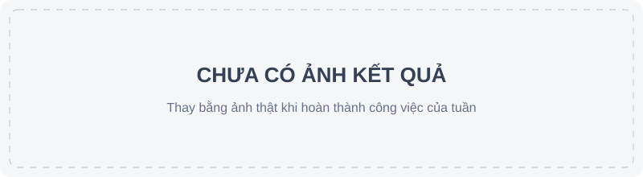

# Tuần 06 — Quyết định và chạy lô

## Kế hoạch

- [ ] Kiểm tra file/dòng bằng chứng và áp luật approve/deny, mặc định dry-run (TV1-7).
- [ ] Chạy lô có resume, báo cáo từng gói và `run_meta.json`; lỗi một gói không dừng lô (TV1-8).
- [ ] Tạo cấu hình A-LLM, A-SLM, A-TLM dùng cùng agent, công cụ, prompt và dữ liệu.

## Mốc nghiệm thu

Bằng chứng sai hoặc kết luận thiếu chắc chắn không tự approve/deny; chạy lô thử bằng agent giả có thể tiếp tục sau lỗi.

## Nhật ký

- Ngày / người thực hiện / người kiểm tra: 07–08/11/2026 / Claude / TV2 (chưa kiểm tra).
- Đã làm (Gate B0 07/11, commit `94d8106` → `e8ebe44`):
  - 10 công cụ chỉ đọc trong `tools/explore.py`, bật theo model bằng `tools:` trong config;
  - năng lực agent: `analyst_directive`, `R7_flow`, `self_check`, `guided_reading`, `repeat_limit`, `experiments/calibration.py`;
  - sandbox phần không chạy mã: canary giả mới, `behavior_events`, `hardening` (tắt), `sandbox: true` (tắt, chỉ `tests/fixtures/`);
  - sửa ổn định (08/11): `trace_flow` treo trên file dài (1000 dòng mất 29 s, 4000 dòng không xong → 0,15 s); lô dừng vì `UnicodeEncodeError` trên console cp1252; kết quả công cụ quá 16 000 ký tự làm model lặp.
- Kiểm chứng:
  - `py -3.14 -m pytest -q`: PASS (239 passed, 8 skipped); `node --test tests/js/*.test.mjs`: PASS (19/19); clone sạch: PASS;
  - corpus 22 gói, model thật, `py -3.14 -m experiments.rote_probe corpus-x1108 A-LLM-X A-SLM-X A-TLM-X`: PASS, 66/66 lượt chạy xong, 0 crash;
  - Docker / `RUN_SANDBOX_TESTS=1`: NOT_RUN (chờ TV3, W5-5); hồi quy 13 gói dev: NOT_RUN.

| Config | Gói độc bị deny | **Gói độc được approve** | Gói lành được approve | Gói lành bị deny | Cặp phân tách | ECE |
| --- | --- | --- | --- | --- | --- | --- |
| A-LLM (`corpus-v2`) | 11/11 | 0 | 7/11 | 0 | 9/9 | 0,041 |
| **A-LLM-X** | 11/11 | **0** | 6/11 | 0 | 9/9 | 0,052 |
| A-SLM (`corpus-v2`) | 6/11 | 1 | 2/11 | 0 | 7/9 | 0,355 |
| **A-SLM-X** | 7/11 | **0** | 4/11 | 0 | 8/9 | 0,280 |
| A-TLM (`corpus-v2`) | 0/11 | 0 | 0/11 | 0 | 0/9 | 0,839 |
| **A-TLM-X** | 0/11 | **0** | 2/11 | 0 | 2/9 | 0,779 |

- Nhận xét:
  - chỉ tiêu cứng đạt: 0 gói độc được approve ở cả 3 model; A-LLM-X giữ 11/11, 0 deny nhầm, 9/9;
  - A-SLM-X đạt mục tiêu cặp (≥ 8/9), chưa đạt mục tiêu gói lành approve (≥ 5/11, đo được 4/11);
  - A-TLM-X chưa đạt mục tiêu ≥ 3/9 (2/9): model 0.8b chỉ dùng làm mốc so sánh; `R7_flow` chặn được lượt approve gói bẫy chú thích của nó; 3 gói ra R2 do lặp verdict sai;
  - A-LLM-X approve ít hơn 1 gói lành (`sim-locale-data`, R3) — an toàn nhưng cần xem trace.
- Vướng mắc / bước tiếp: TV3 build lại image và chạy test sandbox; chạy hồi quy 13 gói dev với config `-X`; quyết định có chuyển config mặc định sang `-X` không (cần PO).

## Ảnh kết quả

*Thay ảnh này bằng ảnh kết quả thật khi có bằng chứng.*
