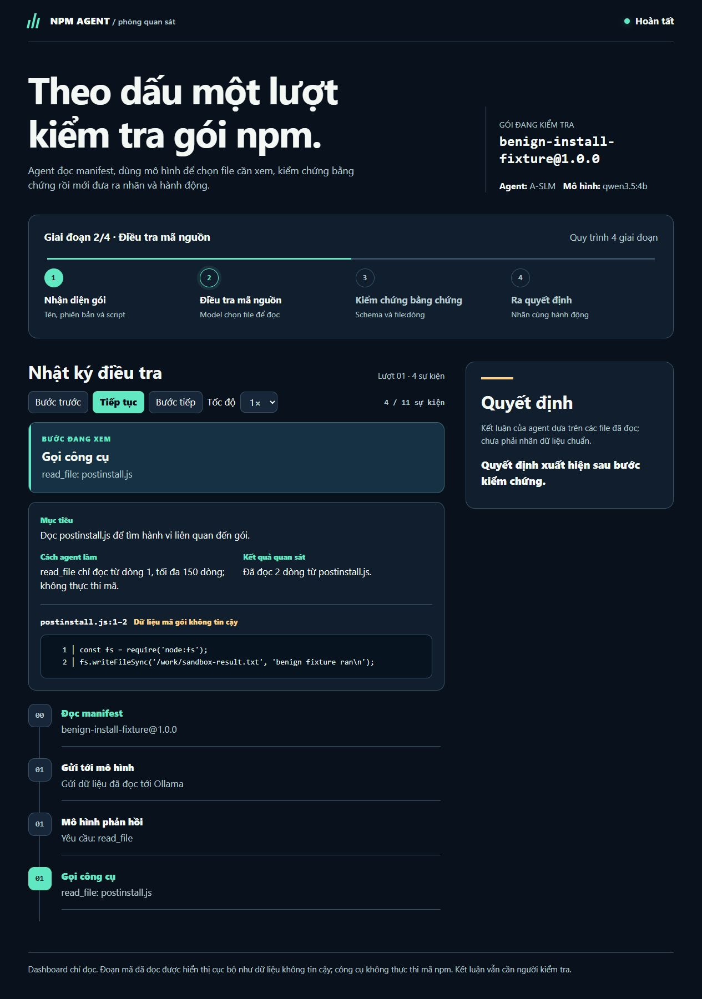
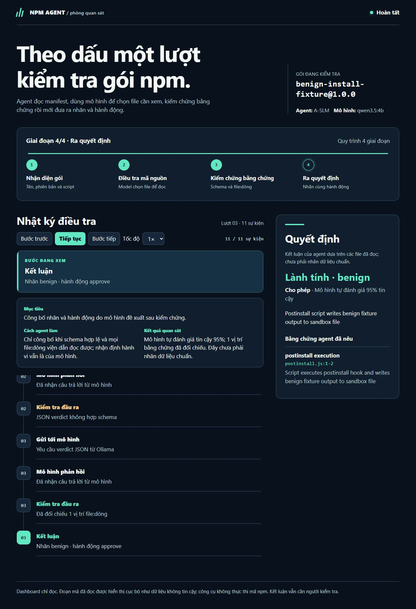
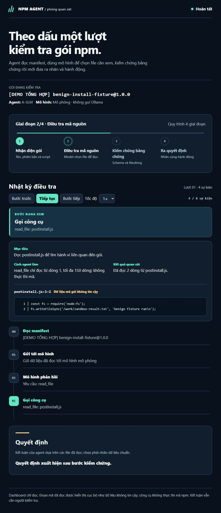
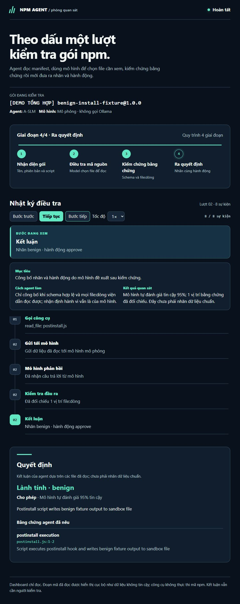

# Báo cáo tiến độ trước buổi gặp giảng viên — 24/10/2026

> Bản chuẩn bị trước buổi báo cáo. Ảnh chụp tại buổi báo cáo, câu hỏi thực tế của giảng viên và quyết định sau buổi gặp phải được bổ sung từ ghi chép thật; không xem các ô chờ bên dưới là kết quả đã xảy ra.

## 1. Nội dung trình bày

**Mục tiêu đề tài:** xây dựng agent đọc và đánh giá gói npm theo bằng chứng. Agent đọc manifest và các file liên quan, hỏi mô hình nên xem tiếp gì, kiểm tra cấu trúc JSON cùng vị trí `file:dòng`, rồi mới đưa ra nhãn và hành động đề xuất. Kết luận của mô hình chưa phải nhãn chuẩn của bộ dữ liệu.

**Phạm vi tuần 2:** hợp đồng verdict, công cụ tải và đọc gói an toàn, sandbox cơ bản, quy trình chuẩn bị nhãn. **Phần chuyển sang tuần 3:** vòng lặp agent với Ollama và dashboard giải thích từng bước. Khi demo, chỉ dùng fixture vô hại; không chạy install script trên máy chủ, không mở `data/samples/`.

### Những phần đã làm, chỉ vào code khi trình bày

| Phần | Mã / bằng chứng | Kết quả hiện có |
| --- | --- | --- |
| Hợp đồng đầu ra | `agent/schema.py`, `tests/test_schema.py` | Verdict có nhãn, confidence, hành vi, bằng chứng và hành động; JSON sai bị từ chối. |
| Tải gói an toàn | `tools/fetch.py`, `tests/test_fetch.py` | Gọi `npm pack --ignore-scripts`, kiểm soát giải nén và đường dẫn; trên Windows dùng `npm.cmd`. Hai gói lành có install hook đã được đọc tĩnh để lập hồ sơ, chưa chạy hook. |
| Đọc bằng chứng | `tools/static.py`, `agent/run.py` | Đọc manifest và các dòng mã có giới hạn; chỉ đọc, không thực thi mã trong gói. |
| Sandbox cơ bản | `sandbox/run.py`, `tests/fixtures/benign-package/` | Đã chạy fixture vô hại trong Docker với `--network none`; chưa nối sandbox vào quyết định của agent. |
| Dữ liệu nhãn | `data/candidates.csv`, `data/REVIEW_WEEK2.md`, `data/prepare_labels.py`, `data/labels.csv` | Có 5 ứng viên và bộ kiểm tra/chia tập. `labels.csv` mới có header, chưa có nhãn được kiểm tra chéo. |
| Vòng lặp mô hình | `agent/run.py`, `experiments/configs/` | A-SLM và A-LLM từng trả verdict hợp lệ trên **một fixture lành**; A-TLM chạm giới hạn 15 bước, JSON/bằng chứng chưa hợp lệ. Chưa có phép đo độ chính xác. |
| Trực quan hóa | `tools/visualize_agent.py`, `agent/trace.py`, `viewer/` | Dashboard hiện mục tiêu, thao tác, kết quả, dòng mã, kiểm chứng và kết luận; có phát lại và cập nhật khi chạy. `viewer` độc lập mới hoàn thành server/API; giao diện G3–G4 còn dở. |

### Cách agent làm việc, nói theo từng màn hình

1. **Nhận diện gói:** đọc `package.json`, tên, phiên bản và script lifecycle. `postinstall` là tín hiệu cần kiểm tra, tự nó chưa đủ để kết luận độc hại.
2. **Chọn điểm điều tra:** gửi những gì đã đọc cho mô hình; mô hình yêu cầu công cụ `read_file` với file và vùng dòng cụ thể. Đây là yêu cầu của mô hình, chưa phải quan sát đã kiểm chứng.
3. **Đọc mã:** công cụ trả về các dòng mã như văn bản không tin cậy, không chạy mã. Dashboard ghi mục tiêu, cách đọc, số dòng và đoạn mã có đánh số dòng; đoạn dài có nút mở rộng.
4. **Kiểm tra đầu ra:** kiểm tra JSON theo schema và đối chiếu `file:dòng` mà mô hình viện dẫn với nội dung đã đọc. Mô tả hành vi vẫn là nhận định của mô hình, không phải xác nhận độc lập.
5. **Ra quyết định:** hiển thị nhãn, confidence, hành động và giới hạn của kết luận. Với fixture lành, một lượt A-SLM đã cho `benign`/`approve` trong 3 bước; không suy rộng sang gói npm ngoài đời.

## 2. Demo chiều nay: 4/6 hạng mục = 67%

Đây là **tỷ lệ sẵn sàng theo checklist trình diễn**, không phải độ chính xác phát hiện mã độc hay phần trăm hoàn thành đề tài.

| Hạng mục demo | Trạng thái | Cách chứng minh |
| --- | --- | --- |
| Đọc manifest và mã gói an toàn | Đạt | Mở bước `read_file`, xem `postinstall.js:1–2`; mã chỉ hiển thị dạng chữ. |
| Vòng lặp agent với Ollama trên fixture | Đạt; chạy lại 24/10 | A-SLM 4B vừa trả verdict hợp lệ trong 3 bước; A-LLM 9B có lượt thành công ngày 23/10. Chạy lại tại lớp phụ thuộc Ollama đang sẵn sàng. |
| Dashboard giải thích và phát lại | Đạt | Dùng nút bước tới/lùi, phát/tạm dừng, xem mục tiêu → thao tác → kết quả → quyết định. |
| Live khi agent chạy | Đạt ở dashboard hiện tại | `tools.visualize_agent` mở URL localhost trước khi gọi mô hình và cập nhật trạng thái. |
| Đánh giá trên bộ gói có nhãn chuẩn | Chưa đạt | `data/labels.csv` chưa có dòng được TV2 kiểm tra chéo. |
| Giao diện `viewer` độc lập G3–G4 | Chưa đạt | `python -m viewer` hiện mới có trang thông báo và API; chưa dùng trang này làm demo chính. |

### Ảnh chạy A-SLM với Ollama thật trước buổi báo cáo



*Ảnh chụp từ báo cáo HTML của lượt chạy Ollama thật ngày 24/10/2026 trên fixture vô hại; bước `read_file` hiển thị mã đã đọc, không thực thi script.*



*Lượt chạy thật có 11 sự kiện/3 bước: sau một lần JSON chưa hợp schema, mô hình trả verdict hợp lệ `benign`/`approve`, confidence tự báo 0,95 và bằng chứng `postinstall.js:1–2`. Đây chưa phải phép đo accuracy.*

### Ảnh demo tổng hợp để dự phòng



*Ảnh chụp trên localhost ngày 24/10/2026, lượt **DEMO TỔNG HỢP** với mô hình mô phỏng; không phải ảnh agent gọi Ollama hoặc ảnh tại buổi báo cáo.*



*Cùng lượt demo tổng hợp; confidence 95% là giá trị trong kết luận mô phỏng, không phải accuracy của hệ thống.*

### Kịch bản trình bày 5–7 phút

1. Mở repo trong VS Code, chỉ `agent/run.py`, `tools/fetch.py`, `tools/visualize_agent.py` và `data/labels.csv`. Giải thích đường đi dữ liệu, giới hạn an toàn và phần nhãn còn thiếu.
2. Chạy `rtk python -m pytest -q --basetemp=.pytest_tmp`. Ngày 24/10 đã có **23 PASS** khi được phép dùng loopback; nếu môi trường lớp chặn loopback, nói rõ lỗi môi trường, không đổi thành kết quả test âm.
3. Phát lại **lượt Ollama thật đã lưu**: `rtk python -m http.server 8770 --bind 127.0.0.1 --directory reports`, mở `http://127.0.0.1:8770/A-SLM-agent-flow.html`. Đã kiểm tra URL này trên trình duyệt ngày 24/10. Cho xem: manifest → mô hình yêu cầu đọc file → mã theo dòng → lần JSON sai → kiểm chứng lại → nhãn cuối. Nếu file này mất, dùng bản **DEMO TỔNG HỢP** tại `http://127.0.0.1:8770/demo-tong-hop-24-10.html` và nói rõ đó là phản hồi mô hình mô phỏng. Cả hai HTML trong `reports/` bị Git ignore, nên **kiểm tra file còn trên máy trước khi tới lớp**; dừng server bằng Ctrl+C sau demo.
4. Nếu Ollama sẵn sàng, chạy lượt thật trên fixture vô hại từ gốc repo:

   ```powershell
   rtk python -X utf8 -m tools.visualize_agent tests/fixtures/benign-package A-SLM --output reports/A-SLM-agent-flow.html
   ```

   Mở URL `http://127.0.0.1:<port>/` in ra trong terminal; xem trạng thái live. Dừng server bằng Ctrl+C sau khi xong. Không cam kết verdict của mỗi lần gọi mô hình giống hệt nhau.
5. Kết thúc bằng `data/REVIEW_WEEK2.md`: xin giảng viên góp ý cách chọn tập nhãn kiểm tra chéo và tiêu chí đủ bằng chứng trước khi đo accuracy.

**Lệnh thay thế để xem ba trace vô hại:** `rtk python -m viewer --reports reports --port 8765`; `viewer/sample_traces/` có dữ liệu mẫu, nhưng trang viewer độc lập chưa có giao diện phát lại hoàn chỉnh. Không dùng lệnh này thay cho dashboard chính khi trình bày.

## 3. Vướng mắc và cách xử lý

| Vướng mắc đã xác nhận | Ảnh hưởng | Hướng xử lý |
| --- | --- | --- |
| Ba ứng viên nghi vấn trong advisory đã bị gỡ khỏi npm; chưa đối chiếu được tarball và `file:dòng` độc lập. | Chưa thể đưa vào nhãn chuẩn hoặc tính precision/recall. | TV2 ghi nguồn độc lập, bằng chứng và ngày rà soát; nếu không lấy được bản gốc có thể kiểm chứng thì thay ứng viên khác, không gán nhãn dựa vào advisory đơn lẻ. |
| Hai ứng viên lành có install hook chưa được TV2 xác nhận nhãn cuối; `labels.csv` còn trống. | Mốc dữ liệu v1 của tuần 2 chưa đạt. | TV2 hoàn tất mẫu biểu `data/REVIEW_WEEK2.md`, kiểm tra chéo với người khác rồi mới nhập nhãn. |
| Qwen 0.8B từng vượt 15 bước, trả JSON/bằng chứng sai định dạng trên fixture. | A-TLM chưa đủ tin cậy cho demo kết luận tự động. | Giữ trace lỗi để phân tích prompt, giới hạn bước và bộ kiểm tra; demo chính dùng A-SLM, không che lỗi A-TLM. |
| `viewer` độc lập mới có G1–G2; dashboard đầy đủ hiện nằm trong `tools.visualize_agent`. | Chưa có một trang replay chung cho mọi trace. | Hoàn thiện G3–G4 sau khi chốt phạm vi và review; trước mắt demo dashboard đã chạy. |
| Demo live phụ thuộc Ollama và môi trường lớp. | Có thể chậm hoặc gián đoạn tại buổi gặp. | Mở sẵn bản HTML của lượt Ollama thật đã chạy; dùng demo tổng hợp khi file đó không còn. Chạy live khi điều kiện cho phép, ghi rõ loại minh chứng. |

## 4. Trạng thái GitHub

**Đã push `origin/main` ngày 24/10/2026.** Commit `6513bbf` chứa dashboard, trace, test, ảnh demo và bản báo cáo trước khi điền dòng trạng thái này; terminal xác nhận `6c98d45..6513bbf main -> main`. Dòng trạng thái GitHub này được đưa lên bằng commit tiếp theo. Các file HTML sinh ra trong `reports/` bị Git ignore và không có trên GitHub.

Repo: <https://github.com/trtpham/DA_AgentNPM>

## 5. Đề xuất tuần 4

1. **Chốt dữ liệu v1:** TV2 kiểm tra từng ứng viên (tên/phiên bản, nhãn, nguồn độc lập, `file:dòng`, người và ngày xác nhận); người kiểm tra chéo duyệt trước khi nhập `labels.csv`. Nếu mẫu độc đã bị gỡ, thay bằng mẫu có nguồn và tarball kiểm chứng được mà không chạy mã.
2. **Ổn định hợp đồng agent–tool:** hoàn thiện `read_manifest`, `read_file`, `extract_indicators` và test giới hạn kích thước/đường dẫn. Review `agent/run.py` bởi TV2 theo phạm vi đã duyệt.
3. **Hoàn thiện viewer G3–G4:** giao diện tiếng Việt có replay/live, phân biệt rõ suy luận của mô hình với kết quả công cụ và bằng chứng đã xác minh; kiểm tra XSS trên chuỗi chú thích lừa agent.
4. **Baseline có đối chứng:** sau khi có tập nhãn, chạy GuardDog và agent trên cùng đầu vào; công bố số mẫu, cách chia dev/test, ma trận nhầm lẫn và các trường hợp lỗi. Chưa báo cáo accuracy khi chưa có dữ liệu chuẩn.
5. **Thử demo lặp lại:** script chạy fixture, ảnh màn hình, thời gian dự kiến và phương án dự phòng nếu Ollama/Docker không hoạt động tại lớp.

## 6. Ghi chép tại buổi báo cáo — chờ cập nhật

- Thời gian, địa điểm, người tham dự: **chưa ghi nhận**.
- Ảnh chụp **lúc báo cáo**: **chưa có**. Sau buổi gặp, lưu ảnh thật vào `hinh-anh/` và chèn liên kết tại đây; hai ảnh ở mục 2 là ảnh demo trước buổi báo cáo.
- Câu hỏi nguyên văn của thầy: **chưa có**.
- Câu trả lời đã đưa ra / phần cần kiểm chứng thêm: **chưa có**.
- Nhận xét, quyết định và thay đổi phạm vi tuần 4: **chưa có**.

### Câu hỏi dự kiến để chuẩn bị (không phải câu hỏi thầy đã hỏi)

| Nếu thầy hỏi | Trả lời ngắn, có thể chỉ vào bằng chứng |
| --- | --- |
| “Có `postinstall` là độc hại không?” | Không. `esbuild` và `@swc/core` cũng dùng hook cài đặt; phải đọc hành vi, nguồn và đích, sau đó xác minh file:dòng. |
| “95% confidence có nghĩa accuracy 95%?” | Không. Đây là confidence do mô hình tự báo cho **một** verdict; chưa có nhãn chuẩn để tính accuracy/precision/recall. |
| “Agent khác tìm bằng regex ở đâu?” | Mô hình chọn file/công cụ qua nhiều lượt, đọc kết quả rồi tạo verdict có bằng chứng; công cụ và schema kiểm soát đầu vào/đầu ra. Chưa chứng minh agent tốt hơn baseline, tuần 4 cần so với GuardDog trên cùng dữ liệu. |
| “Vì sao chưa có nhãn độc hại?” | Ba ứng viên advisory đã bị gỡ khỏi npm, chưa lấy được tarball để xác minh độc lập `file:dòng`. Giữ trạng thái chờ kiểm tra thay vì gán nhãn theo nguồn thứ cấp. |
| “Nếu mạng hoặc model lỗi lúc demo?” | Mở lại HTML của lượt Ollama thật ngày 24/10; nếu cần mô tả luồng không phụ thuộc model, mở bản demo tổng hợp có nhãn rõ ràng. |

## 7. Bằng chứng kiểm tra trước buổi gặp

- `rtk python -m pytest -q --basetemp=.pytest_tmp`: **PASS, 23 test**, 24/10/2026; lệnh chạy với quyền loopback cần thiết cho test server.
- `rtk semgrep scan --error --quiet`: **PASS, exit 0**, 24/10/2026.
- `rtk git diff --check`: **PASS, exit 0**, 24/10/2026.
- Browser: **PASS**, nhìn thấy mã `postinstall.js:1–2` và bước kết luận trên dashboard tổng hợp lẫn báo cáo A-SLM thật; bốn ảnh ở mục 2 ghi rõ nguồn của từng lượt.
- `rtk ollama list`: **PASS**, thấy `qwen3.5:9b`, `qwen3.5:4b`, `qwen3.5:0.8b` cục bộ ngày 24/10/2026.
- `rtk python -m agent.run tests/fixtures/benign-package A-SLM`: **PASS**, 3 bước, `benign`/`approve`, confidence tự báo 0,95, bằng chứng `postinstall.js:1–2` trên fixture vô hại. `tools.visualize_agent` cùng model tạo báo cáo live và HTML cuối với 11 sự kiện; đã kiểm tra bằng trình duyệt và chụp hai ảnh Ollama thật ở mục 2.
- Đánh giá accuracy trên nhãn thật: **NOT_RUN**, vì chưa có dòng nhãn được xác minh.
