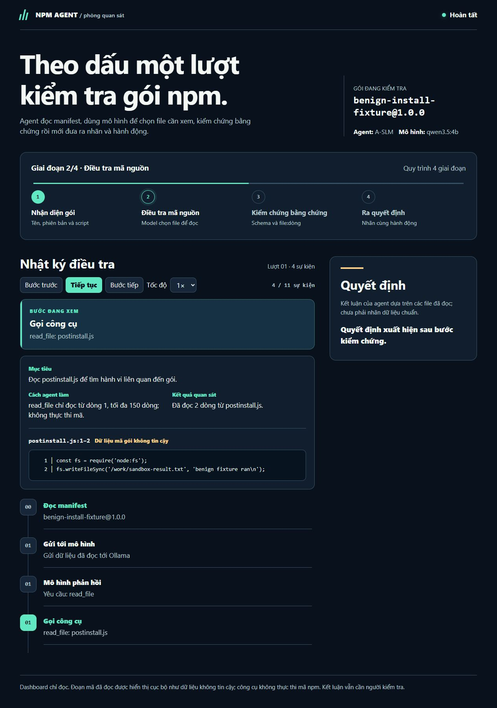
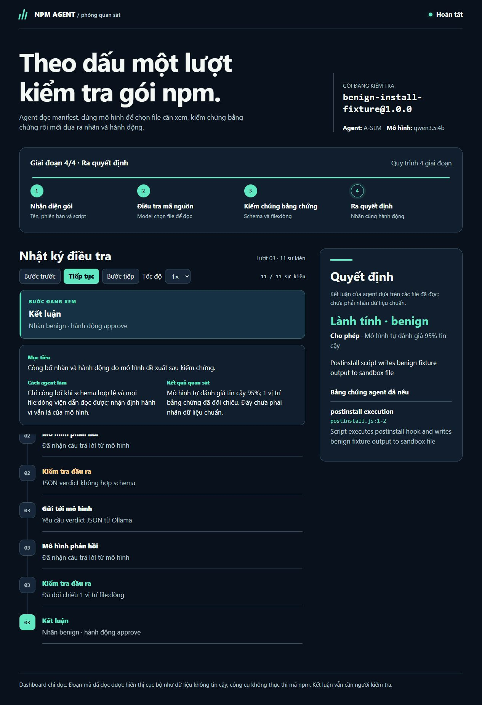
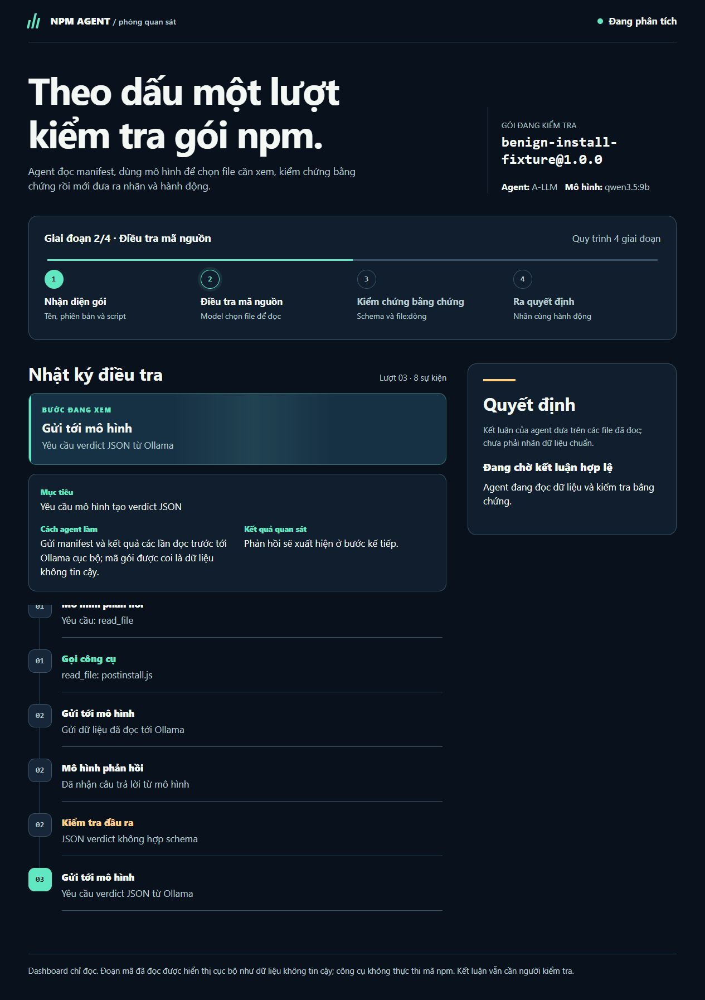
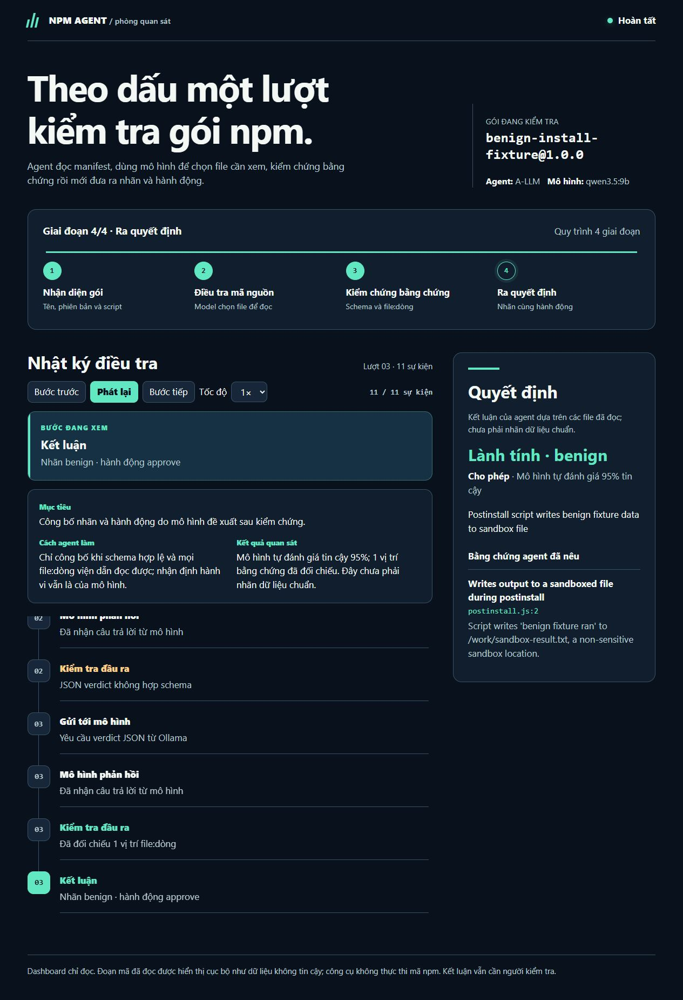

# Báo cáo tiến độ tuần 03 — AI Agent kiểm tra gói npm

**Thành viên:** Lê Đặng Thiên Phước · Phạm Minh Triết · Nguyễn Đình Thiên

**Bản cập nhật:** 01/11/2026; nội dung buổi gặp giảng viên được ghi theo thông tin nhóm đã cung cấp, không phải bản chép lời.

**Mức hiện tại:** các agent đã chạy thử sơ bộ trên mẫu mô phỏng vô hại và một gói npm lành. Nhóm đã trình diễn được quá trình đọc mã, ghi lại từng bước và đưa ra quyết định. Đây là bản demo hoạt động, chưa phải hệ thống đã được đánh giá độ chính xác trên dữ liệu chuẩn.

## 1. Nội dung buổi báo cáo tuần

Nhóm trình bày cách một agent kiểm tra gói npm trước khi đưa ra quyết định: đọc `package.json`, tìm lệnh chạy lúc cài đặt, đọc đúng file mã mà lệnh đó gọi, đối chiếu dấu hiệu và trích dẫn `file:dòng`. Kết quả cuối có nhãn, hành động và lý do. Hành động hiện chỉ là **dry-run**, không tự sửa dự án hoặc chạy script cài đặt trên máy thật.

Để thầy nhìn thấy quá trình thay vì chỉ thấy một nhãn cuối, nhóm đã có trang xem lại trace theo từng bước. Mỗi bước cho thấy agent gọi công cụ nào, nhận dữ liệu gì và bằng chứng nào được chấp nhận hoặc bác bỏ. Sandbox Docker chạy riêng với fixture vô hại và canary giả để ghi dấu vết; sandbox chưa được nối vào vòng lặp agent.

Sau buổi báo cáo, theo ghi nhận của nhóm, góp ý chính của thầy là **tiếp tục tìm và hoàn thiện dữ liệu**. Nhóm đã tổng hợp 450 ứng viên metadata theo 25 batch và xây dựng bảng riêng gồm 76 nhãn có nguồn, hành vi và vị trí mã. Danh sách 450 ứng viên không được tự động coi là dữ liệu đã gán nhãn. Bảng 76 nhãn vẫn cần kiểm tra chéo mã gốc trước khi dùng làm đáp án chuẩn để tính độ chính xác.

## 2. Demo hiện làm được bao nhiêu?

Theo **sáu hạng mục demo** nhóm theo dõi từ đầu tuần, hiện đạt **5/6 (khoảng 83%)**. Đây là mức hoàn thành phần trình diễn, **không phải độ chính xác của AI**.

| Hạng mục | Tình trạng có thể trình bày |
| --- | --- |
| Đọc manifest và mã gói theo dòng | Đạt; có trace `read_manifest`, `read_file`, `extract_indicators`. |
| Agent gọi Ollama và kiểm tra verdict | Đạt với A-LLM và A-SLM trên fixture vô hại. |
| Sandbox Docker ghi dấu vết canary giả | Đạt; fixture canary chạy trong container, trace có tín hiệu `.ssh` và `.npmrc` giả. |
| Dashboard xem lại từng bước | Đạt; có thể phát lại trace đã lưu. |
| Xem trực tiếp và quét thử một gói npm thật | Đạt trên `esbuild@0.24.0`; A-LLM kết thúc sau 6 bước với verdict hợp lệ `benign/approve`, 3 bằng chứng được xác minh, vẫn là dry-run. |
| Đánh giá độ chính xác trên bộ nhãn chuẩn | Chưa đạt; cần kiểm tra chéo 76 nhãn và chạy cùng một bộ đầu vào cho các mô hình. |

Ảnh dưới đây chụp **demo trên fixture vô hại trước buổi gặp**; không phải ảnh quét `esbuild` hay ảnh chụp trong lúc gặp thầy.

**Bằng chứng mới nhất:** trace quét `esbuild@0.24.0` ở `reports/esbuild-0.24.0-16k/` trên máy demo. Gói được tải bằng `npm pack --ignore-scripts`; không chạy script cài đặt. Khi trình bày, mở trace này trong viewer để thầy thấy cả sáu bước, nhất là ba dòng bằng chứng trong `install.js` và quyết định cuối.

## 3. Cách demo 5–7 phút

1. Mở VS Code tại repo, chỉ vào `agent/run.py`, `tools/static.py` và `agent/schema.py` để giải thích agent đọc gì, kiểm tra gì và vì sao verdict phải có bằng chứng.
2. Tại thư mục repo, chạy `rtk python -m viewer --reports reports --port 8765`, rồi mở `http://127.0.0.1:8765`. Chọn run `esbuild-0.24.0-16k`, phát lại từng bước đọc mã và quyết định `benign/approve` ở chế độ dry-run.
3. Chọn trace fixture canary để cho thấy A-LLM và A-SLM kết luận `malicious/deny` khi bằng chứng đủ; nhấn mạnh canary là mẫu mô phỏng vô hại.
4. Nếu cần chứng minh chất lượng code, chạy `rtk uv run --no-project --offline --with pytest --with pydantic python -m pytest -q`. Lượt kiểm tra ngày 01/11 đạt **72/72 test**.

Nên dùng **replay** cho phần trình bày chính vì lượt quét thật qua Ollama mất vài phút. Chế độ live dùng khi thầy muốn xem sự kiện mới xuất hiện theo thời gian thực.

## 4. Việc đã gỡ và việc còn kẹt

Lúc đầu A-LLM đọc `esbuild` nhưng lặp verdict sai và chạm giới hạn 15 bước. Nhóm tìm được Ollama đang dùng ngữ cảnh 4096 token; sau khi tăng lên 16384 token và bỏ verdict sai cũ khỏi lịch sử chat, cùng gói này đã hoàn tất trong 6 bước. Bộ kiểm tra vẫn từ chối mã MITRE không được chứng minh và các dòng agent chưa đọc. A-LLM và A-SLM cũng đã kiểm tra lại fixture canary với kết quả `malicious/deny`. Toàn bộ test repo **72/72 PASS**, Semgrep trên `agent/run.py` **PASS**.

Trace `esbuild` cũng ghi nhận **ba verdict JSON không hợp lệ trước verdict hợp lệ cuối cùng**. Vì vậy lượt quét thành công này chứng minh luồng chạy được, nhưng chưa đủ để gọi A-LLM ổn định hay đo độ chính xác.

**A-TLM (`qwen3.5:0.8b`) chưa ổn định:** trên hai fixture khó là `no-hook-package` và `canary-package`, model vẫn không trả verdict đúng schema trong 15 bước. Hệ thống rơi về `suspicious/review`; đây là cách giữ an toàn khi không chắc, không chứng minh model đã nhận diện canary. Không dùng A-TLM làm kết quả chính của demo.

**Dữ liệu chưa chốt làm ground truth:** có 76 nhãn (20 lành, 2 nghi vấn, 54 độc hại) và 450 ứng viên metadata. Đã chia theo họ gói để cả `dev` và `test` có đủ ba lớp, không rò cùng họ giữa hai tập. Lượt kiểm tra cấu trúc thứ hai đã qua, nhưng chưa có chữ ký kiểm tra chéo mã gốc từng nhãn của TV2/người được giao. Vì vậy nhóm chưa báo cáo accuracy, recall hoặc F1.

Trong 450 ứng viên, **445 có metadata tra cứu được, 5 không còn tra cứu được**; cả 450 vẫn chờ đọc mã và kiểm tra nhãn. Đây là kho ứng viên để chọn mẫu cho bước tiếp theo, chưa phải 450 mẫu đánh giá AI.

## 5. GitHub và ảnh lúc báo cáo

Báo cáo tuần 3 đã được đưa lên GitHub. Phần cập nhật code, dữ liệu và test tuần 1–3 vẫn ở commit cục bộ, chưa được đồng bộ lên GitHub. Trace quét gói thật nằm trong `reports/` trên máy demo và được Git bỏ qua; nhóm dùng dashboard cục bộ để trình bày trace đó.

Nhóm **không có ảnh chụp lúc gặp giảng viên** vì đã quên chụp. Các ảnh ở mục 2 là ảnh demo trước buổi báo cáo. Nhóm có file ghi âm nhưng chưa dùng nó để chép nguyên văn câu hỏi; không ghi câu hỏi hay lời nhận xét cụ thể ngoài góp ý tìm thêm dữ liệu mà thành viên đã cung cấp.

## 6. Đề xuất tuần 4 và định hướng

1. **Ưu tiên dữ liệu:** TV2 hoặc người được giao kiểm tra chéo 76 nhãn theo từng batch 15–20 dòng, xác nhận tên/phiên bản, nguồn, `file:dòng`, người và ngày duyệt. Chỉ đưa nhãn đã duyệt vào bộ đánh giá; 450 ứng viên metadata vẫn chờ đọc mã.
2. **Ưu tiên agent:** giữ A-LLM và A-SLM làm luồng demo chính. Đo trên các fixture vô hại và những gói đã được phép kiểm tra; ghi lại số verdict JSON hợp lệ, thời gian và lỗi. Tiếp tục sửa A-TLM trên fixture; khi model lỗi, giữ kết quả `review`.
3. Khi có đủ nhãn đã kiểm tra chéo, mới tính độ chính xác, recall và các ca sai trên cùng một tập test. Nối sandbox vào agent sau khi luồng dữ liệu và quyền thực thi được review. Chụp ảnh thật trong buổi báo cáo tiếp theo.

**Trạng thái chốt tuần 3:** các mốc công cụ, agent với A-LLM/A-SLM, viewer và sandbox cơ bản đã có bằng chứng chạy. Phần chưa hoàn tất là đánh giá trên bộ nhãn được kiểm tra chéo và độ ổn định của A-TLM.
