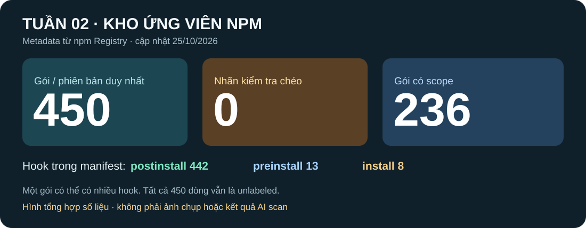
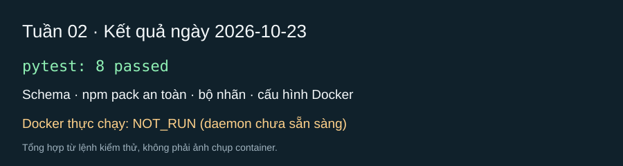

# Nội dung nộp LMS — báo cáo tiến độ tuần 02

**Đề tài:** AI Agent kiểm tra gói npm

**Thành viên:** Lê Đặng Thiên Phước · Phạm Minh Triết · Nguyễn Đình Thiên

**Ngày cập nhật:** 25/10/2026

## 1. Nội dung buổi báo cáo tuần

Nhóm báo cáo tiến độ phần dữ liệu và công cụ kiểm tra gói npm. Đã xây dựng hợp đồng JSON/verdict, công cụ lấy gói bằng `npm pack --ignore-scripts` và đọc tĩnh an toàn, cùng sandbox Docker chạy offline trên fixture vô hại. Bộ thu thập metadata đã tổng hợp **450 gói/phiên bản npm duy nhất** có lifecycle hook; mỗi dòng có URL manifest để đối chiếu. Trong đó có 236 gói scoped. Dữ liệu và báo cáo đã được đẩy lên GitHub.

Điểm kẹt chính là **chưa có bộ nhãn được kiểm tra chéo**: `labels.csv` hiện có 0 dòng ground truth. Cả 450 dòng mới chỉ là ứng viên `unlabeled`, chưa xác định gói lành hay độc và chưa đủ điều kiện tính độ chính xác. Theo ghi nhận của nhóm, góp ý chính của giảng viên là **tiếp tục tìm và hoàn thiện dữ liệu**. Nhóm đã bổ sung số lượng ứng viên, nhưng cần xác minh bằng chứng và nhãn trước khi dùng cho thực nghiệm.

## 2. Demo bao nhiêu phần trăm (kèm ảnh)

**Mức có thể demo: 3/4 hạng mục tuần 02 = 75% phạm vi tuần**, không phải 75% toàn đồ án. Có thể trình bày: (1) schema verdict và kiểm tra đầu ra, (2) đọc/lấy gói an toàn không chạy install script trên host, (3) sandbox Docker với fixture vô hại. Hạng mục chưa demo như kết quả hoàn chỉnh là **bộ dữ liệu v1 có nhãn được TV2 kiểm tra chéo**. Không chạy AI scan trên toàn bộ 450 ứng viên.

*Ảnh 1: tổng hợp số liệu từ CSV ngày 25/10/2026; đây là infographic, không phải ảnh chụp buổi báo cáo.*

*Ảnh 2: tổng hợp test và Docker fixture ngày 23/10/2026; không phải ảnh chụp buổi báo cáo. Khi đăng LMS, tải hai file SVG từ `hinh-anh/` lên cùng bài nộp và chèn vào đúng vị trí.*

## 3. Ảnh chụp lúc báo cáo

**Không có ảnh chụp tại buổi báo cáo vì nhóm quên chụp.** Nhóm có file ghi âm buổi trao đổi và có thể cung cấp nếu giảng viên cần đối chiếu nội dung. Hai ảnh ở mục 2 là hình minh họa kết quả kỹ thuật, không được dùng thay hoặc ghi nhãn là ảnh chụp buổi báo cáo.

## 4. Đề xuất tuần 03–04, cách giải quyết và định hướng

**Tuần 03 — ưu tiên chất lượng dữ liệu và quy trình an toàn:** Chọn một pilot 20–30 ứng viên đa dạng từ kho 450 và nguồn advisory; Minh Triết (TV2) kiểm tra tên/phiên bản, lifecycle hook, bằng chứng `file:dòng`, nguồn độc lập, nhãn và ngày review. Giữ dòng thiếu bằng chứng ở trạng thái chờ. Thiên Phước (TV1) cùng Minh Triết khử trùng lặp theo tên/cụm và bổ sung gói đối chứng lành để giảm lệch do tìm kiếm `postinstall`. Đình Thiên (TV3) cùng Thiên Phước rà sandbox, `strace` và canary trên fixture vô hại; mẫu thật chỉ xem xét trong VM theo quy trình đã duyệt. Nhóm agent chỉ phân tích subset đã duyệt, không chạy hàng loạt 450 gói.

**Tuần 04 — tích hợp và baseline có kiểm soát:** Chốt một tập dev/test nhỏ từ những dòng đã được kiểm tra chéo; review `agent/run.py` và bằng chứng verdict của A-LLM/A-SLM/A-TLM trên cùng quy trình. Bổ sung công cụ bối cảnh chỉ đọc như OSV/metadata, sau đó chạy GuardDog baseline trên tập phù hợp khi đã có nhãn. Mọi hành động approve/deny vẫn là dry-run. Chỉ lập ma trận nhầm lẫn và Precision/Recall/F1 sau khi có ground truth đủ tin cậy.

**Định hướng:** Chuyển từ **450 ứng viên có nguồn** sang **bộ dữ liệu có nhãn và bằng chứng được kiểm tra chéo**. Số lượng ứng viên đã đạt mục tiêu tìm kiếm ban đầu; việc còn quan trọng là xác minh, cân bằng nhóm, cố định split và ghi lại sai sót của mô hình. Không coi metadata hay advisory là nhãn cuối nếu TV2 chưa duyệt.

**Minh chứng GitHub:** [commit dữ liệu `eb2f925`](https://github.com/trtpham/DA_AgentNPM/commit/eb2f925) và [báo cáo tuần 02 `d0f245c`](https://github.com/trtpham/DA_AgentNPM/commit/d0f245c). Báo cáo chi tiết: [bao-cao-tuan-02-2026-10-25.md](bao-cao-tuan-02-2026-10-25.md).
