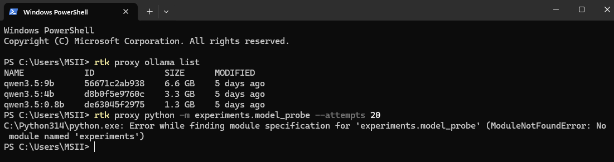
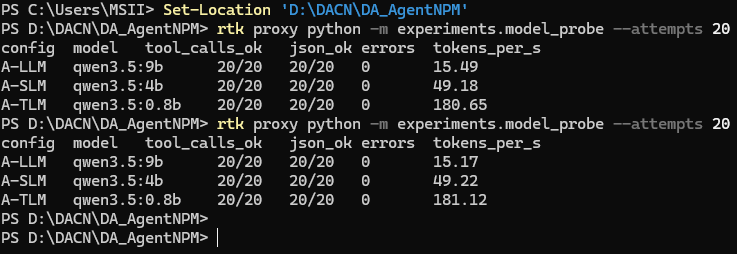

# Tuần 01 — Chốt nền tảng

## Kế hoạch

- [x] Chọn và tải ba model `qwen3.5:9b`, `qwen3.5:4b`, `qwen3.5:0.8b` qua Ollama.
- [x] Dựng khung repo và `.gitignore` chặn mẫu độc, tarball và đầu ra sandbox (TV1-1).
- [x] Chốt hợp đồng JSON, quyền ghi và phiên bản công cụ.
- [x] Probe tool calling 20 lượt/model bằng công cụ giả (TV2-1).

## Nhật ký

- Ngày: 23/10/2026.
- Kết quả đã xác minh: `ollama list` hiển thị đủ ba tag; 9B 6.6 GB, 4B 3.3 GB, 0.8B 1.3 GB.
- Chưa kiểm tra: chất lượng suy luận, tool calling và các mốc còn lại của tuần.
- Người thực hiện / người kiểm tra: chưa phân công.

## Ảnh kết quả

*Ảnh PowerShell do Phạm Minh Triết cung cấp ngày 28/10/2026.*

## Cập nhật 2026-10-25

- **PASS — nền tảng:** Repo có cấu trúc, hợp đồng verdict và phân quyền dry-run. Python 3.14.2, Node 24.13.0, npm 11.6.2, Ollama 0.40.11; `ollama list` có đủ ba tag.
- **PASS — probe giả lập:** `experiments/model_probe.py` gọi công cụ giả 20 lượt/model. A-LLM, A-SLM, A-TLM đều đạt 20/20 tool call và 20/20 JSON. Tốc độ quan sát lần lượt 15.2, 48.24, 145.97 token/s; đây là phép đo đầu ra của probe, không phải benchmark chất lượng phân tích gói.
- **Quan sát tài nguyên:** `ollama ps` hiển thị 9B 6.3 GB, 4B 3.1 GB, 0.8B 570 MB; các số này không phải RAM đỉnh.
- **Còn thiếu:** Chưa có reviewer độc lập ký nghiệm thu tuần 1. Probe công cụ giả chưa chứng minh độ ổn định của agent trên gói thật.

## Cập nhật 2026-10-28 — xác minh lại

- `ollama list` hiển thị đủ ba model: A-LLM `qwen3.5:9b` (`56671c2ab938`), A-SLM `qwen3.5:4b` (`d8b0f5e9760c`) và A-TLM `qwen3.5:0.8b` (`de63045f2975`).
- Phạm Minh Triết chạy `python -m experiments.model_probe --attempts 20` **hai lần liên tiếp** tại gốc repo. Mỗi lần, cả ba model đều đạt `20/20` tool call, `20/20` JSON và `0` lỗi; tổng cộng `40/40` mỗi chỉ số cho từng model trên hai lượt probe.

| Model | Token/s lượt 1 | Token/s lượt 2 |
| --- | ---: | ---: |
| A-LLM (9B) | 15.49 | 15.17 |
| A-SLM (4B) | 49.18 | 49.22 |
| A-TLM (0.8B) | 180.65 | 181.12 |

*Ảnh PowerShell do Phạm Minh Triết cung cấp ngày 28/10/2026. Probe dùng công cụ giả, không phân tích gói npm; các tốc độ trên không phải kết quả benchmark chất lượng hay độ chính xác của agent. Reviewer độc lập vẫn chưa ký nghiệm thu tuần 1.*

## Rà soát theo vai trò ngày 2026-10-29

- **TV1 — PASS:** khung repo và quy tắc Git ignore cho mẫu độc, tarball, đầu ra sandbox đã có; bộ test toàn repo đạt 64/64. Không có nhiệm vụ TV1 tuần 1 còn thiếu trong kế hoạch.
- **TV2 — PASS phần kỹ thuật:** Ollama có đủ ba model. Probe công cụ giả mới nhất đạt 20/20 tool call, 20/20 JSON, 0 lỗi cho từng model; tốc độ quan sát A-LLM 14.12, A-SLM 46.09, A-TLM 152.22 token/s. Probe không đưa mã gói npm vào mô hình.
- **TV3:** kế hoạch tuần 1 không giao task riêng; sandbox bắt đầu từ tuần 2. Reviewer độc lập chưa ký nghiệm thu tuần 1, nên không ghi đã chốt bởi cả nhóm.

## Xác minh lại ngày 2026-11-01

- Ollama vẫn có đủ `qwen3.5:9b`, `qwen3.5:4b`, `qwen3.5:0.8b`. `.gitignore` còn chặn `data/samples/`, tarball `.tgz` và trace dưới `reports/`.
- Bốn đầu việc trong kế hoạch tuần 1 đều có bằng chứng kỹ thuật; bộ test toàn repo hiện **72/72 PASS**. Kết quả probe 20 lượt/model là kết quả đã ghi ngày 28/10, không chạy lại và không phải phép đo độ chính xác trên gói npm.
- Còn điều kiện thủ tục: người review khác người thực hiện cần ký nghiệm thu tuần 1. Không ghi thay chữ ký của thành viên.

## Xác minh lại ngày 2026-11-03 (Claude)

- **PASS — môi trường:** `ollama list` có đủ `qwen3.5:9b/4b/0.8b`; Python 3.14.2 với `requirements.txt` (pydantic 2.13.2, pytest 9.1.1); Node 24.13.0, npm 11.6.2; Docker 29.1.3. `AGENTS.md` gốc đã được đưa vào repo.
- **PASS — probe 20 lượt/model với công cụ giả, chạy lại hôm nay:** A-LLM 20/20 tool call, 20/20 JSON, 14.95 token/s; A-SLM 20/20, 20/20, 49.14 token/s; A-TLM 20/20, 20/20, 177.31 token/s. Probe không dùng mã gói và không đo độ chính xác.
- **Còn thủ tục, chỉ người thật làm được:** reviewer khác người thực hiện ký nghiệm thu tuần 1. Mọi hạng mục kỹ thuật của tuần 1 đã có bằng chứng.
