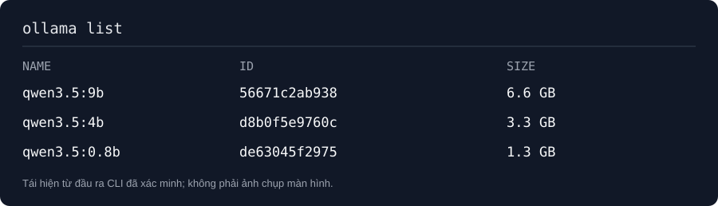

# Tuần 01 — Chốt nền tảng

## Kế hoạch

- [x] Chọn và tải ba model `qwen3.5:9b`, `qwen3.5:4b`, `qwen3.5:0.8b` qua Ollama.
- [ ] Dựng khung repo và `.gitignore` chặn mẫu độc, tarball và đầu ra sandbox (TV1-1).
- [ ] Chốt hợp đồng JSON, quyền ghi và phiên bản công cụ.
- [ ] Probe tool calling 20 lượt/model bằng công cụ giả (TV2-1).

## Nhật ký

- Ngày: 23/10/2026.
- Kết quả đã xác minh: `ollama list` hiển thị đủ ba tag; 9B 6.6 GB, 4B 3.3 GB, 0.8B 1.3 GB.
- Chưa kiểm tra: chất lượng suy luận, tool calling và các mốc còn lại của tuần.
- Người thực hiện / người kiểm tra: chưa phân công.

## Ảnh kết quả

*Hình tái hiện từ đầu ra `ollama list` đã xác minh, không phải ảnh chụp màn hình.*
