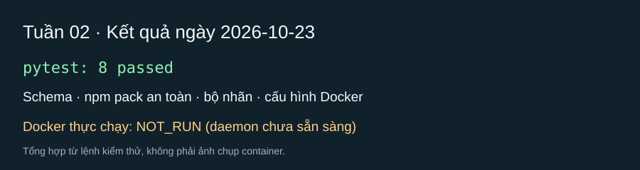

# Tuần 02 — Dữ liệu và hợp đồng công cụ

[Báo cáo tuần 02](noi-dung-lms-tuan-02-2026-10-25.md)

## Kế hoạch

- [x] Định nghĩa/đọc hợp đồng 11 cột `labels.csv`, chống trùng, kiểm tra bằng chứng và chia dev/test theo cụm trên dữ liệu fixture (TV1-2).
- [x] Nhập hai nhãn `benign` do Codex kiểm tra và duyệt theo ủy quyền TV2 vào `labels.csv`; gán split theo cụm (TV1-2).
- [ ] Chốt dữ liệu v1: cần thêm nhãn `malicious`/`suspicious` có `file:dòng` và kiểm tra chéo độc lập trước khi đo agent.
- [x] Tạo schema verdict và kiểm tra các quy tắc JSON (TV2-3).
- [x] Làm `fetch_package` bằng `npm pack`, giải nén an toàn, không chạy script trên máy thật (TV1-3).
- [x] Dựng sandbox cách ly cơ bản với mẫu mô phỏng vô hại (TV3-1).

## Mốc nghiệm thu

Dữ liệu v1 có nguồn và nhãn kiểm tra chéo; các test với dữ liệu giả chứng minh công cụ đọc không thực thi install script.

## Nhật ký

- Ngày / người thực hiện / người kiểm tra: 2026-10-23 / Codex / Phạm Minh Triết nhận vai trò TV2 kiểm tra chéo nhãn, TV1 kiểm tra chéo sandbox; chưa có kết quả review của thành viên.
- Đã làm: tạo cấu trúc dự án, schema verdict bằng Pydantic, `fetch_package` dùng `npm pack --ignore-scripts` và giải nén có giới hạn, bộ chuẩn hóa nhãn với chống trùng và chia dev/test ổn định, lệnh sandbox Docker với mạng tắt và mount chỉ đọc; chỉ dùng fixture vô hại.
- Kiểm chứng: `rtk python -m pytest -q --tb=line --basetemp=.pytest_tmp` — PASS (8 test); test xác nhận lệnh `npm pack` không chạy script, chặn traversal/symlink và lệnh Docker có `--network none`.
- PASS: Docker Engine 29.1.3; chạy `run_sandbox(Path('tests/fixtures/benign-package'))` trong Docker, returncode 0. Log có `benign-install-fixture@1.0.0 postinstall` và `node postinstall.js`; lệnh chạy với `--network none`, mount đầu vào chỉ đọc và giới hạn quyền/tài nguyên.
- Image dùng khi thử: `node@sha256:fe4f6d74e20370acb04ad889077d14d0f64a9c8ea6a42bc60cddf1e844699914`.
- NOT_RUN: không tải hoặc chạy gói npm thật; fixture chỉ mô phỏng vô hại. Chưa đo dấu vết `strace` (việc tuần 3).
- PASS: `rtk semgrep scan` chạy 324 quy tắc trên 34 file Git tracked, 0 findings (sau khi cấp quyền chạy ngoài sandbox công cụ).
- Bổ sung 2026-10-23: ghi 3 ứng viên gói có `postinstall` từ GitHub Advisory/OpenSSF vào `data/candidates.csv` (chỉ metadata, không tải gói). Các nhãn nguồn chưa được kiểm tra độc lập và chưa nhập vào `labels.csv`.
- Vướng mắc / bước tiếp: `data/labels.csv` chỉ có header; 3 ứng viên advisory chưa được TV2 kiểm tra độc lập và chưa có ứng viên benign đã đánh giá. Mốc dữ liệu v1 chưa đạt.

### Bổ sung ngày 2026-10-24

- Đã đồng bộ `labels.csv` và `experiments/dataset.py` với hợp đồng 11 cột ở AGENTS gốc; `prepare_labels` kiểm tra nhãn, bằng chứng, bản trùng rồi gán split ổn định theo tên gói. Test dùng dữ liệu giả; bảng nhãn thật vẫn chỉ có header.
- Đã thêm hai ứng viên lành có install hook (`esbuild@0.24.0`, `@swc/core@1.7.36`) và [hồ sơ bằng chứng cần TV2 kiểm tra](../data/REVIEW_WEEK2.md). Chỉ `npm pack --ignore-scripts` và đọc tĩnh; hai tarball khớp integrity của npm. Ba gói nghi vấn đã bị gỡ khỏi registry, nên chỉ có báo cáo nguồn và chưa có bằng chứng file:dòng được kiểm tra độc lập.
- Sửa `fetch_package` để gọi đúng `npm.cmd` trên Windows. PASS: `fetch_package('esbuild', '0.24.0')` đọc 7 file và `read_manifest` thấy `postinstall: node install.js`; không chạy hook.
- PASS: 9 test trọng tâm tuần 2; PASS: toàn bộ 23 test khi cho phép kết nối loopback cục bộ; PASS: `git diff --check`; PASS: `rtk semgrep scan --error --quiet` (exit 0). Lần pytest thường bị WinError 10013 do sandbox chặn socket loopback của test viewer, không phải lỗi code tuần 2.
- Mốc còn thiếu: Phạm Minh Triết (TV2) xác nhận từng nhãn, nguồn độc lập, `file:lines` và ngày kiểm tra trong hồ sơ. Chưa đưa ứng viên vào `labels.csv` và chưa đánh dấu TV1-2 hoàn tất về dữ liệu.

## Ảnh kết quả

## Trạng thái chốt 2026-10-25

- **PASS — công cụ:** Schema verdict, `fetch_package` và sandbox Docker cơ bản đã có test. Bộ test toàn repo: 50 PASS khi chạy ngoài sandbox hệ thống; Semgrep `--config auto --error` exit 0.
- **BLOCKED — dữ liệu v1:** `labels.csv` chưa có nhãn đã kiểm tra chéo. Ba ứng viên nghi vấn đã bị gỡ khỏi npm, chưa có tarball để TV2 xác minh `file:lines`, nguồn độc lập và ngày kiểm tra. Giữ nhãn ở trạng thái chờ kiểm tra theo quyết định của Phạm Minh Triết; không dùng ứng viên làm ground truth hoặc tính accuracy.
- **Bước tiếp:** TV2 ghi nhãn cuối, bằng chứng `file:lines`, nguồn đối chiếu, tên và ngày vào `data/REVIEW_WEEK2.md`; sau kiểm tra chéo mới chuyển sang `labels.csv` và tách tập dev/test. Mốc dữ liệu tuần 2 **chưa hoàn tất**.

### Bổ sung kho ứng viên ngày 2026-10-25

- **PASS — thu thập metadata:** Thêm `data/review_450/public_candidates_450.csv` với 450 tên gói npm duy nhất, 450 cặp tên/phiên bản, URL manifest và hook cài đặt được xác nhận qua metadata Registry. Có 236 gói scoped; 442 `postinstall`, 13 `preinstall`, 8 `install` (các nhóm hook có thể chồng nhau). Đã kiểm tra cấu trúc CSV, số dòng, trùng tên và URL nguồn; unit test bộ thu thập PASS. Không tải tarball hoặc chạy/test mã của 450 gói.
- **Giới hạn:** Cả 450 dòng là `unlabeled`, cần kiểm tra độc lập. Nguồn tìm kiếm `postinstall` theo xếp hạng npm nên bộ này lệch về gói có hook và chưa cân bằng malicious/benign. `labels.csv` vẫn 0 dòng nhãn thật; mốc dữ liệu v1 tiếp tục **BLOCKED** cho tới khi TV2 duyệt.

*Ảnh SVG tổng hợp kết quả lệnh test và lần chạy fixture trong Docker ngày 2026-10-23; không phải ảnh chụp màn hình container.*

## Cập nhật 2026-10-28 — gỡ kẹt dữ liệu

- **PASS — công cụ tuần 2:** 20 test cho hợp đồng nhãn, `fetch_package`, schema, bộ thu thập metadata và lọc archive tổng hợp đạt; toàn repo 64 test PASS. Semgrep `--config auto --error --quiet` exit 0 khi chạy ngoài sandbox hệ thống. `prepare_labels` giờ báo `no reviewed labels` nếu bảng nhãn chỉ có header, tránh tạo tập dev/test rỗng mà tưởng đã hoàn tất.
- **Đã kiểm kê:** `public_candidates_450.csv` có 450 cặp gói/phiên bản duy nhất; cả 450 dòng vẫn `needs_independent_review`. `labels.csv` có 0 nhãn. Không chạy AI scan, tải tarball hay thực thi mã của 450 ứng viên trong lần kiểm tra này.
- **PASS — đối chiếu metadata:** `npm view` ngày 28/10/2026 trả `dist.integrity` của `esbuild@0.24.0` và `@swc/core@1.7.36` khớp giá trị đã ghi trong hồ sơ tuần 2. Việc này không thay thế kiểm tra chéo mã nguồn hoặc xác nhận nhãn lành.
- **Cần TV2 (Phạm Minh Triết):** ưu tiên kiểm tra chéo hai ứng viên lành và ba ứng viên nghi vấn trong [hồ sơ nhãn](../data/REVIEW_WEEK2.md). Ghi nhãn cuối, bằng chứng `file:dòng`, nguồn độc lập, tên/ngày kiểm tra; gói đã bị gỡ mà không xác minh được mã vẫn giữ ngoài `labels.csv`.
- **Chưa đạt mốc dữ liệu v1:** chỉ sau khi có nhãn đã duyệt mới chạy `prepare_labels`, kiểm tra phân cụm/tách dev-test và dùng dữ liệu để đo agent. Không đổi trạng thái ô TV1-2 thành hoàn thành.

### Đối chiếu nhãn hỗ trợ TV2 ngày 2026-10-28

- **Đã kiểm tra tĩnh 2/5 ứng viên ưu tiên:** `esbuild@0.24.0` và `@swc/core@1.7.36`. Đọc manifest và install hook trực tiếp trong tarball bằng Python, không giải nén hay thực thi. SHA-512 của cả hai khớp `dist.integrity` npm Registry; đã đối chiếu mã/manifest với tag nguồn chính thức. Ghi `file:dòng`, hành vi thực tế và giới hạn kết luận vào [hồ sơ kiểm tra nhãn](../data/REVIEW_WEEK2.md). Kết luận kỹ thuật là `benign` cho hành vi cài binary/compiler fallback, **chưa phải nhãn ground truth**.
- **Chưa xác minh được 3/5 ứng viên nghi vấn:** gói đã bị gỡ; GHSA và OSV cùng dựa trên Amazon Inspector. Chưa có mã gói để xác minh `file:dòng`, nên không nhập `malicious` theo mô tả advisory.
- **Bàn giao TV2:** Codex hỗ trợ kiểm tra ngày 2026-10-28, không ghi rằng Phạm Minh Triết đã tự kiểm tra hoặc ký duyệt. `labels.csv` vẫn 0 nhãn. TV2 cần xác nhận hai kết luận lành; với ba gói còn lại, cần nguồn mã đáng tin cậy có số dòng hoặc kiểm tra mẫu trong VM theo quy tắc an toàn. TV1 chỉ nhập nhãn khi hồ sơ đạt hợp đồng.

### Nghiệm thu phần TV1 và TV3 ngày 2026-10-28

- **TV1-2 — PASS phần công cụ:** `load_labels` đọc đúng hợp đồng 11 cột; `prepare_labels` từ chối bảng rỗng, thiếu bằng chứng, nhãn/trùng sai và giữ các gói cùng cụm trong cùng split. Test dùng dữ liệu fixture, không biến 450 ứng viên metadata thành nhãn thật. Phần nhập nhãn thật vẫn **BLOCKED** vì `labels.csv` có 0 dòng được duyệt.
- **TV1-3 — PASS trên gói lành thật:** `fetch_package('esbuild', '0.24.0')` trả `ok=True`, đọc được 7 file; `read_manifest` nhận `esbuild@0.24.0`, `postinstall: node install.js` ở dòng 10. Lệnh tải có `npm pack --ignore-scripts`; không chạy install hook. File đọc được nằm trong thư mục tạm ngoài repo.
- **TV3-1 — PASS với fixture vô hại:** Docker Engine 29.1.3; build lại image `agent-npm-sandbox:local` từ source hiện tại. Chạy `benign-package`, `canary-package`, `no-hook-package` đều trả `ok=True`, `returncode=0` và tạo `strace.log` không bị cắt. Fixture canary ghi nhận `ssh` và `environment`; hai fixture còn lại không chạm canary. Ba trace lần lượt ở `sandbox/out/trace-v9o8yzr5/`, `trace-dv9cz17r/`, `trace-weokg341/` (chỉ lưu cục bộ, Git ignore).
- **PASS kiểm thử trọng tâm:** `tests/test_fetch.py`, `tests/test_labels.py`, `tests/test_sandbox.py` — 13 test. Sandbox chỉ được nghiệm thu trên fixture; chưa chạy mẫu độc hoặc xác nhận chống sửa dấu vết khi đối đầu mã độc thật.

## Rà soát theo vai trò ngày 2026-10-29

- **TV1 — PASS công cụ, dữ liệu v1 còn thiếu:** hợp đồng 11 cột, chống trùng và chia dev/test theo cụm đã có test; `fetch_package` đọc thành công 7 file từ `esbuild@0.24.0` bằng `npm pack --ignore-scripts`. Sau ủy quyền của TV2, `labels.csv` có 2 nhãn `benign`; vẫn chưa đủ nhãn để chốt dữ liệu v1.
- **TV2 — PASS schema, hai nhãn lành đã duyệt theo ủy quyền:** validator verdict có test. Codex đối chiếu tĩnh `esbuild` và `@swc/core`, ghi `file:dòng` và duyệt hai nhãn theo yêu cầu của Phạm Minh Triết ngày 29/10; ba gói nghi vấn chưa có mã để xác minh. [Hồ sơ nhãn](../data/REVIEW_WEEK2.md) ghi Codex là người kiểm tra, không ghi TV2 tự kiểm tra.
- **TV3 — PASS trên fixture:** image sandbox được build lại ngày 28/10; ba fixture vô hại đều trả `ok=True`, `returncode=0`, tạo `strace.log` không bị cắt; canary fixture ghi nhận `ssh` và `environment`. Chưa dùng mẫu độc thật.
- **Kiểm tra lại:** 64/64 pytest PASS ngày 29/10; không AI scan 450 ứng viên metadata.

### Duyệt nhãn lành theo ủy quyền TV2 ngày 2026-10-29

- **Đã duyệt 2/2 ứng viên lành ưu tiên:** `esbuild@0.24.0` và `@swc/core@1.7.36` được Codex kiểm tra lại tên/phiên bản, manifest, install hook, `file:dòng`, SHA-512 khớp npm Registry và mã/manifest ở tag GitHub chính thức. Không chạy install script. [Hồ sơ nhãn](../data/REVIEW_WEEK2.md) ghi Codex là người duyệt theo ủy quyền trực tiếp của Phạm Minh Triết; không ghi TV2 tự kiểm tra.
- **Đã nhập `data/labels.csv`:** 2 dòng `benign` với nguồn tarball và cụm riêng. `prepare_labels` kiểm tra hợp đồng và chia `@swc/core` vào `dev`, `esbuild` vào `test`; so sánh CSV kết quả với file trong repo khớp từng trường.
- **Giới hạn:** hai nhãn dựa trên bản phát hành và đường cài đặt đã đọc tĩnh, không chứng minh toàn bộ mã gói vô hại. Ba ứng viên nghi vấn vẫn thiếu `file:dòng`; 450 dòng metadata chưa được quét AI hoặc gán nhãn. Chưa dùng hai gói lành để công bố accuracy, recall hoặc F1.

### Rà soát toàn bộ 450 ứng viên metadata ngày 2026-10-29

- **PASS — đối chiếu metadata 450/450:** tra manifest đúng phiên bản trên npm Registry; 445 tên/phiên bản/install hook khớp và có `dist.integrity`, 5 gói trả HTTP 404. Kết quả từng dòng trong [`data/review_450/metadata_review_450.csv`](../data/review_450/metadata_review_450.csv); không tải tarball, không chạy script và không AI scan hàng loạt.
- **PASS — công cụ:** 66/66 pytest sau khi đặt thư mục tạm trong repo và cho phép test HTTP bind `127.0.0.1`; Semgrep `--config auto --error` PASS; `git diff --check` PASS.
- **Tại thời điểm đối chiếu metadata:** cả 450 ứng viên còn `needs_code_review`; lượt metadata không tự tạo nhãn mới. Ba ứng viên nghi vấn ban đầu không còn tarball để kiểm tra `file:dòng`; không đưa chúng vào dữ liệu ground truth.

### Duyệt mã tĩnh trong Docker ngày 2026-10-29

- **Đã duyệt thêm 1 nhãn `suspicious`:** `@ma.vu/virus@1.0.3` gọi `./moon.sh` ở `postinstall` (`package.json:14-16`); `moon.sh:2` in toàn bộ biến môi trường. Tarball chỉ ở trong Docker dùng một lần, không chạy script, SHA-512 khớp npm Registry. Codex ghi bằng chứng và quyết định theo ủy quyền TV2 trong [hồ sơ tuần 2](../data/REVIEW_WEEK2.md), rồi thêm vào `labels.csv`.
- **Đã loại khỏi nhãn đánh giá thực:** `@amrahulmail/ctf-lab-evil@1.2.0` là bài lab mô phỏng gửi thông tin giả tới `example.com`, không coi là malware thật. `prepare_labels` đọc được 3 nhãn đã duyệt và xếp gói `suspicious` vào `dev`.
- **Sau lượt này:** 449/450 ứng viên metadata chưa có nhãn; ba gói nghi vấn ban đầu vẫn thiếu mã đúng phiên bản để kiểm chứng. Tiếp tục đối chiếu OSV và mã phát hành trong Docker.

### Chốt bộ nhãn thử luồng tuần 2 ngày 2026-10-29

- **PASS — đối chiếu advisory:** truy vấn OSV batch cho cả 450 cặp tên/phiên bản: 8 hit; 5 manifest 404, 1 manifest còn nhưng tarball 404, 2 tarball đọc được. Hai bản đọc được là `exnesss@0.0.1` và `@miurba/alcazaba@99.99.99`; SHA-512 đều khớp npm Registry. [Hồ sơ tuần 2](../data/REVIEW_WEEK2.md) ghi hành vi, `file:dòng`, nguồn OSV và người duyệt.
- **Đã thêm nhãn có bằng chứng:** `exnesss` = `malicious` do hook tự gọi HTTPS tới miền OAST khi cài đặt, được Amazon Inspector và OpenSSF Package Analysis xác nhận; `@miurba/alcazaba` = `suspicious` vì PoC nghiên cứu thật sự gửi hostname, username, thư mục và tên biến CI qua DNS/HTTPS. Không chạy install script hoặc AI scan 450 gói.
- **Bộ nhãn hiện tại:** 5 dòng gồm 2 `benign`, 2 `suspicious`, 1 `malicious`; `prepare_labels` kiểm tra hợp đồng và chia cụm dev/test, CSV kết quả khớp file trong repo. Đây là tập thử luồng dữ liệu; `malicious` chỉ có một cụm và không có mẫu ở `test`, nên chưa đo hay công bố accuracy/recall/F1. Còn 447/450 ứng viên metadata chưa có nhãn.

### Chạy theo batch ngày 2026-10-29

- Chia 450 ứng viên thành **25 batch × 18 gói** trong [`data/review_450/batches/`](../data/review_450/batches/), chạy xong cả 25 batch. Mỗi batch ghi CSV sau khi hoàn tất và được kiểm tra khi chạy lại, nên có thể tiếp tục sau khi mạng ngắt.
- Kết quả hợp nhất: 450 cặp tên/phiên bản duy nhất; 445 manifest khớp, 5 HTTP 404; từng trường metadata khớp file tổng `metadata_review_450.csv`. Lượt này chỉ đọc manifest và lệnh lifecycle, không AI scan hoặc thực thi gói. Nhãn trong `labels.csv` vẫn do lượt xem mã và kiểm tra chéo riêng quyết định.
- Kiểm thử sau khi thêm batch runner: 67/67 pytest PASS; Semgrep `--config auto --error` PASS; `git diff --check` PASS. Chạy lại batch 1 báo `already complete`, không gọi Registry lần nữa.

### Cập nhật dữ liệu ngày 2026-11-01

- Kho 450 ứng viên đã được chia thành 25 batch, mỗi batch 18 gói. Có 445 manifest xác minh được và 5 gói không còn metadata; cả 450 vẫn mang trạng thái `needs_code_review`, không bị tự gán nhãn lành từ metadata.
- `labels.csv` hiện có **76 nhãn**: 20 lành, 2 nghi vấn, 54 độc hại. 447/450 ứng viên metadata chưa có nhãn trong bảng này. Hồ sơ tên/phiên bản và nguồn nằm trong [`data/REVIEW_WEEK2.md`](../data/REVIEW_WEEK2.md).
- Đã sửa cách chia tập sau khi phát hiện 54 nhãn độc hại đều nằm ở `dev`: chạy lại `prepare_labels`, chuyển nguyên cụm MUT-4831 gồm 17 gói sang `test`. Nhãn, nguồn và bằng chứng của cả 76 dòng không đổi. Hiện `dev/test` lần lượt có 37/17 malicious, 10/10 benign, 1/1 suspicious; không có cụm nào xuất hiện ở cả hai tập. Test dữ liệu **6/6 PASS**.
- Lượt QA thứ hai kiểm tra cấu trúc 76 nhãn và 450 dòng metadata: không trùng gói/phiên bản, không thiếu trường, đường dẫn bằng chứng không thoát thư mục, dòng bằng chứng hợp cú pháp, nguồn đều là HTTPS và 76 cặp tên/phiên bản đều có trong hồ sơ. Lượt này **chưa xác minh lại mã nguồn gốc từng dòng**; phần kiểm tra chéo độc lập của TV2/người được giao vẫn là điều kiện trước khi dùng bộ nhãn làm ground truth đánh giá agent.

## Kế hoạch đóng tồn đọng tuần 2 — 2026-11-01

**Mục tiêu nghiệm thu:** tạo bộ nhãn v1 có bằng chứng được kiểm tra chéo, đủ để đánh giá agent. Không lấy 450 ứng viên metadata làm 450 nhãn: lượt metadata 25 × 18 đã hoàn tất, 445 manifest còn tra được, 5 không còn; tất cả vẫn chờ đọc mã. Không chạy AI scan 450 gói.

**Đã xử lý ngay:** code và dữ liệu đã được đẩy lên `main` ở commit `508239d`; 72/72 pytest PASS, Semgrep trên các file Python thay đổi PASS, `git diff --check` PASS ngày 01/11. Các kết quả này xác nhận công cụ và cấu trúc dữ liệu, chưa xác nhận đúng/sai của từng nhãn.

| Lượt | Phạm vi nhãn hiện có | Việc cần đối chiếu tĩnh | Trạng thái |
| --- | --- | --- | --- |
| 1 | 20 lành: 10 `esbuild`, 10 `@swc/core` | Tên/phiên bản, tarball khớp integrity npm, hook cài đặt, mã và dòng bằng chứng; xem cả các dòng liên quan trước khi giữ nhãn lành. | Chờ kiểm tra chéo mã gốc |
| 2 | 18 độc hại: `npm-token-worm-2026-03` | Đối chiếu ZIP nguồn Datadog trong Docker dùng một lần; xác nhận đúng gói/phiên bản, file:dòng và hành vi. | Chờ kiểm tra chéo mã gốc |
| 3 | 18 độc hại: `shai-hulud-2-2025-11` | Cùng quy trình lượt 2; ghi rõ nguồn và hành vi của từng phiên bản. | Chờ kiểm tra chéo mã gốc |
| 4 | 17 độc hại `mut-4831`, 1 `exnesss` độc hại, 2 nghi vấn | Đối chiếu nguồn, mã và dòng từng gói; giữ `suspicious` nếu bằng chứng chỉ đủ mức nghi vấn. | Chờ kiểm tra chéo mã gốc |

**Cách xử lý từng lượt (15–20 gói):**

1. Codex chuẩn bị bằng chứng từ đúng nguồn và đúng phiên bản đã ghi trong [`data/REVIEW_WEEK2.md`](../data/REVIEW_WEEK2.md). Chỉ đọc tĩnh trong môi trường cách ly đối với ZIP nghi vấn; không chạy script cài đặt, không chép mẫu vào Git hay máy demo.
2. Với từng nhãn, đối chiếu byte nguồn, hash/integrity khi có, `file:dòng`, hành vi thực sự thể hiện trong đoạn mã và nguồn xác nhận độc lập. Nếu không lấy được đúng phiên bản hoặc dòng không khớp, đánh dấu **chờ/sửa**, không coi là nhãn chuẩn.
3. Ghi kết quả ngay vào hồ sơ nhãn hiện có: trạng thái, bằng chứng, người kiểm tra và ngày. Người kiểm tra chéo phải khác người ghi nhãn ban đầu; không tự ghi tên hoặc chữ ký của TV1/TV3. TV2 Phạm Minh Triết chốt những dòng đã có kiểm tra chéo.
4. Chỉ sửa `labels.csv` khi bằng chứng buộc phải đổi nhãn hoặc loại dòng. Sau mỗi lượt, chạy lại `prepare_labels`, pytest, kiểm tra ba lớp ở `dev`/`test` và bảo đảm một họ gói không xuất hiện ở cả hai tập.

**Điều kiện hoàn tất:** mỗi nhãn dùng để tính điểm có đúng nguồn, đúng `file:dòng`, kết luận phù hợp mã và dấu xác nhận kiểm tra chéo thật; các dòng thiếu bằng chứng được loại khỏi bộ đánh giá. Nếu sau khi loại không còn đủ ba lớp ở cả `dev` và `test`, chưa báo cáo độ chính xác ba lớp. Năm ứng viên metadata 404 giữ trạng thái không khả dụng; việc gán nhãn cả 450 gói là giai đoạn mở rộng, không chặn mốc dữ liệu v1.

**Trạng thái lúc lập kế hoạch:** 4 lượt kiểm tra chéo mã gốc còn mở. Không đánh dấu tuần 2 hoàn tất cho đến khi điều kiện nghiệm thu ở trên được kiểm tra thật.

### Bổ sung lượt 1 — đối chiếu nguồn 20 nhãn lành ngày 2026-11-01

Đã kiểm tra tĩnh 20/20 nhãn `benign` trong container dùng một lần: tên và phiên bản, URL tarball, SHA-512 khớp `dist.integrity`, file bằng chứng và phạm vi dòng đều hợp lệ; không chạy install script. Kết quả chi tiết ở [`data/REVIEW_WEEK2.md`](../data/REVIEW_WEEK2.md). Đây mới là kiểm tra tự động về nguồn và vị trí bằng chứng. Người kiểm tra chéo khác người gán nhãn ban đầu vẫn cần đọc ý nghĩa hành vi, xác nhận tên/ngày; vì vậy lượt 1 và mốc dữ liệu v1 **chưa đóng**.
