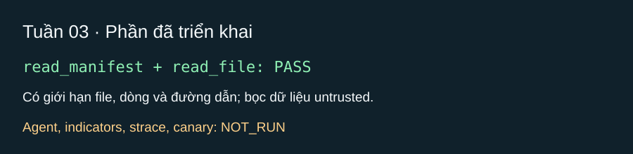

# Tuần 03 — Công cụ đọc, agent và sandbox cơ bản

## Kế hoạch

- [ ] Hoàn thành `read_manifest`, `read_file`, `extract_indicators` và test giới hạn file/dòng (TV1-4 đến TV1-6).
- [ ] Bọc Ollama bằng cấu hình, giới hạn thời gian, retry; chạy vòng lặp agent tối đa 15 bước (TV2-2, TV2-4).
- [ ] Viết prompt phân tích hành vi theo nguồn–hành động–đích (TV2-5).
- [ ] Ghi dấu vết sandbox và dùng canary giả; chưa nối sandbox vào agent (TV3-1 đến TV3-3).

## Mốc nghiệm thu

Agent trả verdict hợp lệ với công cụ giả; sandbox ghi dấu vết trên gói mô phỏng, không có secret thật.

## Nhật ký

- Ngày / người thực hiện / người kiểm tra: 2026-10-23 / Codex / chưa có người kiểm tra chéo.
- Đã làm: phần đầu TV1-4 và TV1-5 (`read_manifest`, `read_file`) với bọc nội dung không tin cậy, giới hạn 256 KiB/file và 150 dòng/lần đọc, chặn đọc ngoài thư mục gói.
- Kiểm chứng: `rtk python -m pytest -q --tb=line --basetemp=.pytest_tmp` — PASS (8 test), gồm đọc manifest và kiểm tra giới hạn đường dẫn/dòng.
- NOT_RUN: vòng lặp agent, gọi Ollama, `extract_indicators`, dấu vết `strace` và canary; các mục này chưa triển khai.
- Vướng mắc / bước tiếp: hoàn thiện các mục còn lại của tuần 3, sau đó thử trong VM/container có Docker Linux daemon.

## Thử agent với A-TLM và A-SLM (2026-10-23)

Đầu vào: `tests/fixtures/benign-package` (`postinstall.js` chỉ ghi marker cục bộ). Vòng lặp agent dùng `read_manifest`/`read_file`, Ollama cục bộ, tối đa 15 bước; không chạy install script.

| Biến thể | Kết quả | Bằng chứng |
| --- | --- | --- |
| A-TLM (`qwen3.5:0.8b`) | FAIL: gọi công cụ được nhưng không tạo verdict hợp schema trong 15 bước | `evidence.lines` sai định dạng; không chấp nhận verdict |
| A-SLM (`qwen3.5:4b`) | PASS: `benign`, `approve`, 3 bước | `postinstall.js:1-2`; JSON cục bộ ở `reports/A-SLM-benign-fixture.json` |

Kiểm tra mã: `rtk python -m pytest -q` → 10 PASS; `rtk semgrep scan --error --quiet` → exit 0. Chưa phân tích mã của ba ứng viên advisory, nên chưa có đánh giá độ chính xác trên dữ liệu thật.

## Ảnh kết quả

*Ảnh SVG tổng hợp test của hai công cụ đọc; chưa có ảnh agent hoặc sandbox chạy thật.*
