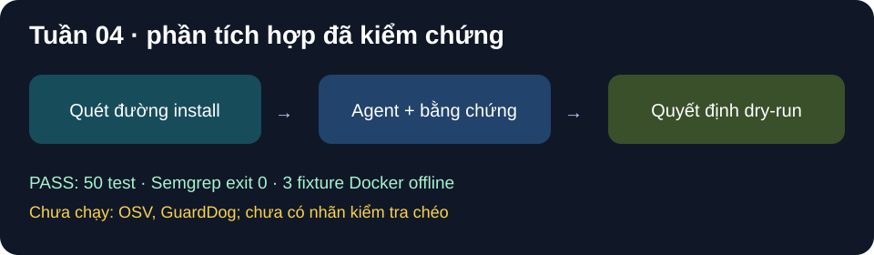

# Tuần 04 — Tích hợp công cụ tĩnh và baseline

## Kế hoạch

- [x] Nối công cụ đọc/quét tĩnh vào agent sau khi hợp đồng JSON ổn định.
- [ ] Bổ sung công cụ bối cảnh như OSV, metadata và so phiên bản theo phạm vi đã chốt; không dùng nhãn bối cảnh làm bằng chứng duy nhất.
- [ ] Chạy GuardDog làm baseline trên dữ liệu đã chuẩn bị (TV3-4).

## Mốc nghiệm thu

Agent hoàn thành ca phân tích tĩnh trên tập dev nhỏ; lưu kết quả GuardDog cùng phiên bản và lệnh chạy.

## Nhật ký

- Ngày / người thực hiện / người kiểm tra: 2026-10-25 / Codex / chờ TV2 review `agent/run.py`.
- **PASS:** Agent tự chạy `extract_indicators` trước lượt model, xác định đường install và dependency cục bộ tối đa hai cấp; trường hợp quét thiếu không tự approve. Prompt yêu cầu nguồn–hành động–đích và từ chối mã MITRE không có bằng chứng.
- **Kiểm chứng:** pytest toàn repo 50 PASS ngoài sandbox hệ thống; Semgrep `--config auto --error` exit 0. Ba model có một lượt verdict hợp lệ trên fixture lành, không chứng minh accuracy hay độ ổn định.
- **NOT_RUN / BLOCKED:** OSV, metadata, `diff_versions` và GuardDog chưa triển khai/chạy. Không có dữ liệu nhãn kiểm tra chéo để đo baseline. Chưa đạt mốc nghiệm thu đầy đủ của tuần 4.
- **Bước tiếp:** TV2 review thay đổi `agent/run.py`; hoàn tất nhãn tuần 2, sau đó thêm công cụ bối cảnh tối thiểu và GuardDog baseline trên tập đã duyệt.

## Ảnh kết quả

*Hình SVG tổng hợp kết quả test; không phải ảnh chụp màn hình hay phép đo trên gói thật.*
