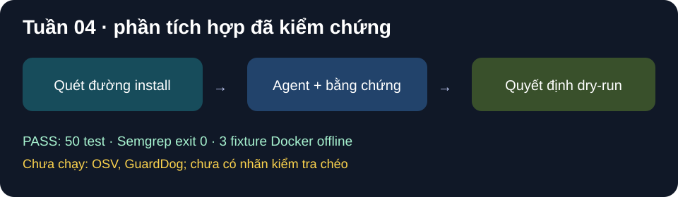

# Tuần 04 — Tích hợp công cụ tĩnh và baseline

## Kế hoạch

- [x] Nối công cụ đọc/quét tĩnh vào agent sau khi hợp đồng JSON ổn định.
- [x] Bổ sung công cụ bối cảnh như OSV, metadata và so phiên bản theo phạm vi đã chốt; không dùng nhãn bối cảnh làm bằng chứng duy nhất.
- [x] Chạy GuardDog làm baseline trên dữ liệu đã chuẩn bị (TV3-4) — trên tập dev nhỏ được PO cho phép; tập đầy đủ chờ nhãn v1.

## Mốc nghiệm thu

Agent hoàn thành ca phân tích tĩnh trên tập dev nhỏ; lưu kết quả GuardDog cùng phiên bản và lệnh chạy.

## Nhật ký

- Ngày / người thực hiện / người kiểm tra: 2026-10-25 / Codex / chờ TV2 review `agent/run.py`.
- **PASS:** Agent tự chạy `extract_indicators` trước lượt model, xác định đường install và dependency cục bộ tối đa hai cấp; trường hợp quét thiếu không tự approve. Prompt yêu cầu nguồn–hành động–đích và từ chối mã MITRE không có bằng chứng.
- **Kiểm chứng:** pytest toàn repo 50 PASS ngoài sandbox hệ thống; Semgrep `--config auto --error` exit 0. Ba model có một lượt verdict hợp lệ trên fixture lành, không chứng minh accuracy hay độ ổn định.
- **NOT_RUN / BLOCKED:** OSV, metadata, `diff_versions` và GuardDog chưa triển khai/chạy. Không có dữ liệu nhãn kiểm tra chéo để đo baseline. Chưa đạt mốc nghiệm thu đầy đủ của tuần 4.
- **Bước tiếp:** TV2 review thay đổi `agent/run.py`; hoàn tất nhãn tuần 2, sau đó thêm công cụ bối cảnh tối thiểu và GuardDog baseline trên tập đã duyệt.

## Ảnh kết quả

*Hình SVG tổng hợp kết quả test; không phải ảnh chụp màn hình hay phép đo trên gói thật.*

## Cập nhật 2026-11-03 — hoàn thành tuần 4 và các task còn nợ (Claude)

- **Ngày / người thực hiện / người kiểm tra:** 2026-11-03 / Claude theo Gate B0 “công việc tuần 4” / chờ TV2 review agent và quyết định, TV3 review baseline và metrics.
- **Đã làm (99 test PASS, Semgrep `--config auto --error` exit 0, `git diff --check` PASS):**
  - `tools/intel.py`:
    - tra OSV (cờ `MAL-`) và npm Registry (phiên bản trước, hook mới, maintainer, integrity), chỉ qua HTTPS tới hai host cố định;
    - `diff_versions` so tĩnh đường install của hai phiên bản.

    Agent chỉ đọc file context; OSV MAL chặn approve qua R5 nhưng không bao giờ là bằng chứng.
  - `tools/actions.py` (TV1-7): `apply_decision` chỉ lập lệnh `npm approve-scripts`/`deny-scripts` ở dry-run; `dry_run=False` bị từ chối.
  - `experiments/run_batch.py` (TV1-8): có resume, `run_meta.json` (commit, Python, phiên bản Ollama, digest model, tham số chat, hash dataset); một gói lỗi không làm dừng lô; dòng không phải `benign` bị chặn trên host.
  - `experiments/baseline_guarddog.py` + `experiments/guarddog/Dockerfile` (TV3-4).
  - `experiments/metrics.py` (TV3-5).
- **GuardDog:** bản pip trên Windows không dùng được. Bản mới nhất không cài được (`nono-py` không build). Bản 2.6.0 cài được nhưng semgrep thoát với mã 2 và GuardDog bỏ qua đường dẫn chứa `tests`, nên "0 issue" là kết quả giả. Vì vậy chuyển sang image `agent-npm-guarddog:2.6.0`, quét `--network none`, mount chỉ đọc. Kiểm chứng trên gói probe tổng hợp: bắt được `npm-exec-base64` ở `index.js:2`.
- **PASS — mốc nghiệm thu "agent hoàn thành ca phân tích tĩnh trên tập dev nhỏ":** tập gồm 10 bản `@swc/core` thuộc `dev` (`npm pack --ignore-scripts`, không chạy hook) cùng 3 fixture, chạy 3 model qua `run_batch`. Context OSV/Registry 10/10 OK, không có MAL, không có hook mới.

| Hệ thống (run) | 10 swc lành: dự đoán | FPR | Verdict hợp lệ | Bước TB | Giây/gói TB | 3 fixture |
| --- | --- | --- | --- | --- | --- | --- |
| A-LLM (`week4-dev-a-llm-20261103`) | 10 benign, cả 10 `review` (R7_review) | 0/10 | 10/10 | 2.8 | 71.5 | approve / deny / review |
| A-SLM (`week4-dev-a-slm-20261103`) | 10 benign, cả 10 `review` (R7_review) | 0/10 | 10/10 | 3.5 | 23.1 | approve / deny / review (R8) |
| A-TLM (`week4-dev-a-tlm-20261103`) | 2 benign, 8 fallback `suspicious` (R2) | 8/10 | 2/10 | 6.3 | 27.9 | approve / R2 / R2 |
| GuardDog 2.6.0 (`week4-dev-20261103/guarddog`) | 10 benign (0 issue) | 0/10 | — | — | — | 0 issue cả ba (bỏ sót canary) |

- **Đọc kết quả cho đúng:**
  - swc luôn ra `review` vì `postinstall.js:125` tự chạy `npm install` để tải gói khác khi cài, và `binding.js` require file `.node` nằm ngoài tarball. Agent không thể xem hết đường install, nên không được tự approve.
  - Tập chỉ có gói lành nên **không có Recall**. FPR 0/10 trên một họ gói không phải ước lượng tổng quát.
  - A-TLM chưa ổn định (verdict hợp lệ 2/10), nhưng mọi thất bại đều rơi về `review` an toàn.
- **Còn lại, chuyển có kiểm soát sang tuần 5–8 (không phải nợ kỹ thuật tuần 4):**
  - đo Recall/F1 và so với GuardDog trên mẫu độc: cần nhãn v1 đã kiểm tra chéo và chạy trong VM;
  - phân biệt `.node` của gói phụ với "quét thiếu" chung;
  - tách lời gọi mạng của npm khỏi lời gọi của gói trong sandbox.
